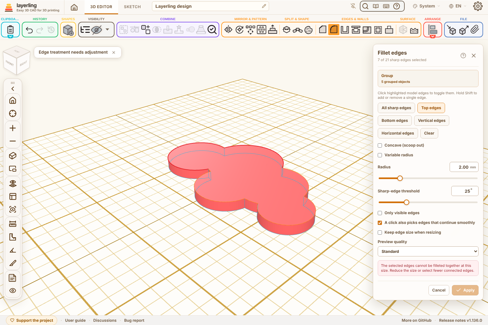
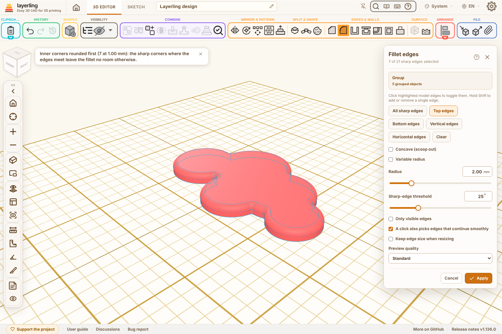
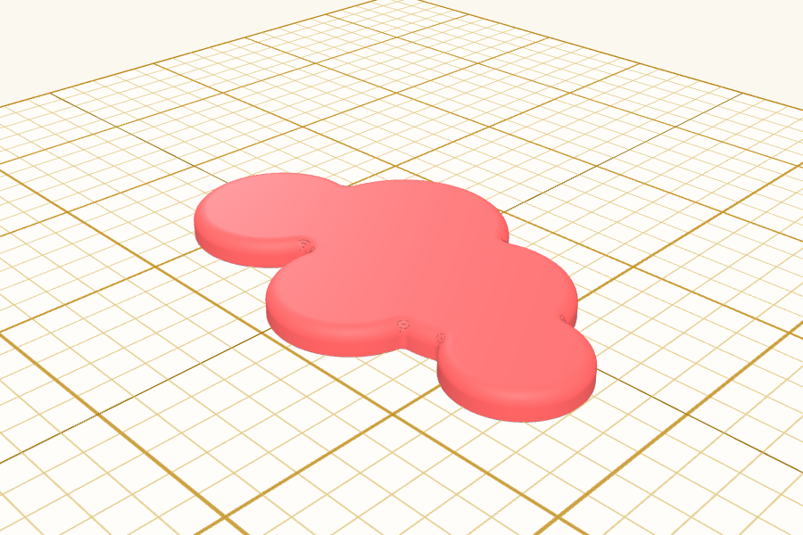

Title: Edge tool: round sharp inner corners first when the picked edges cannot get past them

## Summary

Group a few overlapping discs into a cloud, pick its top edges and Fillet refuses, even at 0.5 mm: "The selected edges cannot be filleted together at this size." The arcs meet in sharp inner corners, notches where the rolling ball has no room at any size, so the kernel rejects the whole selection. Rounded a little first, the notch is gone and the edges go through.

| Before | After |
| --- | --- |
|  |  |

So when a fillet or chamfer fails, and the existing retry with the short corner edges (#1178) does not help either, the worker now:

- looks at the edges that touch the ends of the picked ones and keeps those the solid wraps round by more than half a turn (a notch, not an outer corner – those stay the user's choice),
- tries them together with the picked edges at the same size, and if that fails, rounds them first at a half and then a quarter of the size, finds the picked edges again on the rounded body and treats them as asked,
- says so in the status line: "Inner corners rounded first (7 at 1.00 mm): the sharp corners where the edges meet leave the fillet no room otherwise." A chamfer chamfers the corners and says that.

Guards, because the kernel forced past such a corner can return a body whose faces cross and still call it valid, or crash:

- nothing is tried when a picked or touching edge is shorter than the size (a disc that barely shows between two others) – the refusal stands as before,
- a result only counts when it is a solid and its mesh is closed,
- at most 4 s, and only for a plain fillet (not variable, not concave) or a chamfer.

The MCP result of the edge tool carries `innerCorners: { count, amount }` when this happened. Texts in en, de, fr, nl, ru, cs, sl, da, es, it, pl, ar, zh-cn and zh-tw, one sentence in guide chapter 6 in 15 languages.

## Testing

- `npm run typecheck`, `npm test`, `npm run test:e2e`, `npm run guide`, `npm run i18n:status`
- New: `tests/e2e/cadInnerCorners.e2e.ts` – the worker on a cloud of five grouped discs: top edges filleted at 0.5, 1 and 2 mm (7 inner corners rounded first), chamfered at 1 mm; discs in a row where one barely shows keep the refusal; a single disc goes through without it. `tests/unit/cadCornerEdges.test.ts`: `edgesTouchingEnds`.
- In the browser: five cylinders grouped, Fillet → Top edges → 2 mm: refused before; now the preview comes with the message above, Apply gives a closed body (STL checked: no open edges, the top stays flat).

## Notes

- New file `lib/cadInnerCorners.ts`; `edgesTouchingEnds` in `lib/cadCornerEdges.ts`.
- The corners get a smaller rounding than the picked edges when the same size does not fit; the message names the size they got.
