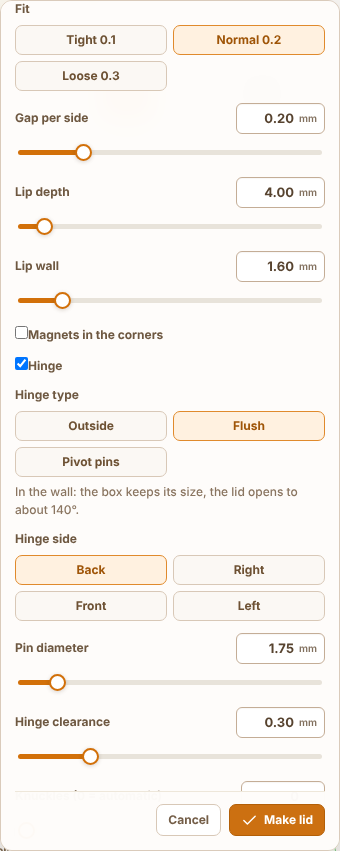
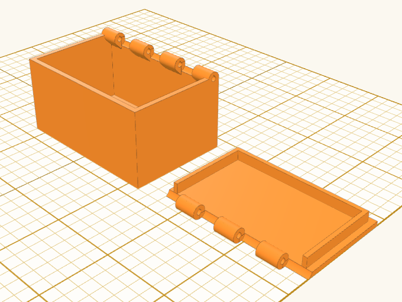
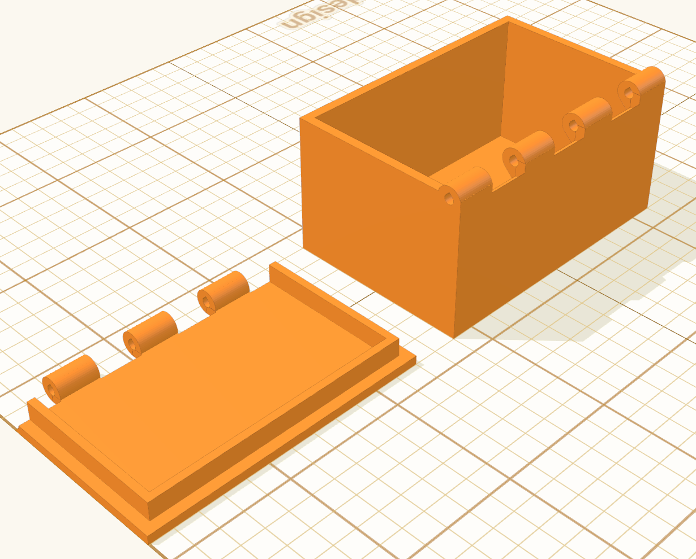
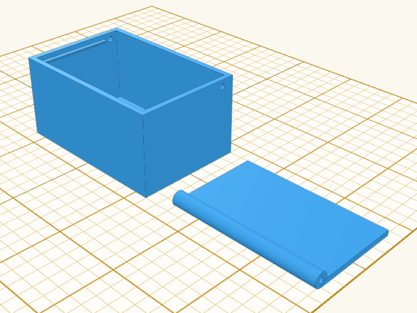
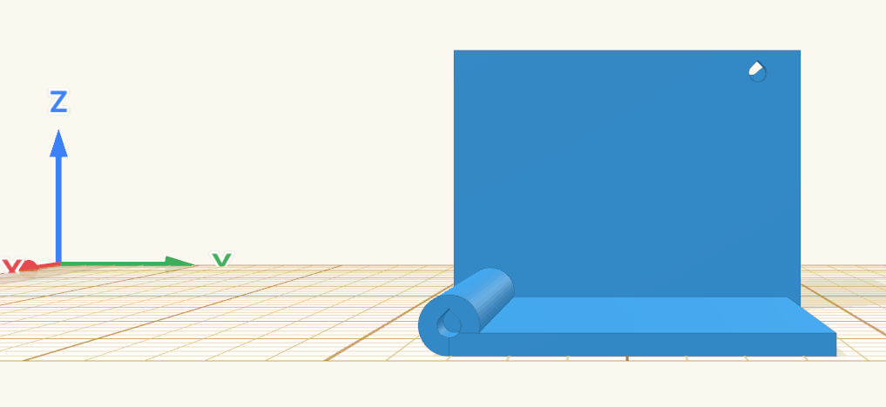

Title: Lid hinge: flush in the wall, or a pivot lid on two pins

## Summary

The hinge sits behind the back wall, so the knuckles make the box deeper (about 5.5 mm with a 1.75 mm pin). In the Facebook group someone asked to have it inside instead, and in [#1220](https://github.com/henmedia/layerling/discussions/1220) the hinge's place came up too. The lid panel now has **Hinge type** under **Hinge**:

- **Outside** (the default, as before): behind the side, the lid opens all the way.
- **Flush**: the knuckles go into the back wall, flush with its outer face and the lid's top, so the box keeps its size.
  - They run from corner to corner. Where they reach into the opening past a wall thinner than them, the body's grow out of the wall's inner face on a 45° slope, so the box still prints upright without support.
  - The wall is slotted round the lid's knuckles and the lid's plate notched round the body's, by the hinge clearance. Behind the axis only the round knuckles stay, and the lid's lip stops short of the knuckles.
  - It opens to about 140°.
- **Pivot pins**: the lid lies in the opening, top level with the rim, and turns on two pins through the side walls, so the box keeps its size.
  - Its back edge is a round bar; a pin goes from outside through each side wall into the bar's end (teardrop holes, each pointing up as its part is printed).
  - A ledge round the other sides holds it level; its underside steps back at 45°.
  - It opens to about 95° and stays open against the back wall. **Print the pin too** makes both pins.

Flush and pivot need a straight side (Hinge side picks which), and go without magnets, which would sit where the slots and pins are; both say so if asked for. The body's slots and pin holes are one hole grouped with it, as the magnets' pockets are.

MCP: `make_lid` takes `hingeStyle` (`outside`, `flush`, `pivot`) and reports it. Texts in en, de, fr, nl, ru, cs, sl, da, es, it, pl, ar, zh-cn and zh-tw, guide chapter 6 in the nine languages that describe the hinge, SKILL copies.

Flush: the box keeps its 60 × 40 mm, seven knuckles in the back wall:

Pivot pins: the lid with its round bar beside the box, a pin hole in the side wall:

## Testing

- `npm run typecheck`, `npm test`, `npm run test:e2e`, `npm run guide`, `npm run i18n:status`
- New `tests/e2e/lidHingeStyles.e2e.ts` (real Manifold kernel, a 60 × 40 × 30 mm box with 2 mm walls):
  - flush: the box with knuckles and slots stays 60 × 40 and one piece; the lid, closed, is as large as the box and overlaps nothing; swung about the axis in 5° steps it touches nothing up to 140°; a 1.75 mm filament goes through all knuckles without touching;
  - pivot: the box stays its size; the lid closed in the opening overlaps nothing and rests on the ledge (0.3 mm lower it would sit in it); a filament pin from outside through each side wall into the bar touches nothing; it opens to 95°; printed pins are two, each 7.8 mm; on the right side the pins go through the front and back walls;
  - flush or pivot with magnets is refused, flush on a round pot and pivot on a round pot too.
- `tests/e2e/lidPanelHinge.e2e.ts`: the three types in order, Outside checked by default, a click hands on the type; the knuckle count is hidden for pivot pins. `tests/unit/lidTool.test.ts`: `hingeStyle` normalised.
- In the browser: a 60 × 40 × 30 mm box hollowed with the top open, Lid → Hinge → Flush (seven knuckles, the box stays 60 × 40) and Pivot pins (lid in the opening, two pin holes), pictures above.

## Notes

- New: `pivotPlan` and `acrossAt` in `lib/lidTool.ts`; `hingePlan` places the axis for flush; `LidHinge` carries `cuts` (slots or pin holes) and `style`.
- The angles (140°, 95°) are those of the 2 mm plate and 1.75 mm pin in the test; a thicker plate or pin changes them a little.
