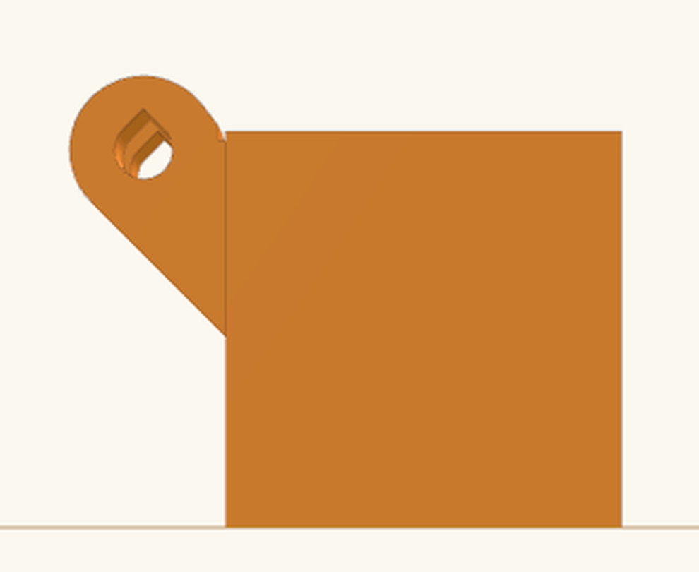
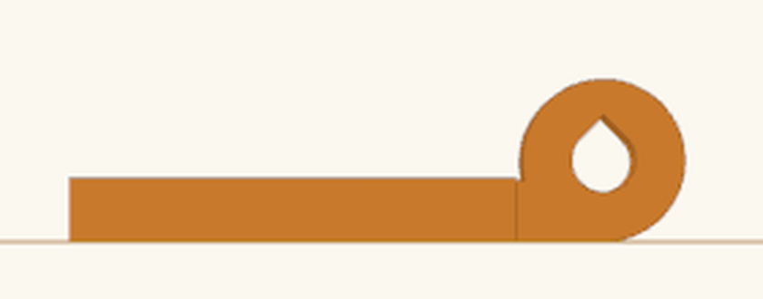
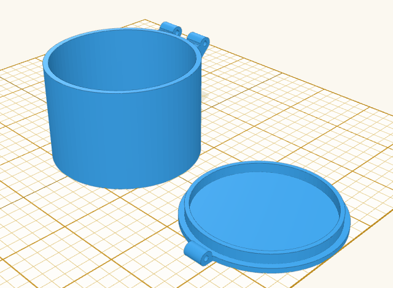
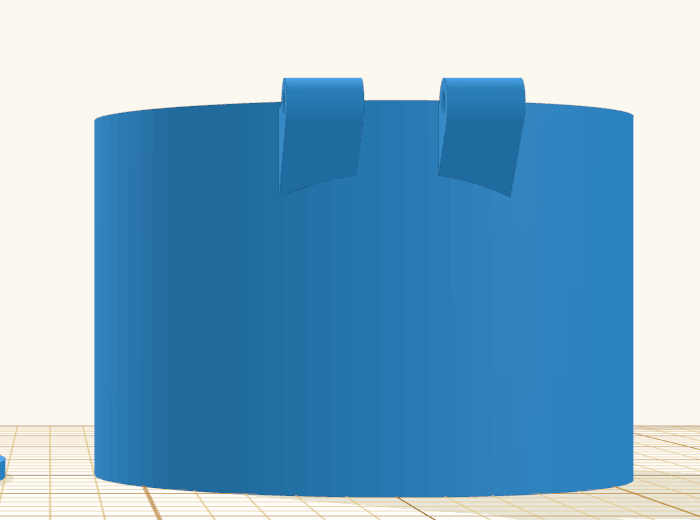

Title: Lid hinge: pick its side, teardrop pin holes, and round pots

## Summary

Three points raised in [#1220](https://github.com/henmedia/layerling/discussions/1220) after the hinge came out in 1.135.0:

**Hinge side.** The hinge always went along the back, so on a box longer than wide it ended up on the short side. The lid panel now has **Hinge side** under **Hinge**: **Back** (the default, so nothing changes for existing designs), **Right**, **Front** or **Left**, as in the starting view, with the hollow tool's names for the sides. The hinge is worked out with that side turned to the back and its pieces turned back after, so it is the same hinge on every side; the lid still lies beside the body, clear of the knuckles.

**Teardrop pin holes** (on by default, **Teardrop pin holes (no droop when printed)**). The pin's hole runs level as the parts print, so the top of a round hole is an overhang that can droop and pinch the pin. Each part's holes now get a 45° point on top as that part is printed: up in the body, which stands upright, and towards the inside in the lid, which lies turned over. The point is cut flat where it would leave less than 0.8 mm of the knuckle (thick pins). The pin turns in the round part with the same play as before. A printed pin (**Print the pin too**) now lies on a flat a tenth of its diameter wide, so it does not roll.

**Round sides** (a pot, a tube). A side without a straight stretch long enough for three knuckles used to be refused. Now the hinge runs where the wall stays within a knuckle's radius of the hinge's line; the body's knuckles stand on a block that reaches in to the wall, its underside on the same 45° slope as before and kept out of the opening, and the lid's web reaches in to its curved edge. A side too short or too sharply curved for three knuckles still gets a message, which now says so.

Also: **Hinge at the back** is now just **Hinge**, and the status line no longer says "at the back". MCP: `make_lid` takes `hingeSide` (`back`, `right`, `front`, `left`) and `hingeTeardrop` and reports the side under `hinge`. Texts in en, de, fr, nl, ru, cs, sl, da, es, it, pl, ar, zh-cn and zh-tw, guide chapter 6 in the nine languages that describe the hinge, SKILL copies.

A box 40 wide and 80 deep with the hinge on the right, its long side:

Teardrop holes, the box as it stands and the lid as it lies:

A round pot, 60 across, with its hinge at the back:

## Testing

- `npm run typecheck`, `npm test`, `npm run test:e2e`, `npm run guide`, `npm run i18n:status`
- `tests/e2e/lidHinge.e2e.ts`:
  - for the right, the front and the left side of the 60 × 40 box, the body's knuckles are exactly those of the box turned that side to the back, turned back, and the lid is that lid turned the same way; the knuckles stand outside that side, are one piece with the body, and the lid lies clear of both; knuckle counts by the side's length; the test fails when the turn goes the wrong way;
  - teardrop holes: just past the round hole there is no material above it in the body and none below it in the closed lid, and there is with the option off; the round part is the same either way;
  - a round pot 40 across: three knuckles over about 19 mm, one piece with the pot and nothing of them inside it, the lid one piece, closed without overlap, swung from 10° to 170° clear of the pot, a 1.75 mm filament through all holes; at the outer end of a knuckle the block fills the room to the wall, and with five knuckles the lid's web reaches its curved edge (both fail without them); a pot 8 across is refused;
  - the printed pin lies on its flat, 2.7 mm high for a 3 mm pin.
- `tests/e2e/lidPanelHinge.e2e.ts`: the four sides in order, Back checked by default, a click hands on the side; Teardrop pin holes on by default, a click hands on `hingeTeardrop: false`. `tests/unit/lidTool.test.ts`: `hingeSide` and `hingeTeardrop` normalised.
- In the browser: a 40 × 80 × 30 mm box with the hinge on the right (seven knuckles along the 80 mm side); a round pot 60 × 40 mm hollowed with the top open, Lid → Hinge → Make lid (three knuckles at the back on their blocks); a small box's knuckles seen from the side, the holes' points up as each part lies.

## Notes

- `lid.hinge` changed from "Hinge at the back" to "Hinge" in all 14 languages that have it; `lid.hingeSide` and `lid.hingeTeardrop` are new; `lid.error.hingeNoBack` speaks of the side being too short or too curved.
- A cap (rim round the outside) still cannot take a hinge, round or straight: it would hit the wall as the lid opens.
