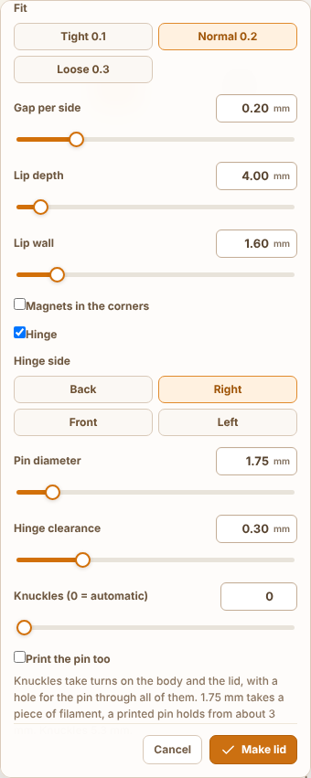
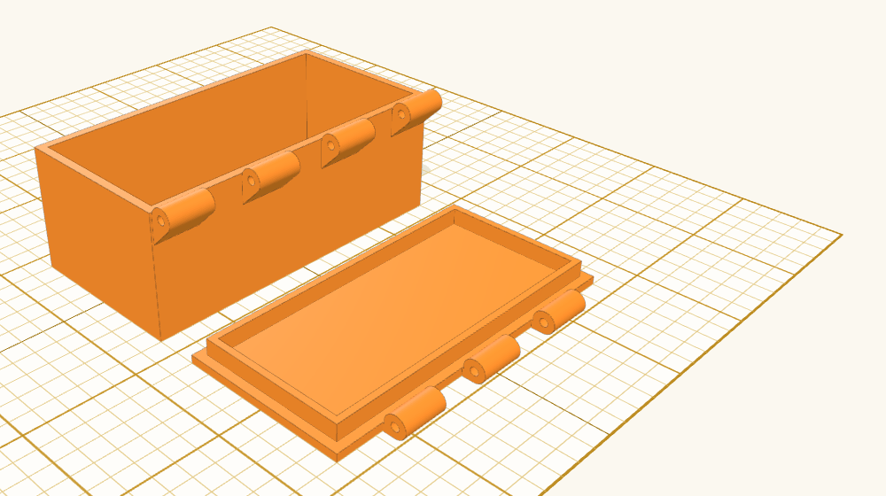
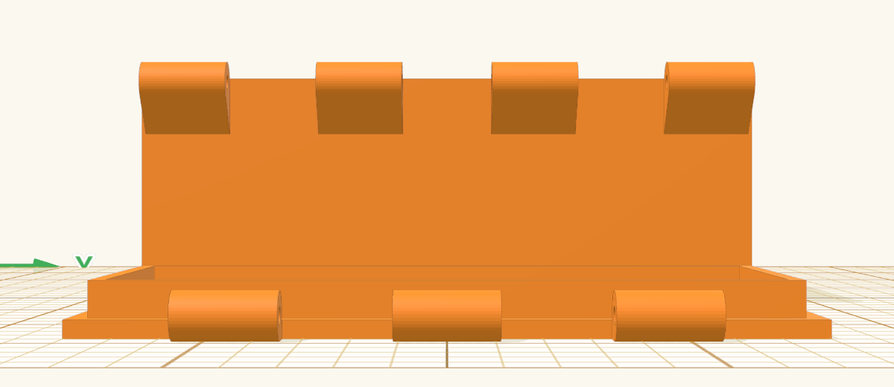

Title: Lid: pick the side the hinge goes along

## Summary

The hinge always went along the back, however long that side is, so on a box longer than wide it ended up on the short side ([asked for in #1220](https://github.com/henmedia/layerling/discussions/1220)). The lid panel now has **Hinge side** under **Hinge**: **Back** (the default, so nothing changes for existing designs), **Right**, **Front** or **Left**, as in the starting view, with the hollow tool's names for the sides.

- The hinge is worked out with the picked side turned to the back and its knuckles, web and pin hole turned back after, so it is the same hinge on every side: knuckles by that side's length, the slope under the body's knuckles, the clearance, the printed pin. The lid still lies beside the body, clear of the knuckles.
- **Hinge at the back** is now just **Hinge**; the status line no longer says "at the back", and the error for a side without a straight stretch speaks of the side picked.
- MCP: `make_lid` takes `hingeSide` (`back`, `right`, `front`, `left`) and reports it under `hinge`.
- Texts in en, de, fr, nl, ru, cs, sl, da, es, it, pl, ar, zh-cn and zh-tw (the side names are the hollow tool's), one sentence in guide chapter 6 in the nine languages that describe the hinge, SKILL copies.

A box 40 wide and 80 deep with the hinge on the right, its long side:

## Testing

- `npm run typecheck`, `npm test`, `npm run test:e2e`, `npm run guide`, `npm run i18n:status`
- `tests/e2e/lidHinge.e2e.ts`: for the right, the front and the left side of the 60 × 40 box, the body's knuckles are exactly those of the box turned that side to the back, turned back; the lid is that lid, turned the same way; the knuckles stand outside that side, grow out of the wall as one piece with the body, and the lid lies clear of both. Knuckle counts by the side's length (3 on the 40 mm sides, 5 on the 60 mm front). The test fails when the turn goes the wrong way.
- `tests/e2e/lidPanelHinge.e2e.ts`: the four sides in order, Back checked by default, a click hands on the side. `tests/unit/lidTool.test.ts`: `hingeSide` normalised, unknown values stay at the back.
- In the browser: a 40 × 80 × 30 mm box, hollowed with the top open, Lid → Hinge → Right → Make lid: seven knuckles along the 80 mm side, the lid beside it.

## Notes

- `lid.hinge` changed from "Hinge at the back" to "Hinge" in all 14 languages that have it; `lid.hingeSide` is new.
