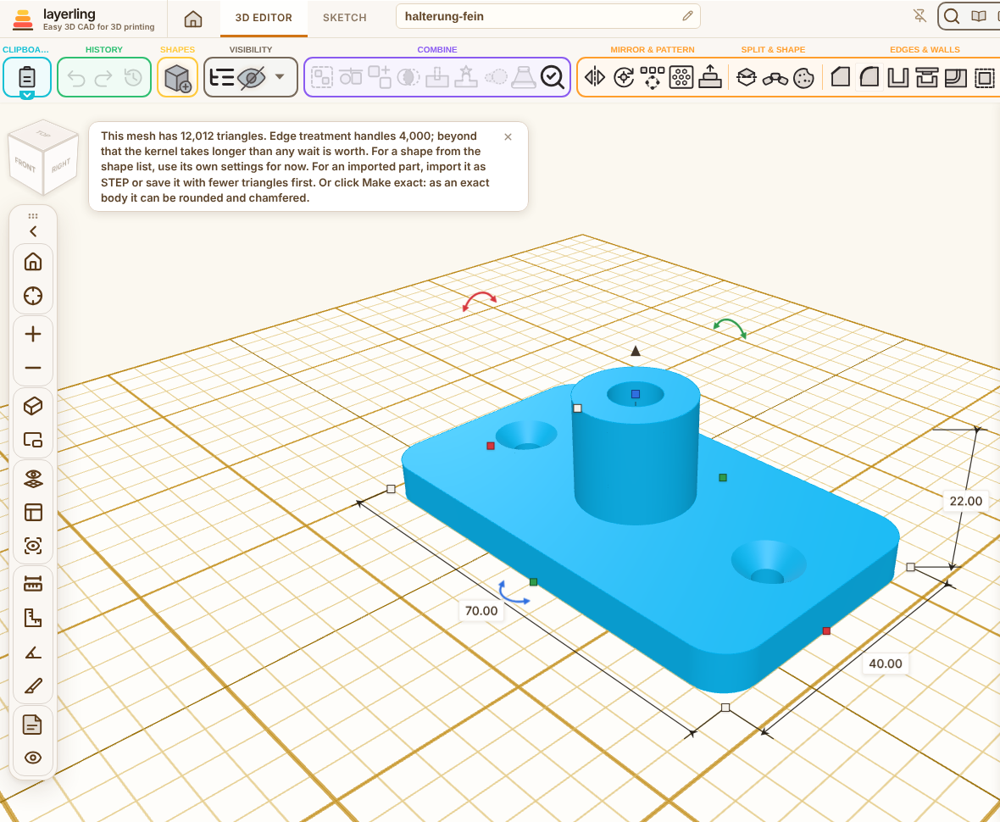
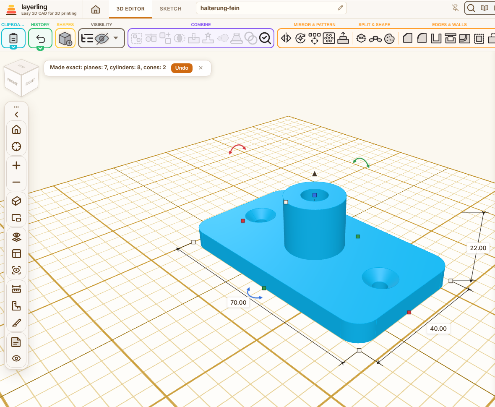
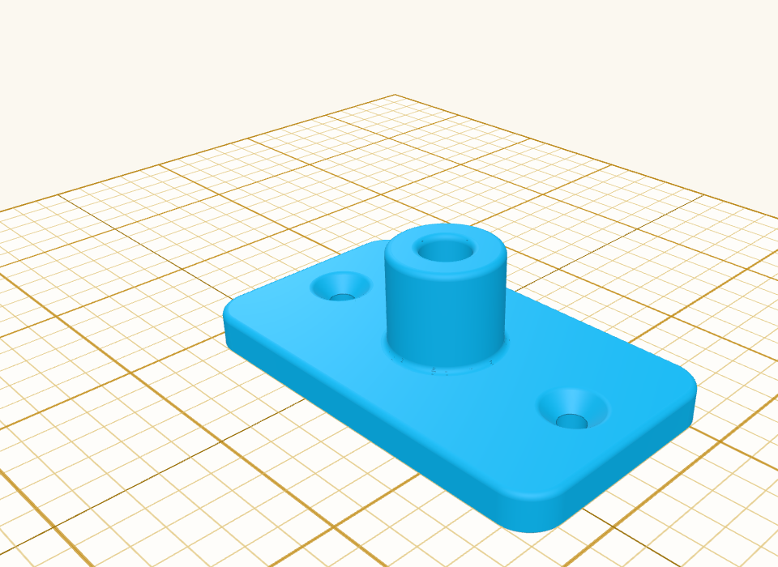
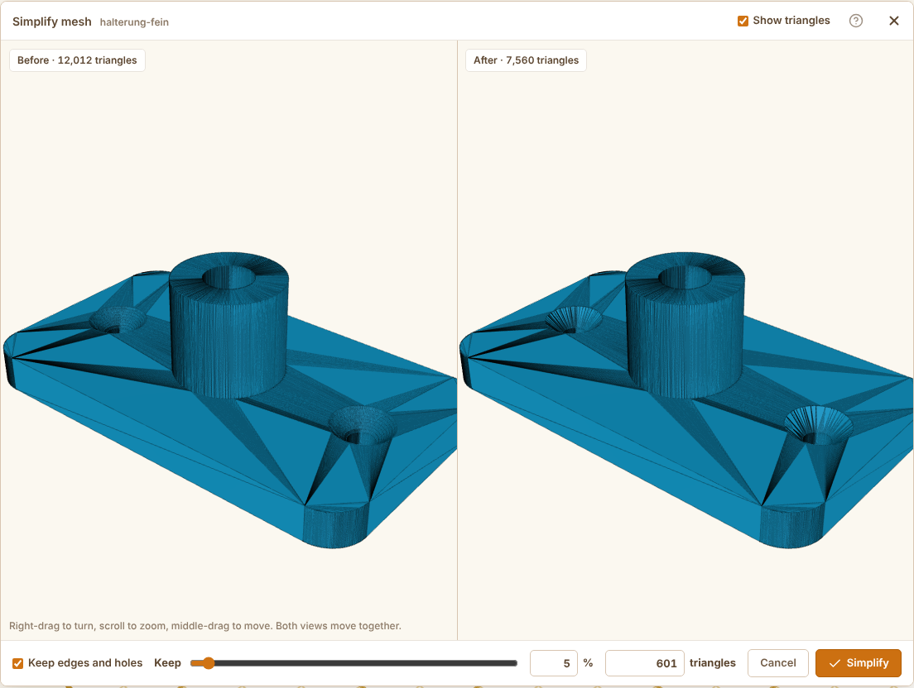
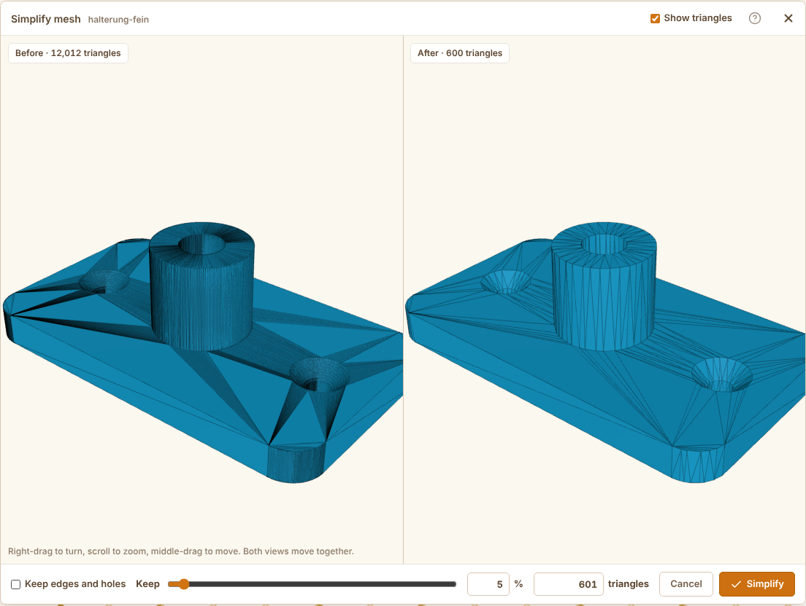

Title: Make exact: rebuild imported meshes as exact bodies, and keep edges when simplifying

## Summary

An STL, OBJ or 3MF is only triangles, even when it was drawn in CAD with flat faces and round bores. So the edge tools refuse it above 4,000 triangles, a bore's rim is dozens of short edges below that, Delete face finds no faces, and the STEP export leaves it out. This adds:

- **Make exact** (Modify → Surface, the body's right-click menu, MCP `layerling_make_exact`): finds the planes, cylinders, cones, spheres and tori the mesh was made of and rebuilds it as an exact OCCT solid, its faces on those surfaces and the edges between them as lines, circular arcs, ellipses or splines. Afterwards the body behaves like a STEP import: Fillet and Chamfer follow one clean edge, Delete face takes away a whole rounding or a bore's wall, and STEP carries the real faces. The status line says what was found ("planes: 7, cylinders: 8, cones: 2"). Whatever fits no surface stays as small flat facets, and the message gives their share. One undo step brings the mesh back.
- A mostly free-form mesh (a figure, a sculpted or lofted shape) is recognised before anything is built and stays a mesh, with the share that does fit a surface. A mesh with gaps or crossed walls fails with its own message. Up to 400,000 triangles.
- A mesh divided again after its export has its new corners on the straight chords, a few µm off the cylinder. Such a mesh is tried again at 4× and 16× the tolerance; the looser result is only taken when both agree, so a free-form surface is not "fitted" by chance.
- **Edge tool:** a small mesh with round faces (within the existing 4,000-triangle limit) is rebuilt the same way on the fly, in at most 6 s, so a fillet follows one round edge instead of a hundred short ones. Above the limit, the notice now points to Make exact.
- **STEP export:** imported meshes go along made exact (at most 200,000 triangles each, 60 s for all of them); a free-form mesh is left out with a reason of its own.
- **Simplify mesh → Keep edges and holes** (on by default, remembered): sharp edges (more than 30°) become seams that only collapse along straight runs, points where an edge bends (a bore's rim) or edges meet are locked, and round faces may move by at most 0.05 % of the part's size. Flat faces still lose most of their triangles. The MCP tool takes `keepEdges` (default true).
- Texts in en, de, fr, nl, ru, cs, sl, da, es, it, pl, ar, zh-cn and zh-tw (and the STEP note that said meshes go as STL, also in hu, ja, pt-br and tr), a guide section in chapter 12 in 15 languages, a row in the MCP table, the SKILL copies and the READMEs.

A 12,012-triangle STL of a bracket: Fillet refuses it, Make exact finds 7 planes, 8 cylinders and 2 cones in 2.5 s, and then 18 edges take a 1 mm fillet:

Simplify mesh at 5 %, with and without Keep edges and holes:

The STL to try it with: https://raw.githubusercontent.com/marcus040473/layerling/38715b70d62d704780b5a243958b1a4f89ea4aad/make-exact/bracket.stl

## Testing

- `npm run typecheck`, `npm test`, `npm run test:e2e`, `npm run guide`, `npm run i18n:status`
- New unit tests: `meshSurfaceFit.test.ts` (plane, cylinder, cone, sphere and torus fits from part of each), `meshSurfaceSegments.test.ts` (box, cylinder, cone, sphere and torus meshes found as their faces; a knot put down as free-form; an open mesh refused), `meshSimplifyEdges.test.ts` (a finely divided plate with a bore: 2 % keeps all 192 rim points and the 8 corners; without the option the rim goes).
- New e2e tests: `cadMeshExact.e2e.ts` (a plate with a bore, a rounded box, a filleted cylinder, a countersink, a sphere, a cloud of fused discs, crossing bores and an oblique cut rebuilt from their kernel meshes with the same volume and the same surfaces; the bore of a fine mesh as one cylinder that takes a fillet; a perforated plate with 36 bores; a mesh re-divided after export; free-form refused; an open mesh), `cadMeshExactWorker.e2e.ts` (prepare with `exact` and the "exact" preview through the worker), `stepExportMesh.e2e.ts` (a meshed plate goes into STEP with a cylindrical surface; a knot is skipped as free-form).
- In the browser (German and English): the bracket above, Make exact from the toolbar and through MCP, Fillet on 18 edges, Simplify with and without the option.

## Notes

- New files: `lib/meshSurfaceFit.ts` (fits and their refinement), `lib/meshSurfaceSegments.ts` (the mesh cut into its faces), `lib/meshSurfaceTopology.ts` (pieces, outlines, corners), `lib/cadMeshExact.ts` (the rebuild), `lib/cadMeshExactMessages.ts` (the messages the editor reads, without loading the rebuild).
- The new button keeps the toolbar's thresholds: measured at 2259, 1935 and 1772 px it ends at 2154, 1860 and 1704 px.
- Limits: a free-form surface stays a mesh. A mesh that another tool has already simplified can keep facets where a round face meets a flat one smoothly.
