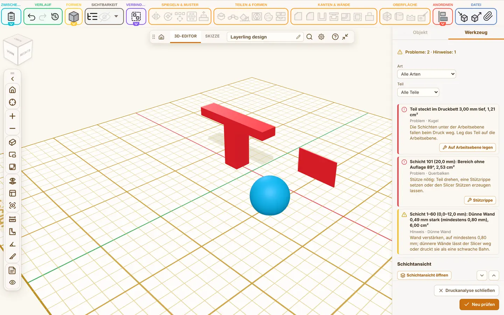
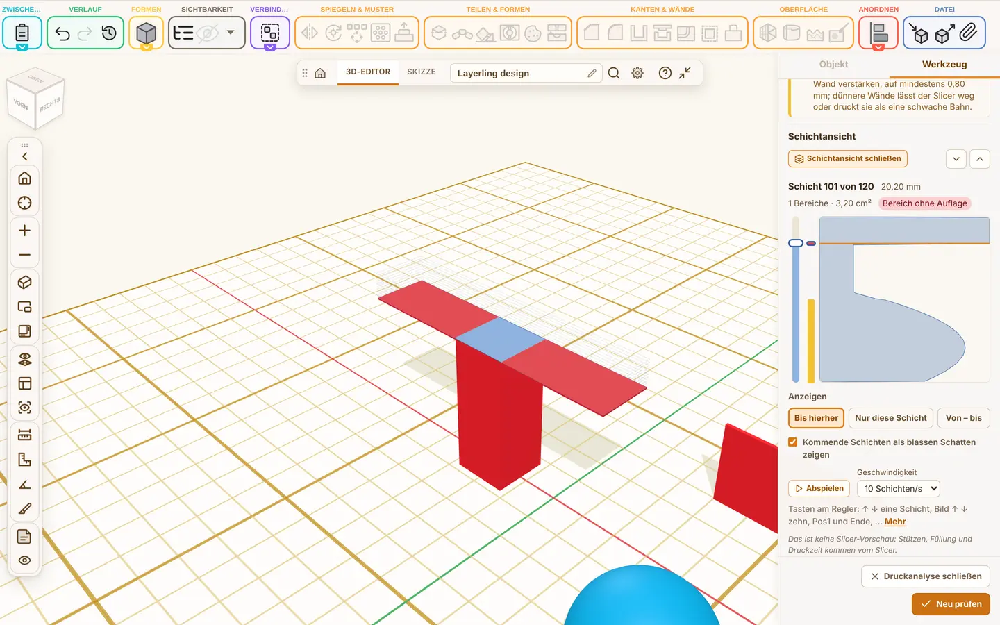
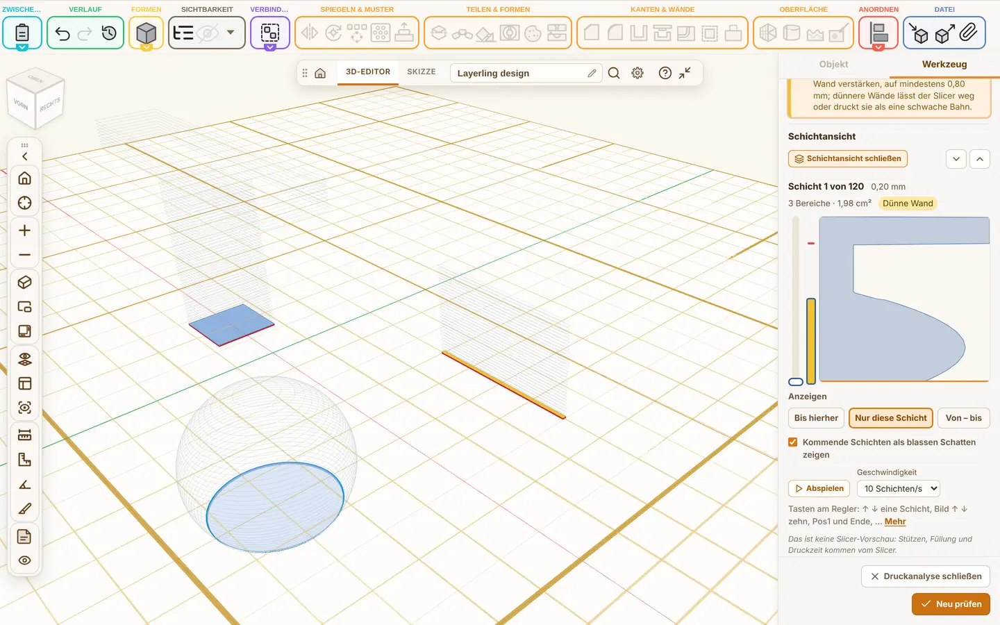
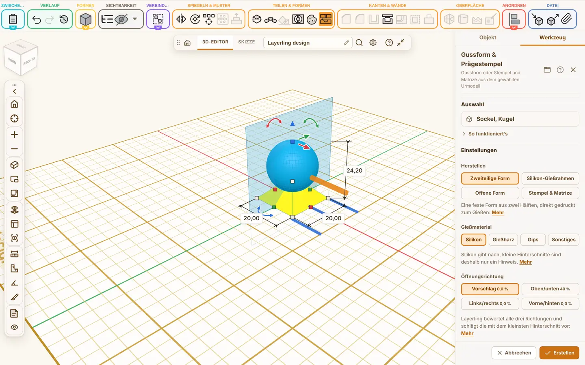
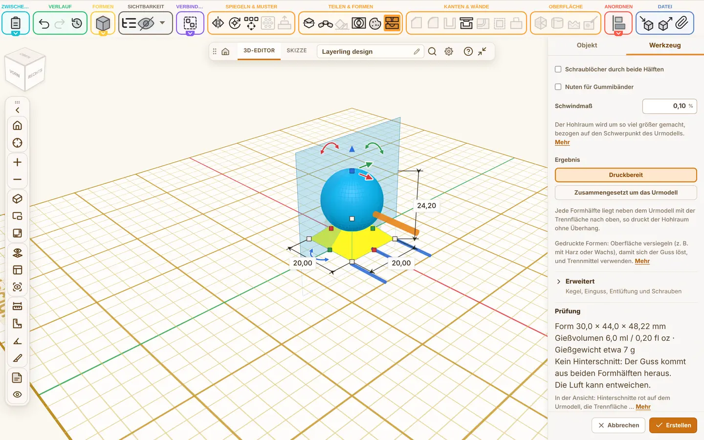
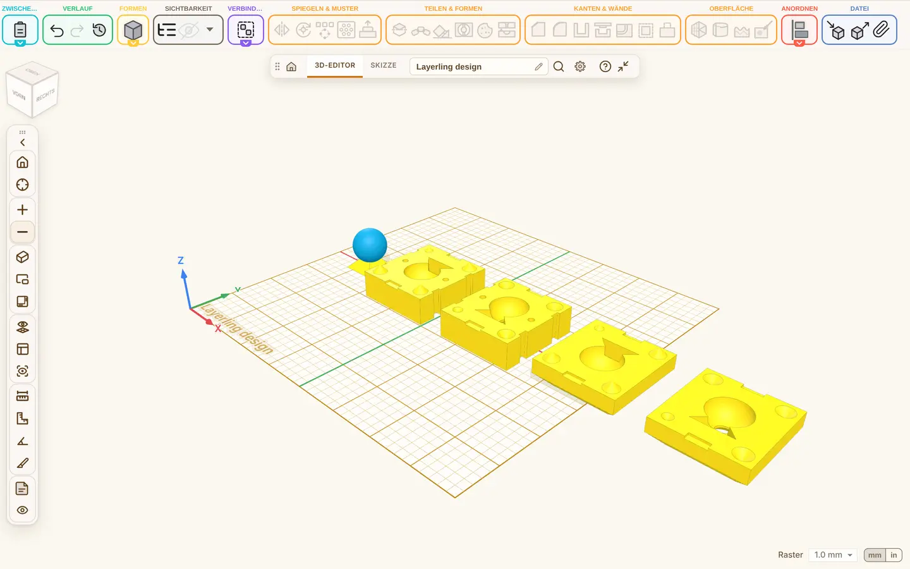
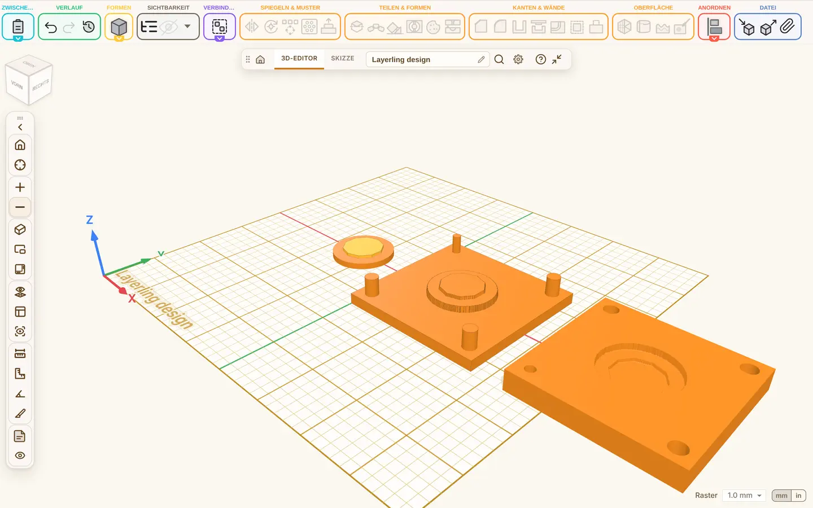

# Anleitung: Druckanalyse, Schichtansicht und Gussform (Stand 17.11.2026)

Kurz und für die Nutzer. Die Bilder liegen im Ordner `bilder/`.

## 1. Druckanalyse mit Schichtansicht

**Wo:** Werkzeugleiste, Gruppe „Verbinden“, neben „Druck prüfen“: **Druckanalyse** (Symbol: gestapelte Schichten).

**So geht's:**
1. Teile auswählen. Ohne Auswahl prüft die Druckanalyse alle sichtbaren Teile.
2. **Druckanalyse** anklicken. Die Prüfung läuft im Hintergrund, ein Balken zeigt den Fortschritt. **Abbrechen** hält sie sofort an.
3. Oben **Schichthöhe** und **Düse** wählen. Unter „Erweitert → Grenzwerte“ stehen die Grenzen für Überhang (45° Hinweis, 60° Problem), Brücke (10 mm), dünne Wand (2 × Düse), kleine Insel (2 mm²) und die Mindestfläche (0,05 mm²).
4. Die **Befundliste** zeigt zuerst die Probleme (rot), dann die Hinweise (gelb), von unten nach oben. Beispiel: „Schicht 101 (20,0 mm): Bereich ohne Auflage 89°, 2,53 cm²“. Darunter steht, was hilft. Mit „Art“ und „Teil“ filterst du die Liste.
5. **Klick auf einen Befund:** Die Schichtansicht öffnet sich an der ersten betroffenen Schicht. Die Kamera fährt hin, die Stelle wird rot oder gelb eingefärbt, die Schichten darunter bleiben sichtbar.
6. Wo es ein passendes Werkzeug gibt, öffnet es ein Knopf am Befund: **Auf Arbeitsebene legen**, **Flach hinlegen** oder **Stützrippe**.

**Schichtansicht:**
- Senkrechter Regler mit Schichtnummer und Höhe. Daneben das Diagramm der Querschnittsfläche über die Höhe. Ein Klick ins Diagramm springt zur Schicht.
- Farbige Striche am Regler zeigen, wo Befunde liegen (gelb Hinweis, rot Problem). Ein Klick auf einen Strich springt dorthin.
- Anzeigen: **Bis hierher**, **Nur diese Schicht**, **Von – bis**. Die kommenden Schichten erscheinen auf Wunsch als blasser Schatten.
- **Abspielen** mit 5, 10, 25 oder 50 Schichten pro Sekunde.
- Tasten am Regler: ↑ ↓ eine Schicht, Bild ↑ ↓ zehn Schichten, Pos1 und Ende, Leertaste spielt ab, N nächster Befund, Umschalt+N voriger Befund.
- Je Schicht: Anzahl getrennter Bereiche und Querschnittsfläche.
- Beim Schließen kommt die Kamera dahin zurück, wo sie vorher war.

**Wichtig:** Die Druckanalyse ist keine Slicer-Vorschau. Stützen, Füllung und Druckzeit kommen vom Slicer. Die Analyse ändert nichts am Entwurf. Nach einer Änderung steht oben „Der Entwurf wurde geändert: neu prüfen“.

### Häufige Befunde und was hilft

| Befund | Was es heißt | Abhilfe |
|---|---|---|
| Teil steckt im Druckbett | Ein Teil ragt unter die Arbeitsebene. Diese Schichten fallen weg. | „Auf Arbeitsebene legen“ (Taste D) |
| Teil schwebt über der Arbeitsebene | Die erste Schicht käme in die Luft. | „Auf Arbeitsebene legen“ |
| Bereich ohne Auflage | Eine Fläche beginnt ohne Schicht darunter (z. B. die Arme eines T). | Teil drehen, Stützrippe, Slicer-Stützen |
| Überhang | Die Fläche ragt steiler hinaus als 45° (ab 60° Problem). | Teil drehen, Fase statt Überhang |
| Brücke | Freie Spannweite über 10 mm. | Stützrippe in die Mitte, Teil drehen |
| Dünne Wand | Dünner als zwei Düsenbahnen. | Wand verstärken |
| Kleine Insel | Dünner Stift unter 2 mm², der wackelt. | Dicker machen oder anbinden |
| Haftfläche | Wenig Fläche auf dem Bett für die Höhe. | Auf größere Fläche drehen, Brim im Slicer |

## 2. Gussform & Prägestempel

**Wo:** Gruppe „Teilen & Formen“, Knopf **Gussform & Prägestempel**. Erst das Urmodell auswählen.

**Neu bei der zweiteiligen Form:**
- **Gießmaterial:** Silikon, Gießharz, Gips, Sonstiges. Bei Silikon sind kleine Hinterschnitte (unter 2 % der Oberfläche) nur ein Hinweis. Bei Harz, Gips und Sonstigem ist jeder Hinterschnitt ein Problem, und Flächen ohne Entformungsschräge bekommen einen Hinweis. Das Material setzt auch Schwindmaß und Dichte.
- **Öffnungsrichtung:** Layerling rechnet alle drei Richtungen (Oben/unten, Links/rechts, Vorne/hinten) und wählt die mit dem kleinsten Hinterschnitt vor. Der Anteil steht auf jedem Knopf.
- **Hinterschnitte** werden Fläche für Fläche gefunden, auch verdeckte. Im Fenster stehen Fläche und Anteil. In der Ansicht sind sie rot.
- **Vorschau:** Trennfläche als farbige Ebene, Einguss orange, Entlüftungen blau, Lufteinschlüsse rot.
- **Entlüftungen** einzeln an- und abschaltbar. Ein Hochpunkt ohne Entlüftung wird als „Lufteinschluss“ gemeldet. Ohne Befund steht da „Die Luft kann entweichen“.
- **Einguss verschieben** (X und Y) unter „Erweitert“.
- **Außenform:** Block oder **konturnahe Schale** (spart Filament, druckt trotzdem ohne Stützen, mit Flansch für Zapfen und Schrauben).
- **Schraublöcher** durch beide Hälften (3,4 mm für M3) und **Nuten für Gummibänder**.
- **Schwindmaß** in Prozent: Der Hohlraum wird größer.
- **Ergebnis:** druckbereit (Trennfläche nach oben) oder **zusammengesetzt** zur Kontrolle.
- **Kennzahlen:** Außenmaß, Gießvolumen mit Einguss (ml und fl oz), Gießgewicht.
- **Gussform neu erzeugen:** Eine Formhälfte auswählen und den Knopf drücken. Das Fenster öffnet sich mit den alten Einstellungen. „Gussform neu erzeugen“ ersetzt beide Hälften in einem Schritt. Rückgängig geht mit einem Schritt.

**Neu beim Prägestempel & Matrize:**
- Neuer Modus **Relief prägen:** Der Stempel übernimmt das Relief des Urmodells (Münze, Logo). Die Matrize folgt ihm mit der Materialstärke ringsum.
- Der **vierte Führungsstift ist dünner.** Die Matrize passt nur in einer Lage.
- Warnung, wenn Stellen des Umrisses schmaler sind als das doppelte Material.

### Häufige Probleme bei Gussformen

| Problem | Abhilfe |
|---|---|
| Hinterschnitt (rot) | Vorgeschlagene Richtung nehmen, Trennung verschieben, Urmodell drehen oder Silikon-Gießrahmen |
| Lufteinschluss | Entlüftung an diesem Hochpunkt einschalten oder Urmodell drehen |
| Zu wenig Entformungsschräge | Den Flächen 1° oder mehr Schräge geben oder in Silikon gießen |
| Form zu groß oder zu schwer | Konturnahe Schale wählen, Wand dünner (nicht unter 3 mm) |
| Guss klebt | Form versiegeln (Harz oder Wachs), Trennmittel nehmen. PLA wird ab etwa 55 °C weich |

## 3. Für die KI (MCP)

- Neues Werkzeug `layerling_check_layers`: die Druckanalyse, mit Befundliste als Antwort.
- `layerling_make_mold` kennt jetzt `direction`, `castMaterial`, `shrinkage`, `density`, `draftLimit`, `outer`, `screws`, `bands`, `ventsOff`, `sprueShiftX/Y`, `output` und `dieMode: "relief"`. Die Antwort enthält eine `analysis` mit den Werten je Richtung.
