# Bild-Anleitung: Druckanalyse, Gussform und Prägestempel (Stand 17.11.2026)

Jedes Bild zeigt einen Schritt. Die orangen Nummern im Bild sind unter dem Bild erklärt. Alle Bilder liegen in `bilder/`.

---

## Teil A – Druckanalyse mit Schichtansicht

Die Druckanalyse prüft das ganze Teil in einem Durchgang, Schicht für Schicht. Sie findet die Probleme, die Schichtansicht zeigt, warum es Probleme sind. Du musst nicht selbst durch die Schichten blättern.

### A1 – Starten

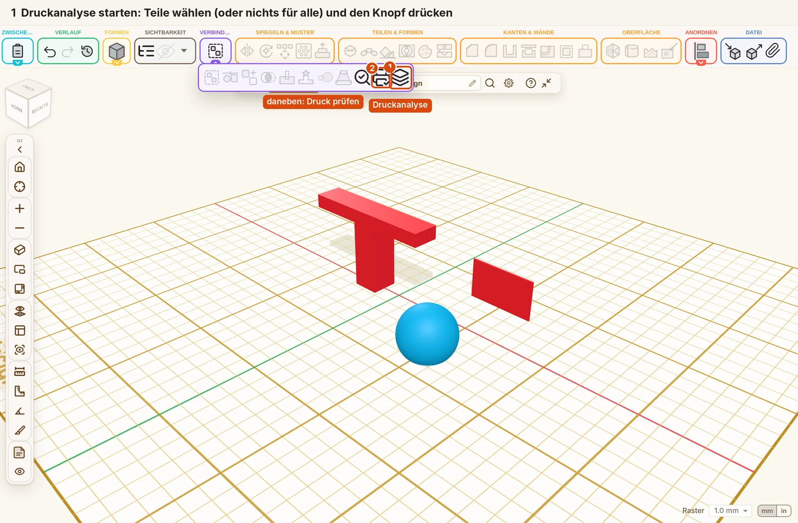

1. **Druckanalyse** in der Werkzeugleiste, Gruppe „Verbinden“.
2. Daneben liegt **Druck prüfen**. Das ist die schnelle Prüfung ohne Schichten.

Teile auswählen und auf **Druckanalyse** klicken. Ist nichts ausgewählt, werden alle sichtbaren Teile geprüft.

### A2 – Einstellungen

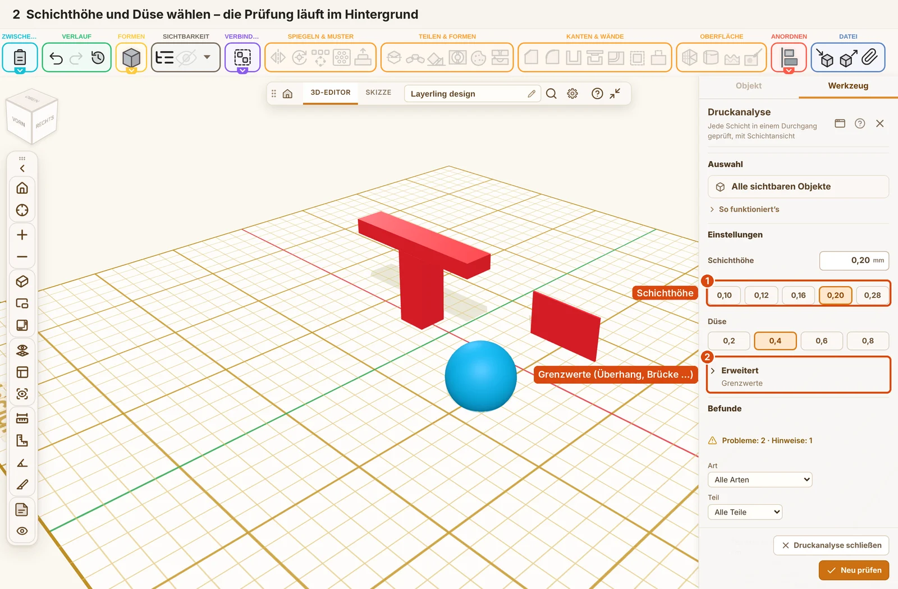

1. **Schichthöhe**: wie im Slicer (0,10 bis 0,28 mit einem Klick, jeder andere Wert im Feld). Darunter die **Düse**.
2. **Erweitert → Grenzwerte**: ab wann ein Überhang ein Hinweis (45°) oder ein Problem (60°) ist, ab welcher Spannweite eine Brücke gemeldet wird (10 mm), wie dünn eine Wand sein darf (2 × Düse), wie klein eine Insel (2 mm²) und unter welcher Fläche nichts bewertet wird (0,05 mm²).

Die Prüfung läuft im Hintergrund mit einem Balken. **Abbrechen** stoppt sie sofort. Ein Teil mit 100.000 Dreiecken braucht bei 0,2 mm etwa eine Sekunde.

### A3 – Die Befundliste

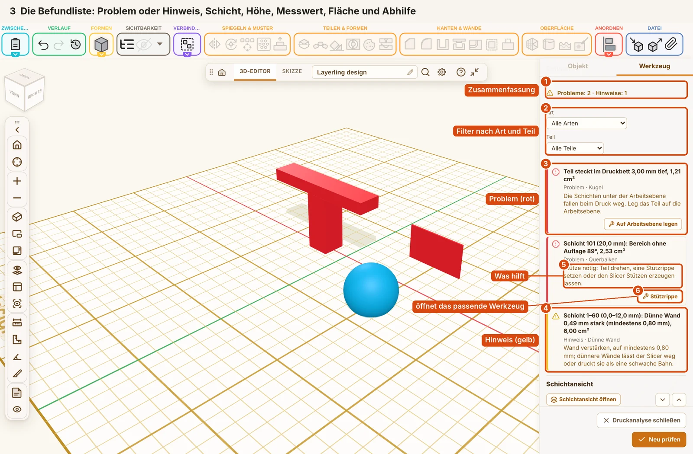

1. **Zusammenfassung**: wie viele Probleme und Hinweise, oder „Keine Befunde“.
2. **Filter** nach Art (z. B. nur Überhänge) und nach Teil.
3. **Problem** (roter Streifen): so wird der Druck nicht gelingen.
4. **Hinweis** (gelber Streifen): geht vielleicht, sollte man ansehen.
5. **Was hilft**: die Abhilfe in einem Satz.
6. **Werkzeug-Knopf**: öffnet das passende Werkzeug, hier die Stützrippe. Andere Befunde haben „Auf Arbeitsebene legen“ oder „Flach hinlegen“.

Jede Zeile nennt Schicht, Höhe, Messwert und Fläche, z. B. „Schicht 101 (20,0 mm): Bereich ohne Auflage 89°, 2,53 cm²“. Dieselbe Stelle über viele Schichten ergibt **einen** Befund.

### A4 – Klick auf einen Befund: die Schichtansicht

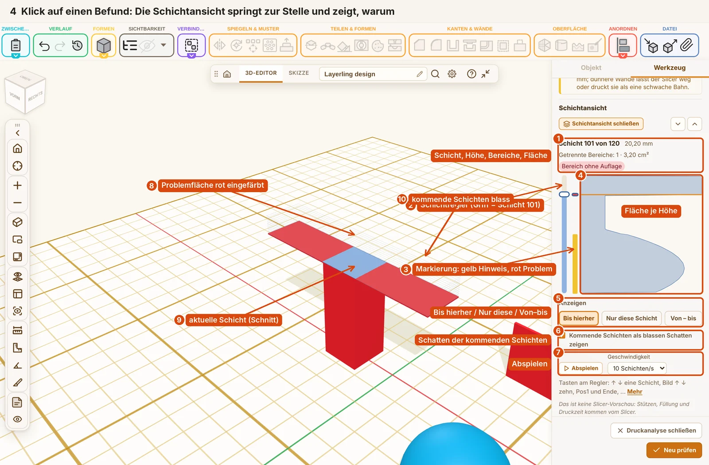

1. **Schicht, Höhe, getrennte Bereiche, Fläche** der gezeigten Schicht und die Art des gewählten Befunds.
2. **Schichtregler**: senkrecht wie das Teil, unten Schicht 1. Ziehen oder klicken.
3. **Markierungen**: ein Strich je Befund (gelb Hinweis, rot Problem). Klick springt hin.
4. **Fläche je Höhe**: das Diagramm der Querschnittsfläche. Klick springt zur Schicht. Hier sieht man den Sprung bei Schicht 101, wo der Querbalken beginnt.
5. **Anzeigen**: Bis hierher, Nur diese Schicht, Von – bis.
6. **Schatten**: die kommenden Schichten als blasse Linien.
7. **Abspielen** mit 5 bis 50 Schichten pro Sekunde.
8. **Problemfläche**, rot eingefärbt (gelb bei einem Hinweis).
9. **Aktuelle Schicht**: Hier ist das Teil aufgeschnitten. Darunter bleibt alles sichtbar.
10. **Kommende Schichten** blass, damit man sieht, was noch kommt.

Tasten am Regler: ↑ ↓ eine Schicht, Bild ↑ ↓ zehn, Pos1 und Ende, Leertaste spielt ab, N nächster Befund, Umschalt+N voriger.

### A5 – Durch die Schichten gehen

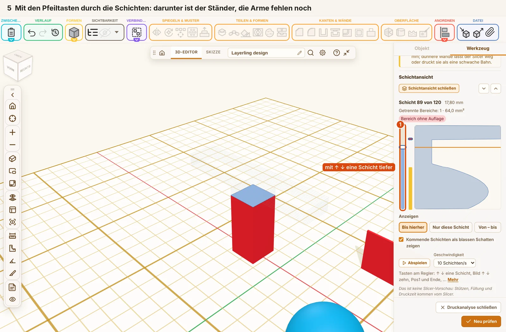

1. Mit ↓ zwölf Schichten tiefer: Hier gibt es nur den Ständer, die Arme kommen erst später. Genau das ist das Problem: Die Arme beginnen in der Luft.

### A6 – Nur diese Schicht

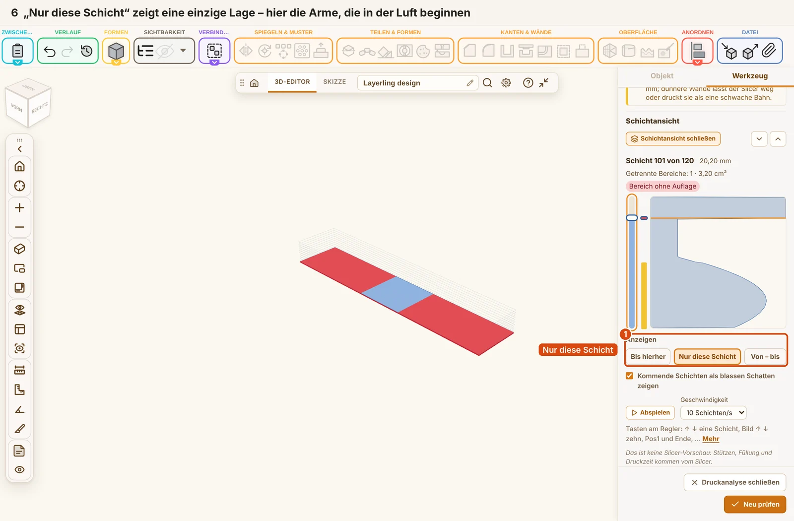

1. **Nur diese Schicht** zeigt eine einzige Lage: die erste Schicht des Querbalkens. Rot sind die Teile ohne Auflage, blau der Teil über dem Ständer.

### A7 – Abhilfe anwenden

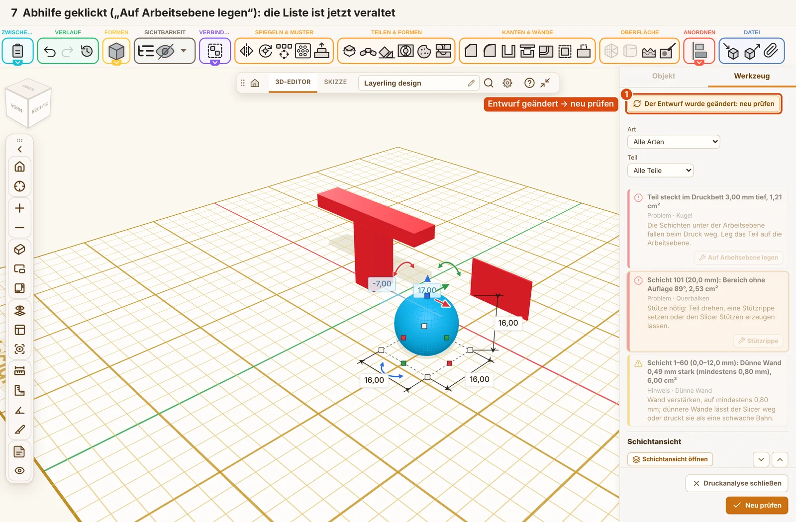

1. Nach „Auf Arbeitsebene legen“ beim Befund „Teil steckt im Druckbett“ hat sich der Entwurf geändert. Die Liste ist als **veraltet** markiert. Klick darauf prüft neu.

### A8 – Neu geprüft

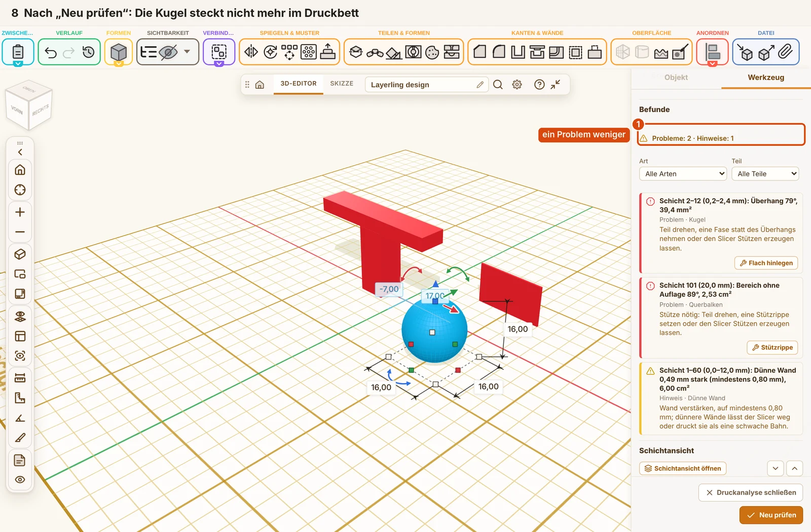

1. Ein Problem weniger: Die Kugel liegt jetzt auf der Arbeitsebene. Rückgängig geht wie immer mit einem Schritt.

**Wichtig:** Die Druckanalyse ist keine Slicer-Vorschau. Stützen, Füllung und Druckzeit kommen vom Slicer. Beim Schließen kommt die Kamera dahin zurück, wo sie war.

### Befunde und Abhilfe auf einen Blick

| Befund | Was es heißt | Abhilfe |
|---|---|---|
| Teil steckt im Druckbett | Ein Teil ragt unter die Arbeitsebene. Diese Schichten fallen weg. | Auf Arbeitsebene legen (Taste D) |
| Teil schwebt über der Arbeitsebene | Die erste Schicht käme in die Luft. | Auf Arbeitsebene legen |
| Körper nicht geschlossen | Das Netz hat Löcher. | Netz reparieren, „Exakt machen“ |
| Größer als der Bauraum | Passt nicht auf den gewählten Drucker. | Kleiner machen, drehen, teilen |
| Bereich ohne Auflage | Eine Fläche beginnt ohne Schicht darunter. | Drehen, Stützrippe, Slicer-Stützen |
| Überhang | Steiler als 45° (ab 60° Problem). | Drehen, Fase statt Überhang |
| Brücke | Freie Spannweite über 10 mm. | Stützrippe in die Mitte, drehen |
| Dünne Wand | Dünner als zwei Düsenbahnen. | Wand verstärken |
| Kleine Insel | Dünner Stift unter 2 mm². | Dicker machen oder anbinden |
| Haftfläche | Wenig Fläche auf dem Bett für die Höhe. | Auf größere Fläche drehen, Brim |

---

## Teil B – Gussform

### B1 – Starten

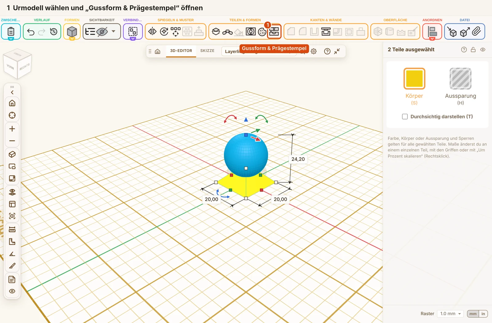

1. Urmodell auswählen (hier Kugel auf Pyramidensockel) und **Gussform & Prägestempel** öffnen.

### B2 – Gießmaterial und Öffnungsrichtung

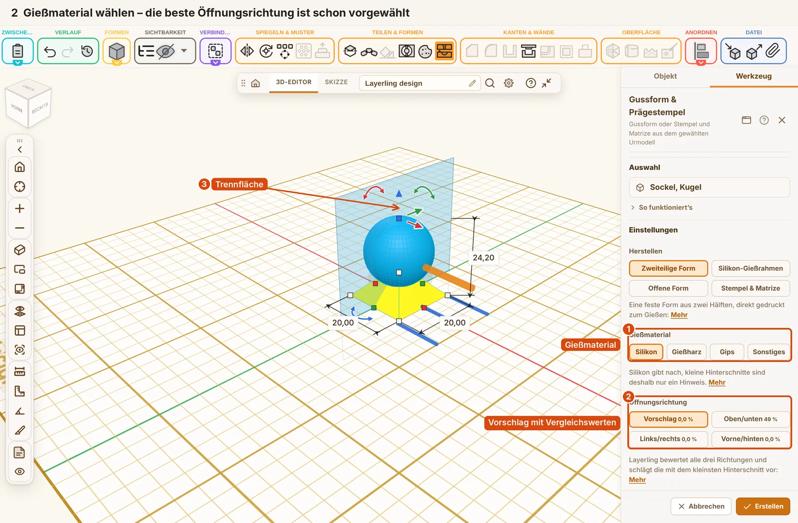

1. **Gießmaterial**: Silikon gibt nach, kleine Hinterschnitte sind nur ein Hinweis. Bei Gießharz, Gips und Sonstigem bleibt jeder Hinterschnitt hängen. Das Material setzt auch Schwindmaß und Dichte.
2. **Öffnungsrichtung**: Layerling rechnet alle drei Richtungen und wählt die mit dem kleinsten Hinterschnitt vor. Die Zahl auf jedem Knopf ist der Anteil der Oberfläche, der hängen bliebe.
3. **Trennfläche**: hier senkrecht, weil die Form nach links und rechts aufgeht.

### B3 – Zum Vergleich: Oben/unten

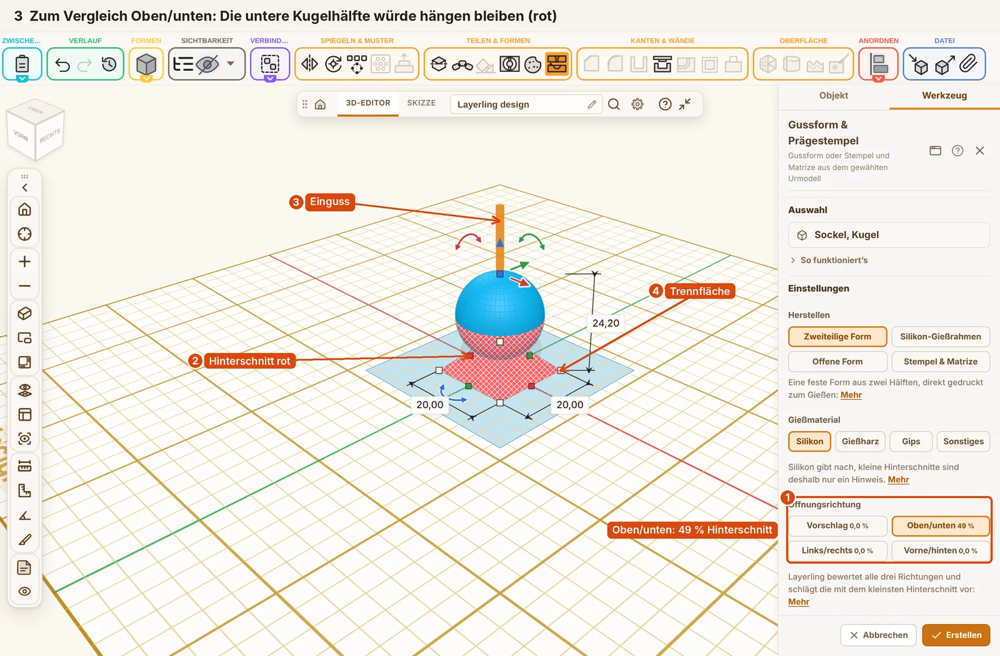

1. Oben/unten hätte **49 % Hinterschnitt**.
2. **Rot**: die Flächen, die hängen blieben (die untere Kugelhälfte über dem Sockel).
3. **Einguss** (orange) am höchsten Punkt.
4. **Trennfläche** (blau), hier waagerecht.

Deshalb schlägt Layerling hier Links/rechts vor.

### B4 – Weitere Einstellungen

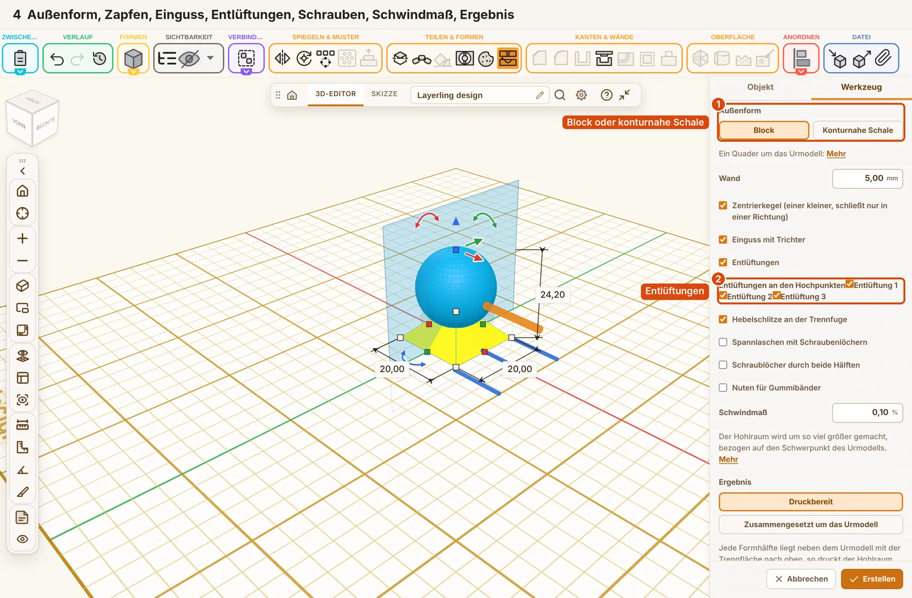

1. **Außenform**: Block (einfach, stabil) oder konturnahe Schale (spart Filament, druckt ohne Stützen).
2. **Entlüftungen**: jede einzeln an- und abschaltbar.

Außerdem: Zentrierzapfen, Einguss mit Trichter, Öffnungskerben, Spannlaschen, **Schraublöcher**, **Gummibandnuten**, **Schwindmaß** und **Ergebnis** (druckbereit oder zusammengesetzt). Unter „Erweitert“: Größen, Spiel, Einguss verschieben (X/Y), Entformungsschräge, Dichte.

### B5 – Prüfung und Erstellen

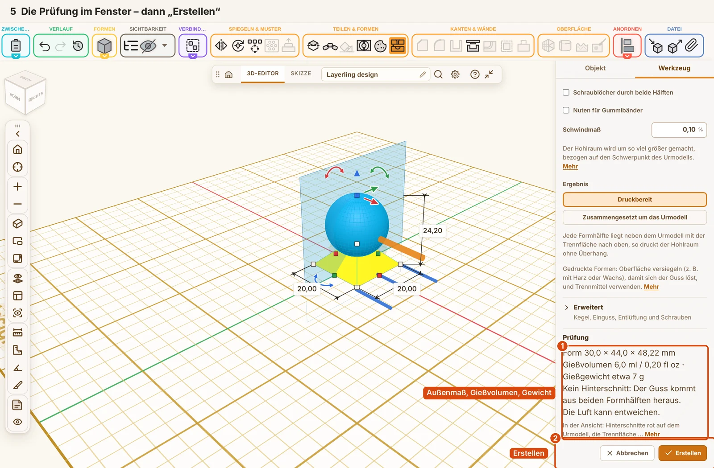

1. **Prüfung**: Außenmaß der Form, Gießvolumen mit Einguss (ml und fl oz), Gießgewicht, Hinterschnitt, „Die Luft kann entweichen“.
2. **Erstellen**.

### B6 – Das Ergebnis

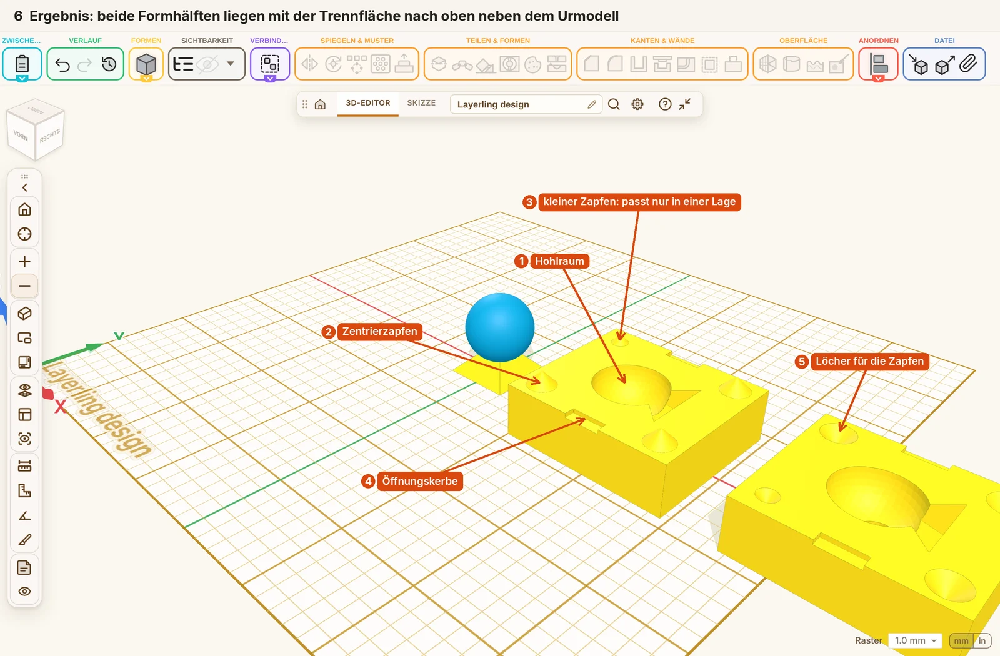

1. **Hohlraum**.
2. **Zentrierzapfen**.
3. **Kleiner Zapfen**: Die Hälften passen nur in einer Lage zusammen.
4. **Öffnungskerbe** für Schraubendreher oder Spachtel.
5. **Löcher für die Zapfen** in der anderen Hälfte.

Beide Formhälften liegen mit der Trennfläche nach oben, so druckt der Hohlraum ohne Überhang. Das Urmodell bleibt unverändert. **Gussform neu erzeugen:** eine Formhälfte auswählen und den Knopf drücken. Das Fenster öffnet sich mit den alten Einstellungen, und die Teile werden in einem Rückgängig-Schritt ersetzt.

### B7 – Lufteinschluss

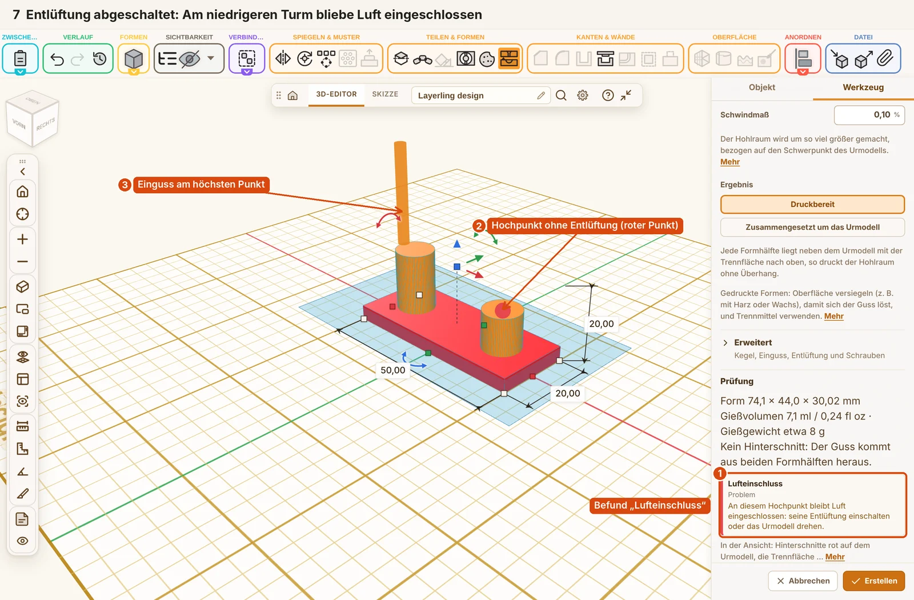

1. Befund **Lufteinschluss**, weil die Entlüftung am niedrigen Turm abgeschaltet wurde.
2. **Roter Punkt**: der Hochpunkt, an dem Luft eingeschlossen bliebe.
3. **Einguss** am höchsten Punkt (hoher Turm).

Ohne Befund steht im Fenster „Die Luft kann entweichen“.

---

## Teil C – Prägestempel & Matrize mit Relief

### C1 – Relief prägen

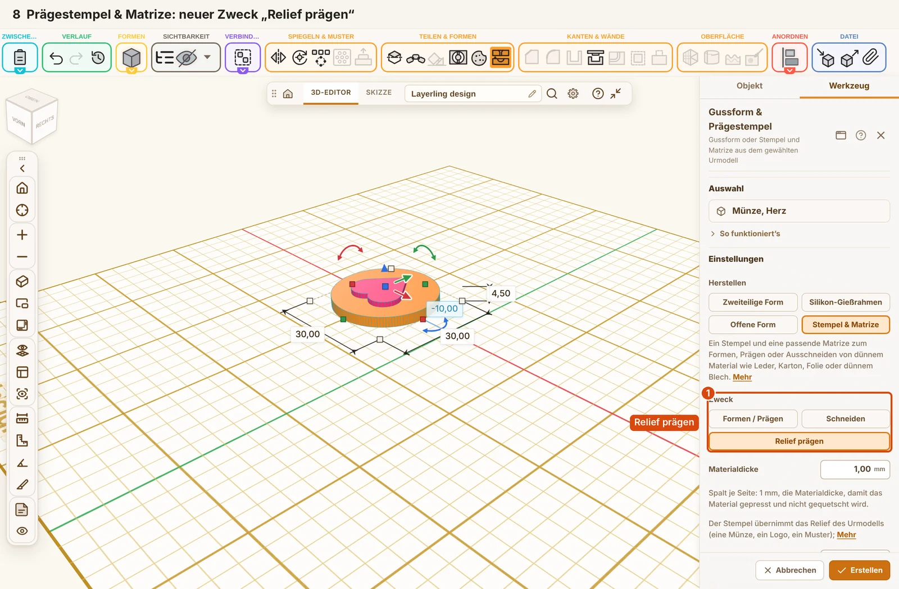

1. Unter **Stempel & Matrize** den Zweck **Relief prägen** wählen. Der Stempel übernimmt dann das Relief des Urmodells.

### C2 – Das Ergebnis

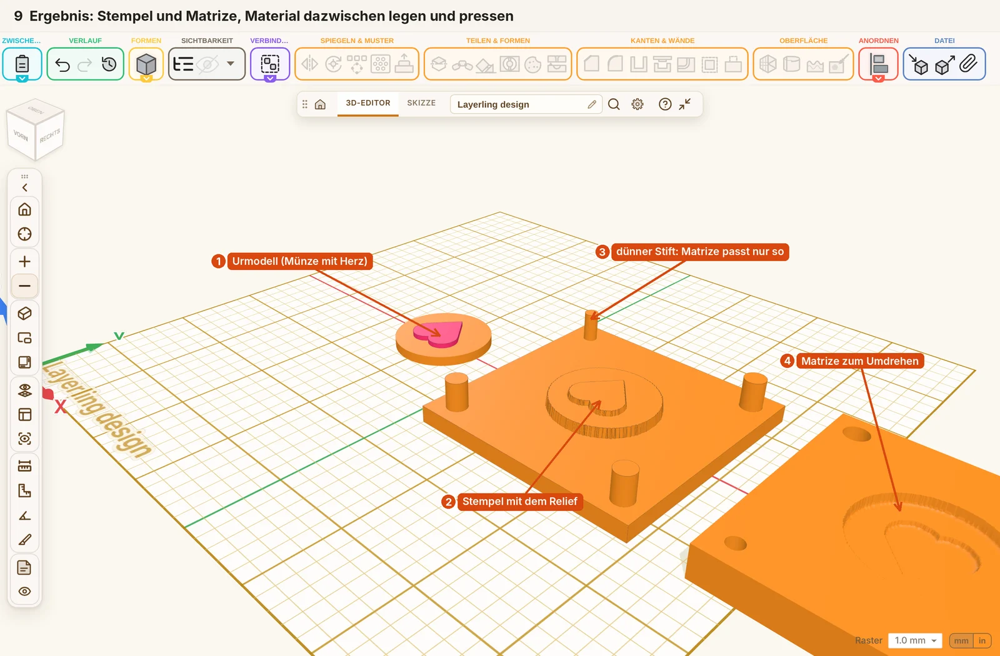

1. **Urmodell**: Münze mit erhabenem Herz.
2. **Stempel** mit dem Relief.
3. **Dünner Stift**: Der vierte Führungsstift ist dünner, die Matrize passt nur in einer Lage.
4. **Matrize**: zum Umdrehen auf den Stempel. Das Relief ist um die Materialstärke größer.

Material (Leder, Karton, Folie) zwischen Stempel und Matrize legen und pressen.

---

## Häufige Probleme bei Gussformen

| Problem | Abhilfe |
|---|---|
| Hinterschnitt (rot) | Vorgeschlagene Richtung nehmen, Trennung verschieben, Urmodell drehen oder Silikon-Gießrahmen |
| Lufteinschluss | Entlüftung an diesem Hochpunkt einschalten oder Urmodell drehen |
| Zu wenig Entformungsschräge | Den Flächen 1° oder mehr Schräge geben oder in Silikon gießen |
| Form zu groß oder zu schwer | Konturnahe Schale wählen, Wand dünner (nicht unter 3 mm) |
| Guss klebt | Form versiegeln (Harz oder Wachs), Trennmittel nehmen. PLA wird ab etwa 55 °C weich |

## Für die KI (MCP)

- Neues Werkzeug `layerling_check_layers`: die Druckanalyse, mit der Befundliste als Antwort.
- `layerling_make_mold` kennt jetzt `direction`, `castMaterial`, `shrinkage`, `density`, `draftLimit`, `outer`, `screws`, `bands`, `ventsOff`, `sprueShiftX/Y`, `output` und `dieMode: "relief"`. Die Antwort enthält eine `analysis` mit den Werten je Richtung.
