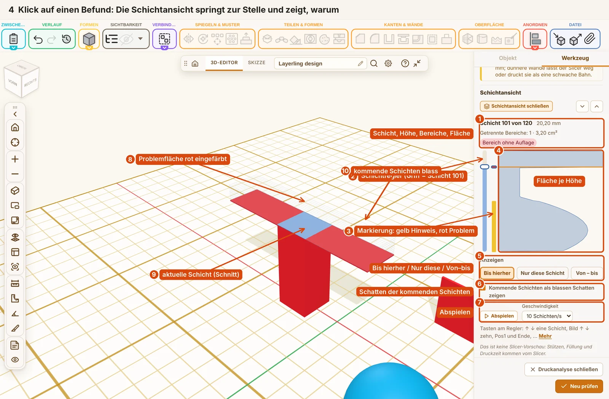
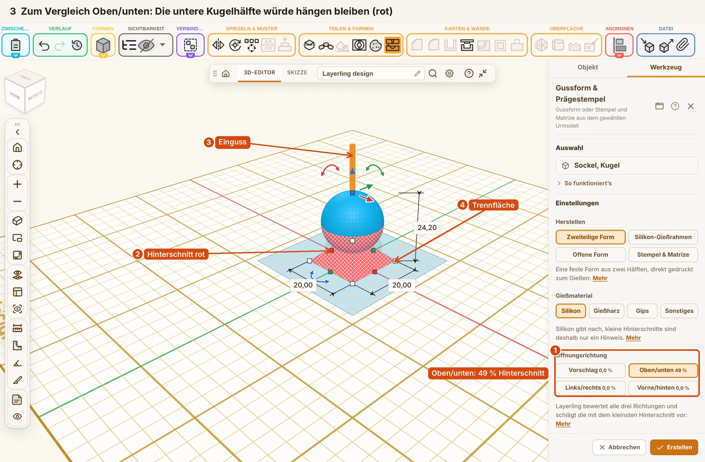
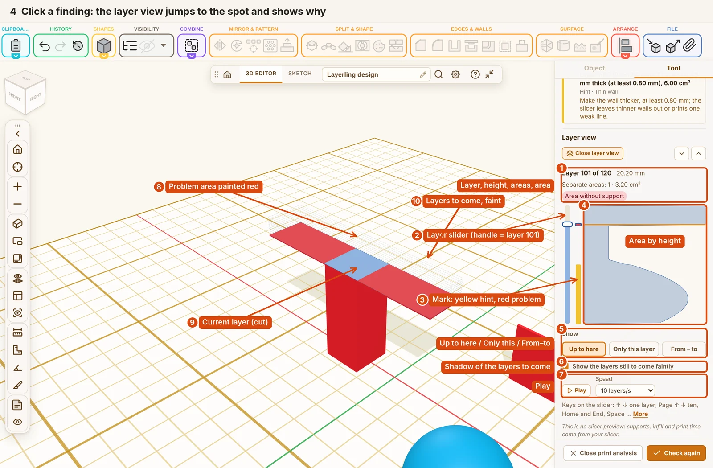
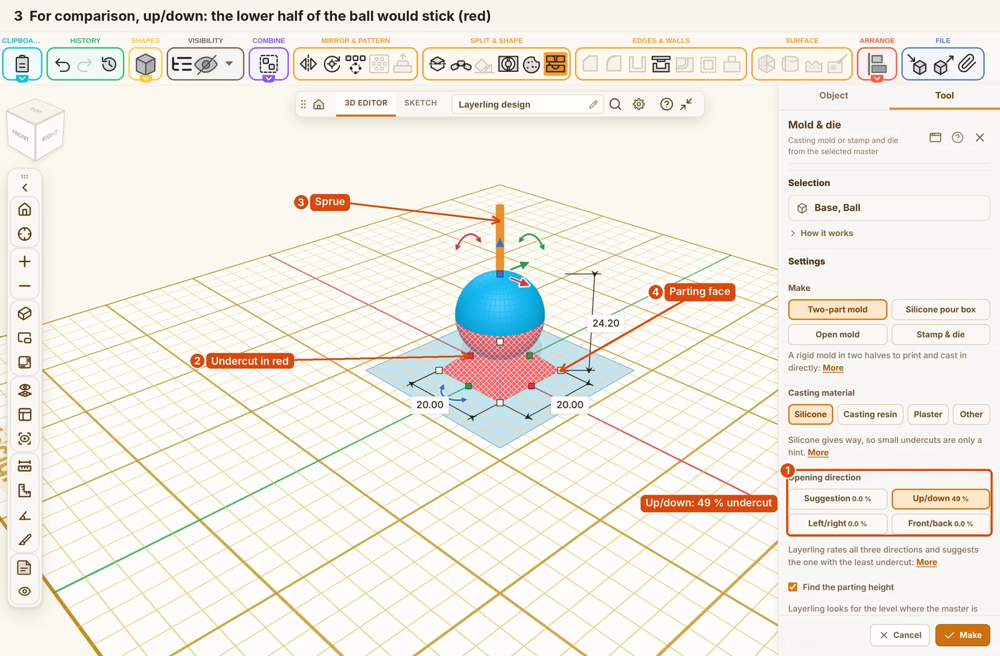

# Beiträge für Facebook und GitHub (Deutsch und Englisch)

Bilder-Links für GitHub (fester Stand, gehen nicht kaputt):
`https://raw.githubusercontent.com/marcus040473/layerling/320fde933cb004e078444a88f635aac3ba335114/uebergabe/druckanalyse-gussform/bilder/<Name>.webp`
Für Facebook die Bilder hochladen: deutsch aus `bilder/`, englisch aus `bilder/en/`. Gute Auswahl: A3, A4, B3, B6, D2.

---

## 1. Facebook (Layerling User Group) – Deutsch

**Neu in Layerling: Druckanalyse mit Schichtansicht, und die Gussform kann jetzt viel mehr**

Hallo zusammen,

vor ein paar Tagen kam hier der Wunsch nach Gussformen auf, und viele von euch haben gefragt, ob man vor dem Druck nicht besser sehen kann, wo es hakt. Beides habe ich jetzt weitergebaut.

**Druckanalyse:** Ein Klick, und Layerling geht das ganze Teil Schicht für Schicht durch. Am Ende steht eine Liste: zuerst die Probleme (rot), dann die Hinweise (gelb). Zum Beispiel „Schicht 101 (20,0 mm): Bereich ohne Auflage“ oder „Überhang 62°“. Bei jedem Befund steht, was hilft, und oft gibt es gleich einen Knopf dafür, etwa „Auf Arbeitsebene legen“ oder „Stützrippe“. Gefunden werden auch Teile, die im Druckbett stecken oder schweben, dünne Wände, lange Brücken, kleine Inseln und eine zu kleine Haftfläche.

Klickt man auf einen Befund, springt die **Schichtansicht** genau dorthin. Die Stelle wird eingefärbt, darunter bleibt alles sichtbar, und mit den Pfeiltasten geht ihr Schicht für Schicht durch. Wichtig: Das ersetzt den Slicer nicht. Stützen, Füllung und Druckzeit kommen weiter von dort.

**Gussform:** Layerling rechnet jetzt alle drei Richtungen aus, in die sich die Form öffnen kann, und schlägt die beste vor. Hinterschnitte werden rot auf dem Urmodell gezeigt, mit Fläche und Anteil in Prozent. Ihr wählt das Gießmaterial (Silikon, Gießharz, Gips), und danach richtet sich die Bewertung. Außerdem gibt es jetzt das Schwindmaß, Entlüftungen, die man einzeln an- und abschalten kann, eine Warnung bei Lufteinschluss, eine konturnahe Schale, die Filament spart, Schraublöcher und Nuten für Gummibänder. Das Fenster zeigt Gießvolumen und Gewicht an. Und wenn ihr eine Formhälfte anklickt, könnt ihr die Form mit geänderten Einstellungen neu erzeugen.

**Prägestempel:** Der neue Modus „Relief prägen“ übernimmt das Relief einer Münze oder eines Logos in den Stempel. Der vierte Führungsstift ist jetzt dünner, so passt die Matrize nur richtig herum.

Ich hänge ein paar Bilder an. Die Werte für Schwindmaß und Dichte sind Annahmen aus Datenblättern, prüft sie bitte an eurem Material. Ich freue mich über eure Rückmeldungen, gerne mit Bildern von euren ersten Abgüssen!

Viele Grüße
Marcus

---

## 1. Facebook (Layerling User Group) – English

**New in Layerling: print analysis with a layer view, and the mold tool does a lot more now**

Hi everyone,

a few days ago someone here asked for casting molds, and many of you wanted an easier way to see what might go wrong before printing. I've worked on both.

**Print analysis:** One click, and Layerling goes through the whole part layer by layer. You get a list: problems first (red), then hints (yellow), for example "Layer 101 (20.0 mm): area without support" or "overhang 62°". Each finding says what helps, and often there is a button for it right there, like "Lay on workplane" or "Support rib". It also finds parts sunk into the bed or floating above it, thin walls, long bridges, small islands and a first layer that is too small to hold.

Click a finding and the **layer view** jumps straight to it. The spot is coloured, everything below stays visible, and the arrow keys take you through the layers one by one. It doesn't replace your slicer: supports, infill and print time still come from there.

**Molds:** Layerling now works out all three directions a mold could open in and suggests the best one. Undercuts show in red on the master, with their area and percentage. You pick the casting material (silicone, resin, plaster), and the rating follows from it. There's also shrinkage, vents you can switch on and off one by one, an air trap warning, a contour shell that saves filament, bolt holes and grooves for rubber bands. The window shows the pour volume and weight. And if you click a mold half, you can make the mold again with changed settings.

**Stamp & die:** The new "Emboss relief" mode copies the relief of a coin or a logo into the stamp. The fourth guide pin is thinner now, so the die only fits the right way round.

A few pictures are attached. The shrinkage and density values are assumptions from data sheets, so please check them against your material. I'd love to hear how it works for you, and pictures of your first casts are very welcome!

Cheers,
Marcus

---

## 2. GitHub (Diskussion, z. B. unter „Show and tell“ oder als Ergänzung zu Discussion #1806) – Deutsch

**Druckanalyse mit Schichtansicht, und die Gussform kann mehr**

Hallo zusammen,

ich habe an zwei Dingen weitergebaut, die hier und in der Facebook-Gruppe gewünscht wurden. Vielen Dank für die Ideen dazu.

**Druckanalyse (neben „Druck prüfen“)**
Sie schneidet die gewählten Teile in Schichten und vergleicht jede Schicht mit der darunter, alles in einem Durchgang und im Hintergrund, mit Fortschrittsbalken und Abbrechen. Das Ergebnis ist eine Befundliste: im Druckbett, schwebend, Netz offen, größer als der Bauraum, ohne Auflage, Überhang (Hinweis ab 45°, Problem ab 60°), Brücke über 10 mm, dünne Wand, kleine Insel, Haftfläche. Gleiche Befunde in aufeinanderfolgenden Schichten werden zu einem zusammengefasst. Ein Klick öffnet die Schichtansicht an der richtigen Stelle. Dort gibt es einen senkrechten Regler mit Markierungen, ein Diagramm der Querschnittsfläche, „Bis hierher / Nur diese Schicht / Von–bis“, Tasten und Abspielen. Ein Teil mit 100.000 Dreiecken dauert bei 0,2 mm etwa eine Sekunde. Für KI-Helfer gibt es das MCP-Werkzeug `layerling_check_layers`.

**Gussform & Prägestempel**
- Die Öffnungsrichtung wird vorgeschlagen (X, Y oder Z, mit Vergleichswerten). Hinterschnitte werden Fläche für Fläche mit einer Sichtprüfung gefunden, nicht nur über die Richtung der Flächennormalen.
- Gießmaterial mit Bewertung, Schwindmaß, Entformungsschräge, Entlüftungen einzeln schaltbar, Lufteinschluss als Befund, konturnahe Schale, Schraublöcher, Gummibandnuten, Ausgabe auch zusammengesetzt.
- Die Teile merken sich ihre Einstellungen, „Gussform neu erzeugen“ ersetzt sie in einem Rückgängig-Schritt.
- Prägestempel: Modus „Relief prägen“, unsymmetrische Führungsstifte, Warnung bei zu feinen Stellen.

Der Stand liegt in meinem Fork im Zweig `claude/upbeat-hypatia-9lluo2`, mit 26 neuen Tests. Bewusst noch nicht drin sind eine freie Öffnungsrichtung mit Drehgriff und Einguss und Entlüftungen zum Ziehen mit der Maus. Ich freue mich über Rückmeldungen, vor allem zu den Grenzwerten und zu den Vorgaben für das Schwindmaß.

Viele Grüße
Marcus

---

## 2. GitHub (Discussion, e.g. under "Show and tell" or as a follow-up to Discussion #1806) – English

**Print analysis with a layer view, and more for the mold tool**

Hi everyone,

I've kept working on two things people asked for here and in the Facebook group. Thanks for the ideas.

**Print analysis (next to Print check)**
It cuts the selected parts into layers and compares each layer with the one below, in one go and in the background, with a progress bar and a stop button. The result is a list of findings: in the bed, floating, open mesh, larger than the build volume, no support underneath, overhang (hint from 45°, problem from 60°), bridge over 10 mm, thin wall, small island, bed adhesion. The same finding on layers in a row counts as one. A click opens the layer view at the right spot. It has an upright slider with marks, a chart of the cross-section over the height, "Up to here / Only this layer / From – to", keys and playback. A part with 100,000 triangles takes about a second at 0.2 mm. AI helpers can use the MCP tool `layerling_check_layers`.

**Mold & die**
- The opening direction is suggested (X, Y or Z, with the figures side by side). Undercuts are found face by face with a visibility check, not just from the direction of the face normals.
- Casting material with its own rating, shrinkage, draft check, vents you can switch on and off one by one, air traps as findings, a contour shell, bolt holes, rubber band grooves, and an assembled output.
- The parts remember their settings, and "Make the mold again" replaces them in one undo step.
- Stamp & die: an "Emboss relief" mode, asymmetric guide pins, a warning for details that are too fine.

It's on the branch `claude/upbeat-hypatia-9lluo2` in my fork, with 26 new tests. Not in yet, on purpose: a free opening direction with a rotate handle, and dragging the sprue and vents with the mouse. I'd be glad to hear what you think, especially about the limits and the shrinkage presets.

Cheers,
Marcus
