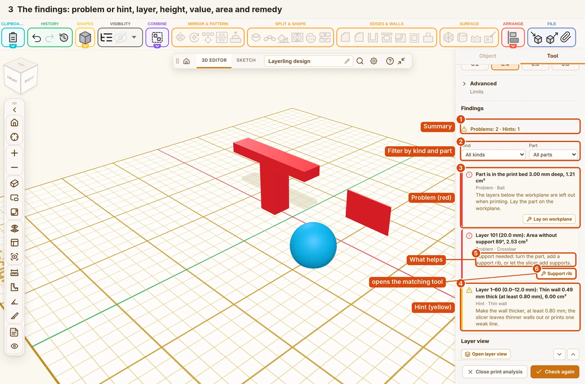
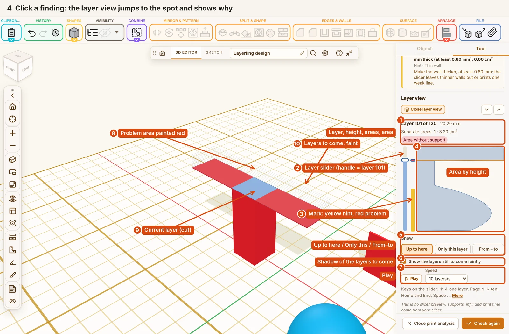
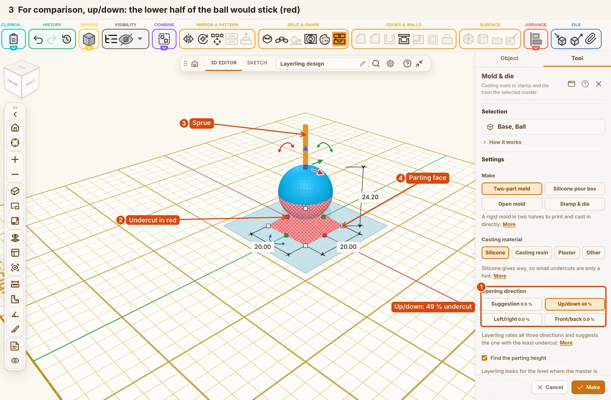
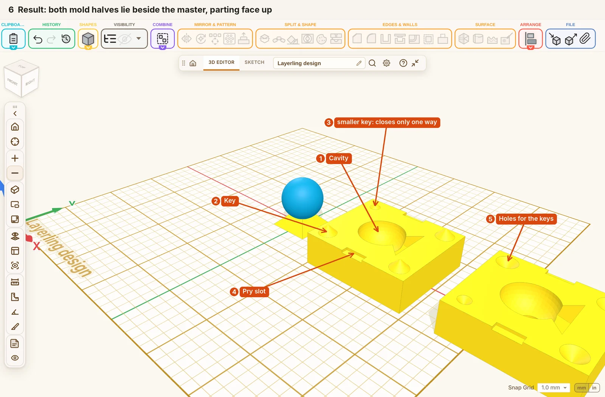

# GitHub posts (English)

## 1. New discussion, category Ideas

**Title:** Print analysis: every layer checked in one go, with a layer view to see why

Hi everyone,

before I slice, I'd like to know what will go wrong without paging through a slicer preview. So I built a **print analysis** in my fork, next to Print check, and I'd love to hear what you think of the idea.

**What it does**
One click cuts the selected parts (or everything visible) into layers and compares each layer with the one below, in the background, with a progress bar and a stop button. It then lists its findings, problems first, then hints, from the bottom up:

- part sunk into the bed (layers below the workplane are not counted), part floating above it, open mesh, larger than the printer's build volume
- area without support (like the arms of a T), overhang (hint from 45°, problem from 60°), bridge longer than 10 mm, thin wall, small island, too little bed adhesion

Each line says where and how bad, for example "Layer 101 (20.0 mm): Area without support 89°, 2.53 cm²", and what helps. Where Layerling has a tool for it, a button opens it (Lay on workplane, Lay flat, Support rib). The same problem on layers in a row counts as one finding.

**The layer view**
Click a finding and the view jumps to its first layer: the part is cut there, the spot is painted red or yellow, and everything below stays visible. There's an upright slider with marks for the findings, a chart of the cross-section over the height, "Up to here / Only this layer / From – to", the layers to come as a faint shadow, arrow keys and playback. When you close it, the camera goes back to where it was.

It's no slicer preview, of course: supports, infill and print time still come from the slicer. A part with 100,000 triangles takes about a second at 0.2 mm. AI helpers can run it as `layerling_check_layers`.

It's on the branch `claude/upbeat-hypatia-9lluo2` in my fork, with tests. Before I'd open a PR, I'd like to know: are the limits sensible defaults for you, and is anything missing that you look for before printing?

Cheers,
Marcus

---

## 2. Short addition in Discussion #1806

A short update on the mold tool, in case it helps with the test prints:

- It now works out all three opening directions and suggests the one with the least undercut. Undercuts are found face by face with a visibility check and shown in red on the master, with their area and percentage.
- You pick the casting material (silicone, resin, plaster): small undercuts are only a hint in silicone, every undercut is a problem in a rigid material, and faces without draft get a hint there.
- New: shrinkage, vents you can switch on and off one by one (an air trap is reported where one is missing), a contour shell that saves filament, bolt holes, rubber band grooves, pour volume and weight, and "Make the mold again" from a selected mold half.
- Stamp & die got an "Emboss relief" mode, and the fourth guide pin is thinner, so the die only fits one way.

It's on the branch `claude/upbeat-hypatia-9lluo2` in my fork. I'll still wait for the first real casts before the PR, as you suggested. The print analysis I built at the same time has its own idea post: [link]
