# Picture guide: print analysis, molds and stamps (17 Nov 2026)

Each picture shows one step. The orange numbers in the picture are explained below it. All pictures are in `bilder/en/`.

---

## Part A – Print analysis with the layer view

The print analysis checks the whole part in one go, layer by layer. It finds the problems, and the layer view shows why they are problems. You don't have to page through the layers yourself.

### A1 – Start

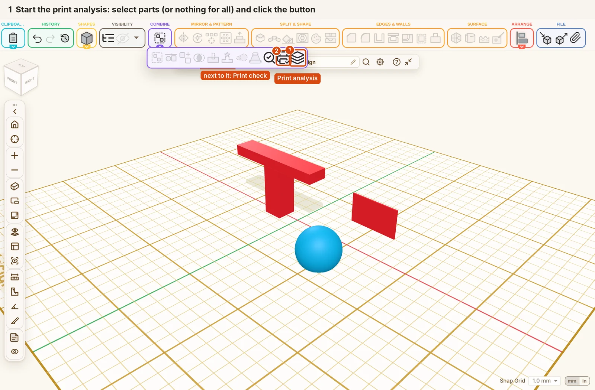

1. **Print analysis** in the toolbar, in the "Combine" group.
2. Next to it is **Print check**, the quick check without layers.

Select the parts and click **Print analysis**. With nothing selected, every visible part is checked.

### A2 – Settings

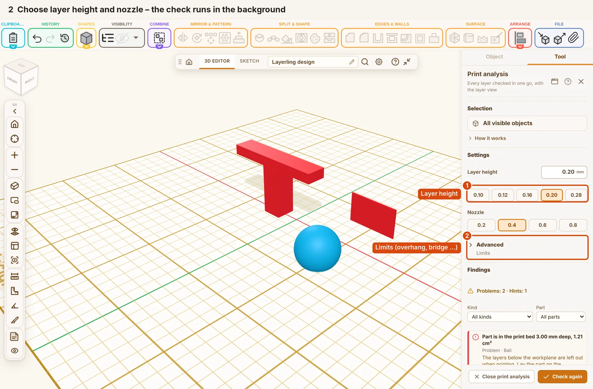

1. **Layer height**, as in your slicer (0.10 to 0.28 with one click, any other value in the field). Below it the **nozzle**.
2. **Advanced → Limits**: when an overhang is a hint (45°) or a problem (60°), from which span a bridge is reported (10 mm), how thin a wall may be (2 × nozzle), how small an island (2 mm²), and below which area nothing is rated (0.05 mm²).

The check runs in the background with a progress bar. **Stop** ends it at once. A part with 100,000 triangles takes about a second at 0.2 mm.

### A3 – The findings

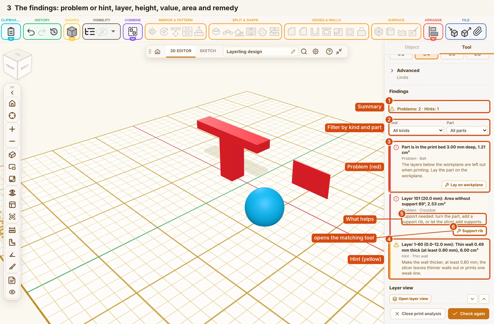

1. **Summary**: how many problems and hints, or "No findings".
2. **Filter** by kind (e.g. only overhangs) and by part.
3. **Problem** (red stripe): the print will not work like this.
4. **Hint** (yellow stripe): may work, worth a look.
5. **What helps**: the remedy in one sentence.
6. **Tool button**: opens the matching tool, here the support rib. Other findings have "Lay on workplane" or "Lay flat".

Each line gives the layer, height, measured value and area, e.g. "Layer 101 (20.0 mm): Area without support 89°, 2.53 cm²". The same spot over many layers is **one** finding.

### A4 – Click a finding: the layer view

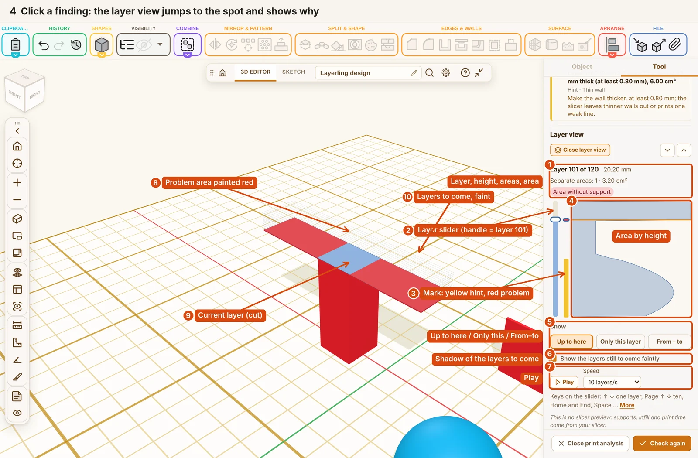

1. **Layer, height, separate areas, area** of the layer shown, and the kind of the chosen finding.
2. **Layer slider**: upright like the part, layer 1 at the bottom. Drag or click.
3. **Marks**: one stripe per finding (yellow hint, red problem). A click jumps there.
4. **Area by height**: the chart of the cross-section. A click jumps to that layer. You can see the jump at layer 101, where the crossbar starts.
5. **Show**: Up to here, Only this layer, From – to.
6. **Shadow**: the layers still to come as faint lines.
7. **Play** at 5 to 50 layers per second.
8. **Problem area**, painted red (yellow for a hint).
9. **Current layer**: the part is cut open here. Everything below stays visible.
10. **Layers to come**, faint, so you see what is still ahead.

Keys on the slider: ↑ ↓ one layer, Page ↑ ↓ ten, Home and End, Space plays, N next finding, Shift+N the one before.

### A5 – Step through the layers

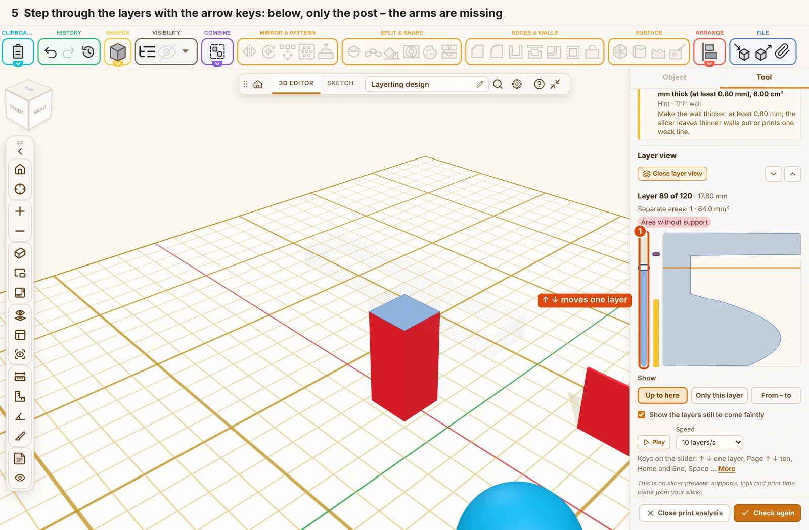

1. Twelve layers lower with ↓: only the post is here, the arms come later. That is exactly the problem: the arms start in the air.

### A6 – Only this layer

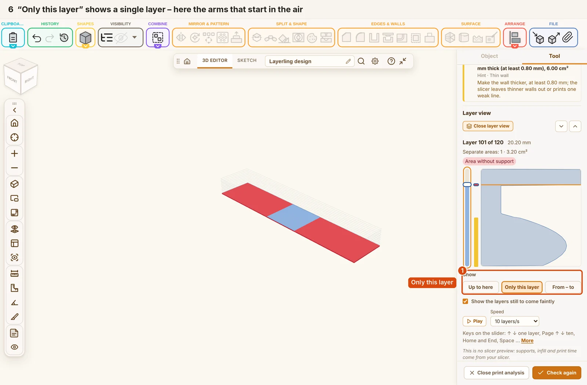

1. **Only this layer** shows a single layer: the first layer of the crossbar. Red are the parts without support, blue the part above the post.

### A7 – Apply a remedy

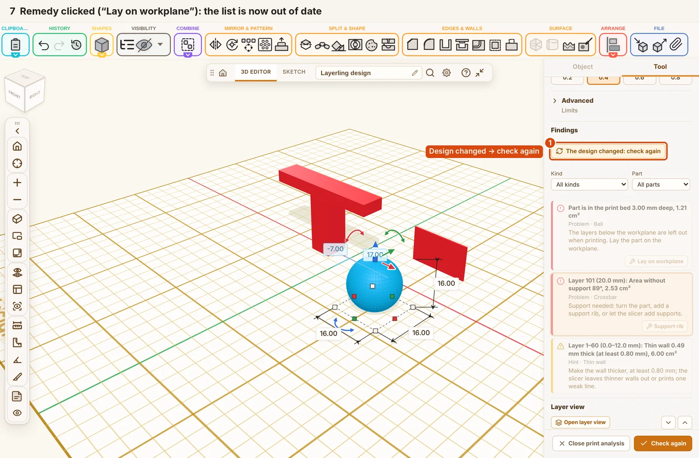

1. After "Lay on workplane" on the finding "Part is in the print bed" the design has changed. The list is marked **out of date**. Click it to check again.

### A8 – Checked again

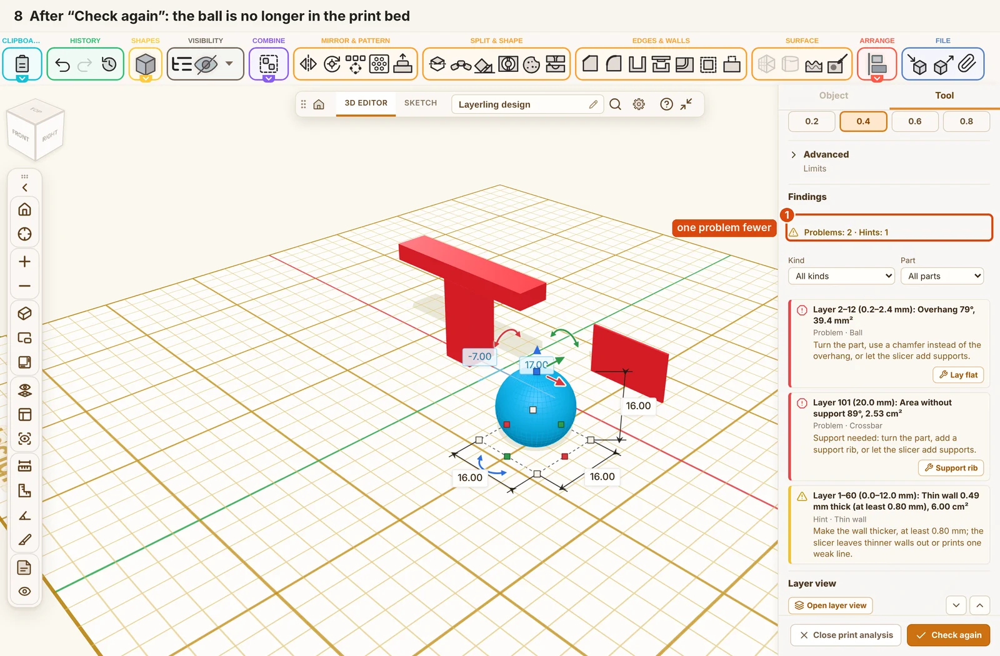

1. One problem fewer: the ball now lies on the workplane. Undo takes it back in one step, as always.

**Important:** the print analysis is no slicer preview. Supports, infill and print time come from your slicer. When you close it, the camera goes back to where it was.

### Findings and remedies at a glance

| Finding | What it means | Remedy |
|---|---|---|
| Part is in the print bed | A part reaches below the workplane. Those layers are left out. | Lay on workplane (key D) |
| Part floats above the workplane | The first layer would be laid into the air. | Lay on workplane |
| Body not closed | The mesh has holes. | Repair the mesh, "Make exact" |
| Larger than the build volume | Doesn't fit the chosen printer. | Make it smaller, turn it, split it |
| Area without support | A place starts with no layer under it. | Turn it, support rib, slicer supports |
| Overhang | Steeper than 45° (a problem from 60°). | Turn it, chamfer instead of overhang |
| Bridge | Free span over 10 mm. | Support rib in the middle, turn it |
| Thin wall | Thinner than two lines of the nozzle. | Make the wall thicker |
| Small island | A thin pin under 2 mm². | Make it thicker or join it to the rest |
| Bed adhesion | Little area on the bed for the height. | Turn onto a larger face, brim |

---

## Part B – Molds

### B1 – Start

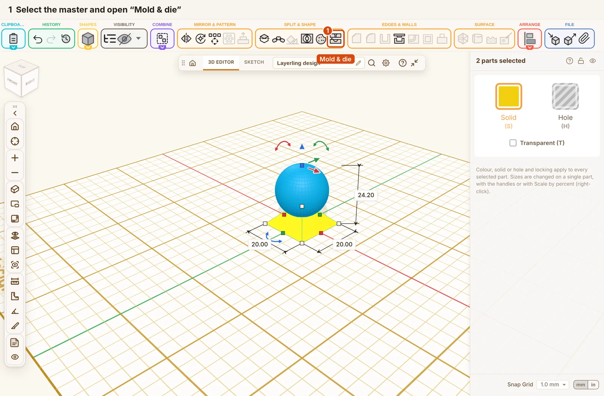

1. Select the master (here a ball on a pyramid base) and open **Mold & die**.

### B2 – Casting material and opening direction

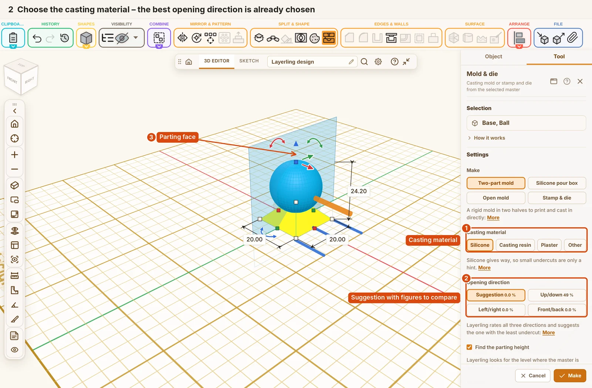

1. **Casting material**: silicone gives way, so small undercuts are only a hint. In casting resin, plaster and the rest, every undercut sticks. The material also sets shrinkage and density.
2. **Opening direction**: Layerling works out all three directions and preselects the one with the least undercut. The number on each button is the share of the surface that would stick.
3. **Parting face**: upright here, because the mold opens left and right.

### B3 – For comparison: up/down

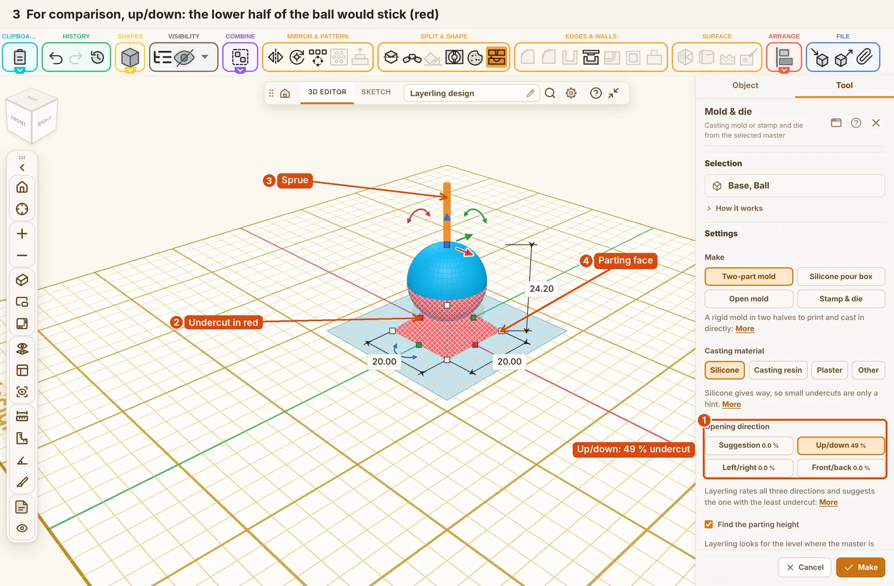

1. Up/down would have **49 % undercut**.
2. **Red**: the faces that would stick (the lower half of the ball above the base).
3. **Sprue** (orange) at the highest point.
4. **Parting face** (blue), level here.

That is why Layerling suggests left/right for this part.

### B4 – More settings

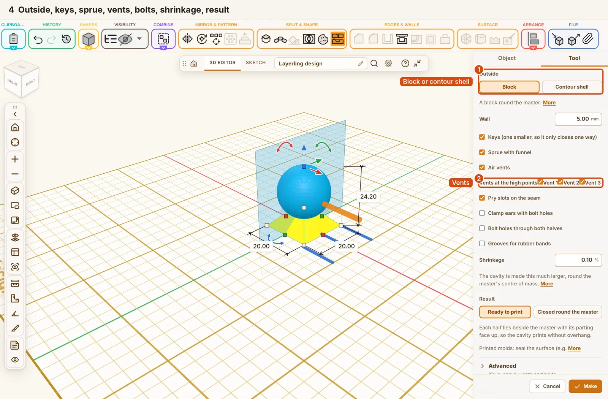

1. **Outside**: a block (simple, sturdy) or a contour shell (saves filament, prints without supports).
2. **Vents**: each one can be switched on and off.

Also: keys, sprue with funnel, pry slots, clamp ears, **bolt holes**, **rubber band grooves**, **shrinkage** and **result** (ready to print or closed round the master). Under "Advanced": sizes, play, moving the sprue (X/Y), draft, density.

### B5 – Check and make

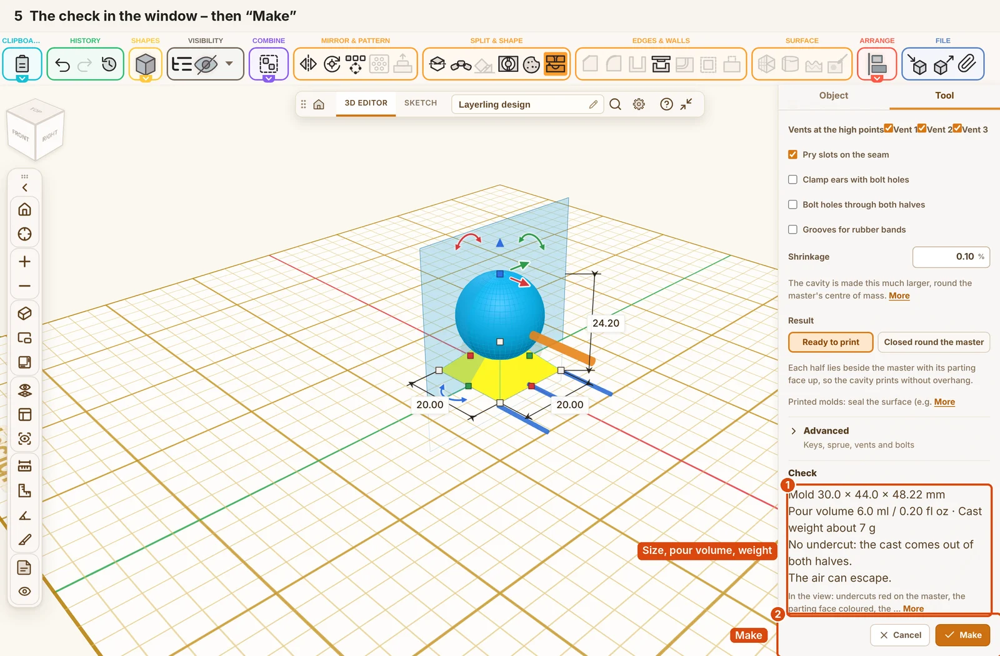

1. **Check**: outside size of the mold, pour volume with the sprue (ml and fl oz), cast weight, undercut, "The air can escape".
2. **Make**.

### B6 – The result

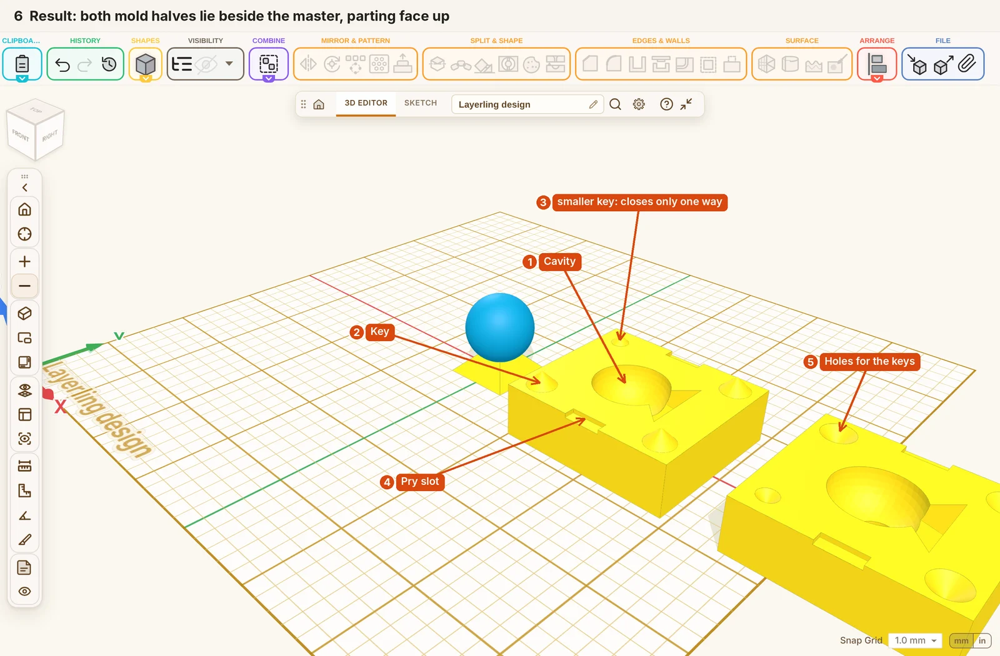

1. **Cavity**.
2. **Key**.
3. **Smaller key**: the halves fit together only one way.
4. **Pry slot** for a screwdriver or spatula.
5. **Holes for the keys** in the other half.

Both mold halves lie with the parting face up, so the cavity prints without overhang. The master stays as it is. **Make the mold again:** select a mold half and click the button. The window opens with the old settings, and the parts are replaced in one undo step.

### B7 – Air trap

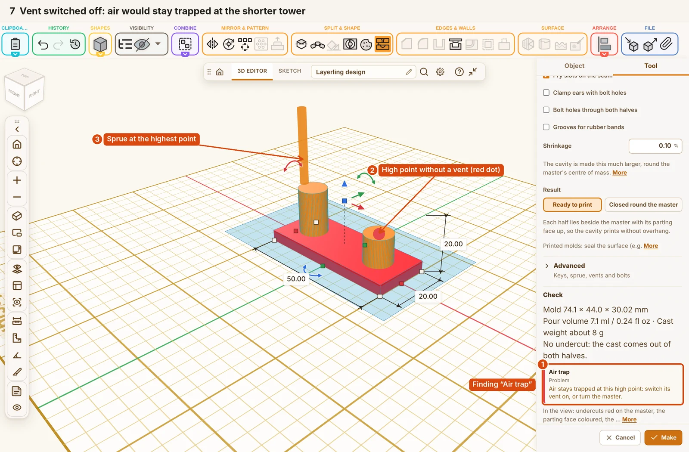

1. Finding **Air trap**, because the vent at the short tower was switched off.
2. **Red dot**: the high point where air would stay trapped.
3. **Sprue** at the highest point (tall tower).

Without a finding, the window says "The air can escape".

---

### B8 – Free opening direction with a drag handle

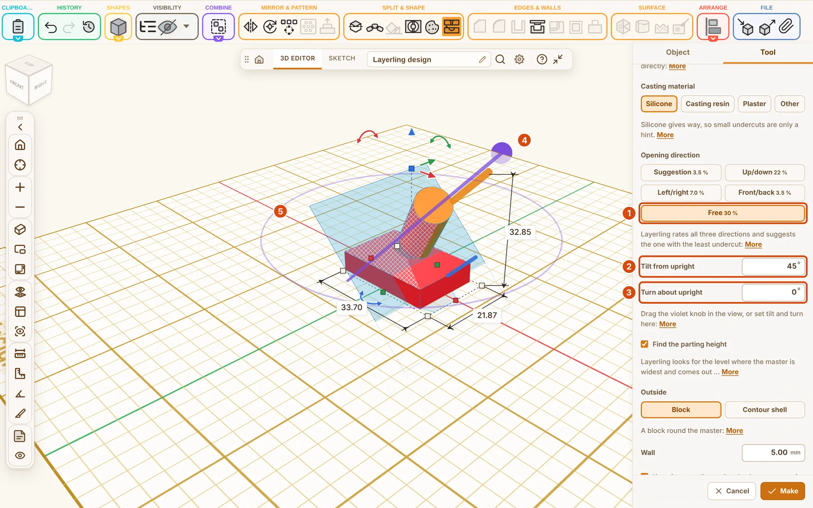

1. **Free**: the mold opens in any direction at all, for a master that comes out best at a slant. The figure is its undercut, to compare with the three straight ways.
2. **Tilt from upright**: 0° opens up and down, 90° sideways.
3. **Turn about upright**: 0° to the right, 90° to the back.
4. **Violet knob**: drag it with the mouse; the arrow, the parting face and the rating follow, and 2 and 3 change with it.
5. **Ring**: the path the knob goes round on.

The halves still lie flat with their parting face up to print. Tip: with straight, parallel walls every degree counts; a master with a little draft is more forgiving.

---

## Part C – Stamp & die with relief

### C1 – Emboss relief

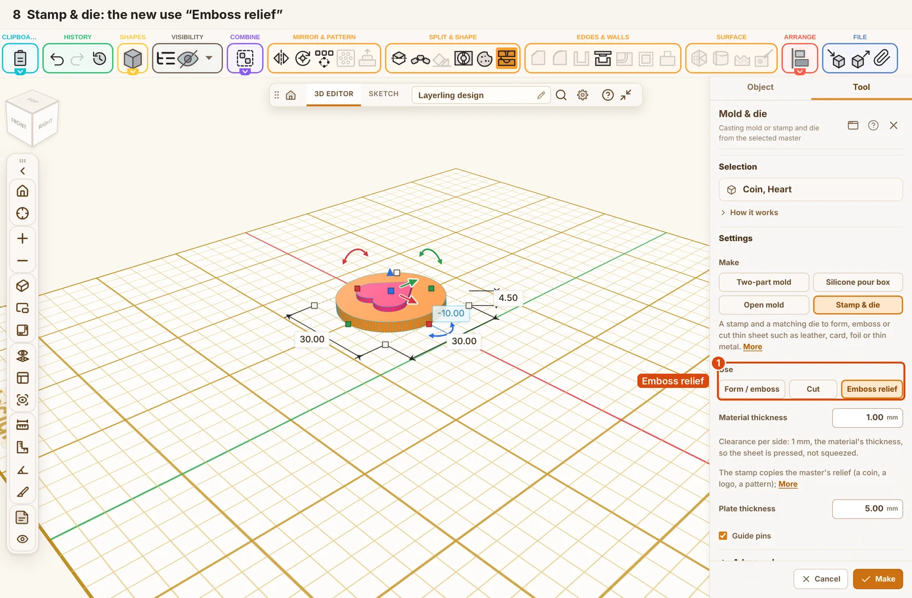

1. Under **Stamp & die**, choose the use **Emboss relief**. The stamp then takes over the master's relief.

### C2 – The result

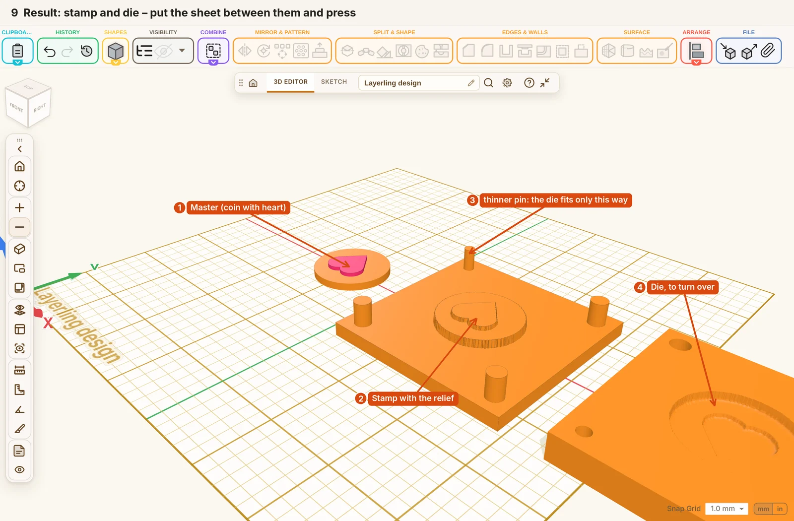

1. **Master**: a coin with a raised heart.
2. **Stamp** with the relief.
3. **Thinner pin**: the fourth guide pin is thinner, so the die fits only one way.
4. **Die**: to turn over onto the stamp. The relief is larger by the sheet's thickness.

Put the sheet (leather, card, foil) between stamp and die and press.

---

## Common mold problems

| Problem | Remedy |
|---|---|
| Undercut (red) | Take the suggested direction, move the parting, turn the master, or use a silicone pour box |
| Air trap | Switch on the vent at this high point, or turn the master |
| Too little draft | Give the faces 1° or more of draft, or cast in silicone |
| Mold too big or heavy | Choose the contour shell, a thinner wall (not under 3 mm) |
| Cast sticks | Seal the mold (resin or wax), use release agent. PLA softens from about 55 °C |

## For AI helpers (MCP)

- New tool `layerling_check_layers`: the print analysis, answering with the list of findings.
- `layerling_make_mold` now takes `direction`, `castMaterial`, `shrinkage`, `density`, `draftLimit`, `outer`, `screws`, `bands`, `ventsOff`, `sprueShiftX/Y`, `output` and `dieMode: "relief"`. The answer includes an `analysis` with the figures for each direction.
