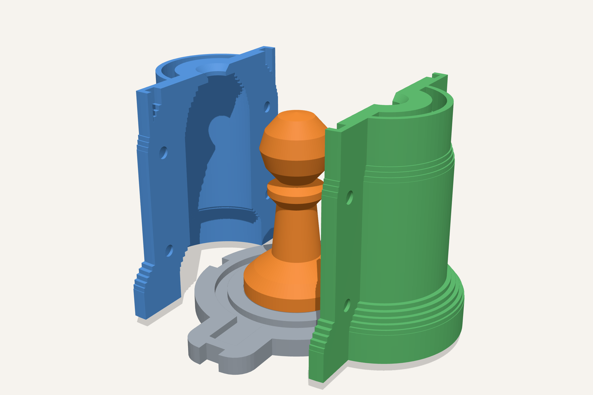
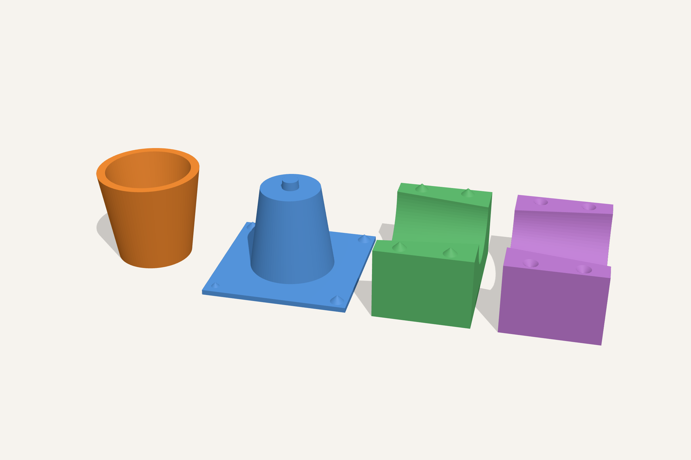
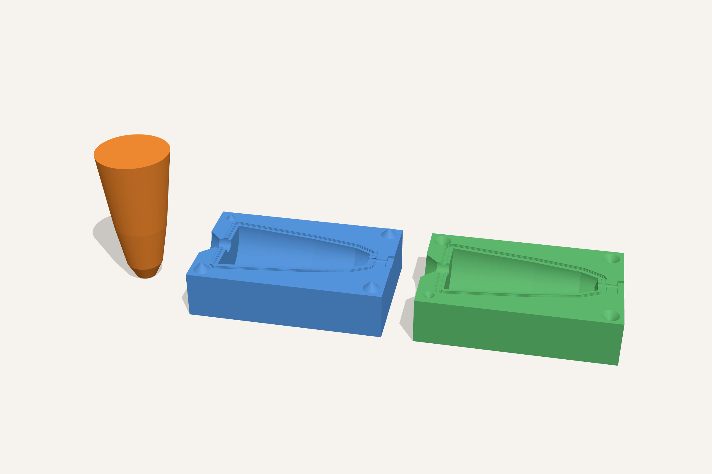
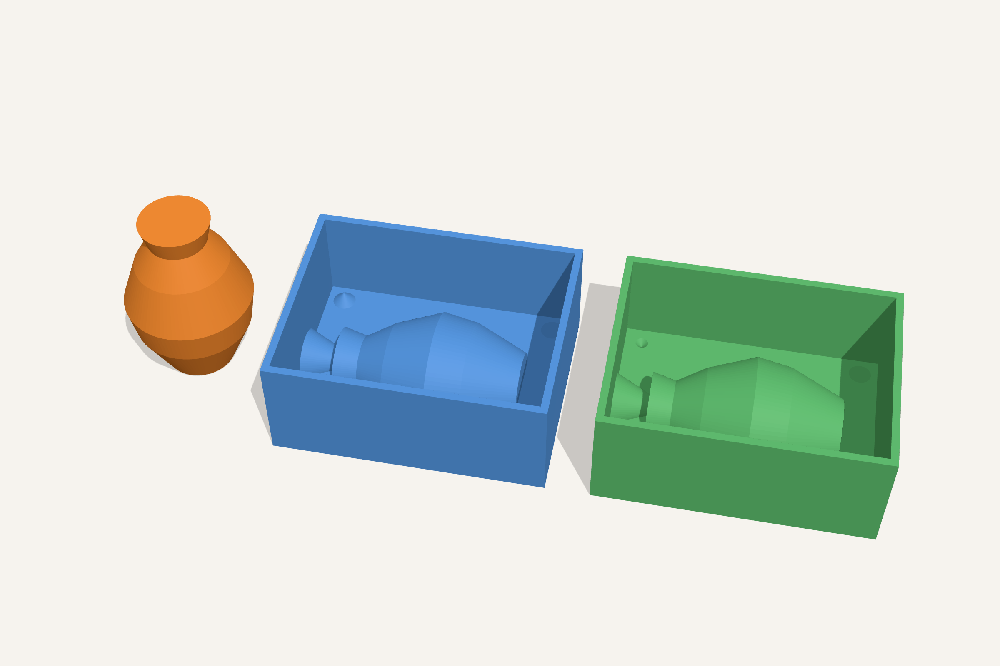
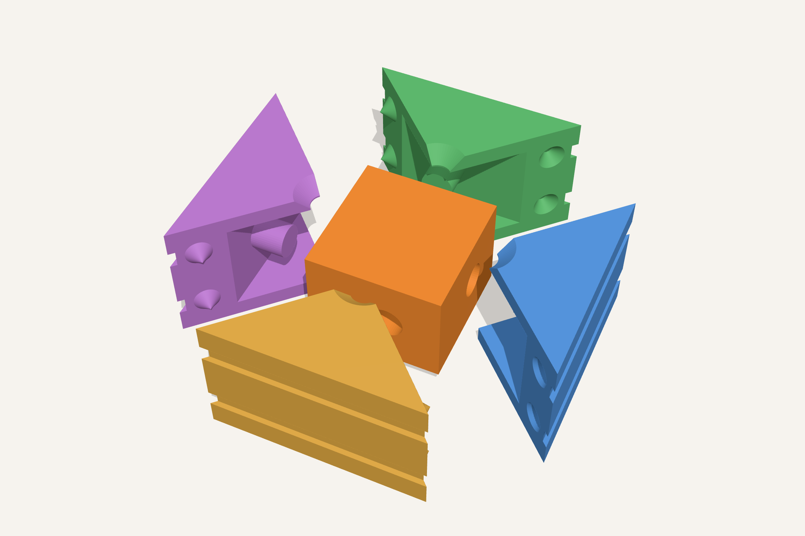

# Beitrag für das GitHub-Forum (Discussions bei henmedia/layerling)

So geht es: Auf https://github.com/henmedia/layerling/discussions auf „New discussion“ klicken, als Rubrik
„Ideas“ oder „Show and tell“ wählen, Titel und den englischen Text unten hineinkopieren. Die Bilder sind schon
verlinkt und erscheinen von selbst. Die deutsche Fassung darunter ist nur für dich zum Mitlesen.

Den Beitrag postest du selbst. Ich schreibe nicht in Stefans Repo.

---

## Titel

Mold & die: silicone skin mold, core mold for planters, candle molds with a wick, and what to mix

## Text (englisch, zum Kopieren)

Hi Stefan, hi everyone,

I have been working on the Mold & die tool again and would like to show you where it stands before I send a pull
request. I looked at what people actually cast (candles, planters, figures, ceramics) and tried to close the gaps.
I would be glad to hear what you think, and what is still missing.

**A silicone skin mold.** Instead of filling a whole box with silicone, the master gets a thin skin of silicone and a
printed shell holds it in shape. For this pawn that is 30 ml of silicone instead of 79 ml, and the window works the
saving out. The shell prints roof down, like a cup, without support, and comes in two halves bolted at a flange.

**A core mold for a vessel.** For planters, cups and vases in concrete or plaster. You select the vessel, and
Layerling finds the hollow and makes a base with the core and a sleeve round the outside, with a pin for a drain
hole if you like. It is cast upside down and poured to the brim.

**Candles and figures poured standing.** A two-part mold can now have its sprue in the seam, half of it in each
half, with a wick hole opposite and a small sealing lip round the cavity.

**Two cases for mold halves.** Each case has half of the master on its plate. Pour silicone or plaster into each and
you have a two-part mold, with natches and a pour channel, and no clay to bed the master in. With plaster and slip as
the casting material, the mold is made larger by what the piece shrinks, for slip casting.

**Four side parts.** Where a master has recesses on all sides, any two halves stick. Four parts that each come off
sideways do not, and the window suggests them when they would do better.

**What to mix.** Under every mold the window now says how much to prepare: the volume, the weight with a little
extra, split by your mixing ratio, and the cost if you give it a price per kg. Wax, soap, concrete and slip are new
casting materials.

To be honest about it: I have not cast any of this in real material yet, and the mixing ratios it starts with are
the usual ones from data sheets. If someone would like to try one of these molds, I would love to see photos and to
hear about everything that does not fit.

The code is on my fork: https://github.com/marcus040473/layerling/pull/5

Thanks for reading!
Marcus

---

## Deutsche Fassung (nur zum Mitlesen)

Hallo Stefan, hallo zusammen,

ich habe wieder am Werkzeug „Gussform & Stanze“ gearbeitet und möchte euch zeigen, wo es steht, bevor ich es als
Pull Request einreiche. Ich habe mir angeschaut, was die Leute wirklich gießen (Kerzen, Übertöpfe, Figuren, Keramik),
und versucht, die Lücken zu schließen. Ich freue mich über eure Meinung und über alles, was noch fehlt.

**Eine Silikon-Hautform.** Statt einen ganzen Kasten mit Silikon zu füllen, bekommt das Urmodell eine dünne
Silikonhaut, und eine gedruckte Schale hält sie in Form. Bei diesem Bauern sind das 30 ml Silikon statt 79 ml, und das
Fenster rechnet die Ersparnis aus. Die Schale wird mit dem Dach nach unten gedruckt, wie ein Becher, ohne Stützen, und
besteht aus zwei Hälften, die an einem Flansch verschraubt werden.

**Eine Kernform für ein Gefäß.** Für Übertöpfe, Becher und Vasen aus Beton oder Gips. Man wählt das Gefäß aus, und
Layerling findet den Hohlraum und macht einen Boden mit dem Kern und einen Mantel für außen, auf Wunsch mit einem
Stift für ein Abflussloch. Gegossen wird kopfüber und bis zur Kante.

**Kerzen und Figuren stehend gießen.** Bei einer zweiteiligen Form kann der Einguss jetzt in der Trennfuge liegen,
je zur Hälfte in beiden Hälften, mit einem Dochtloch gegenüber und einer kleinen Dichtlippe um den Hohlraum.

**Zwei Wannen für Formhälften.** In jeder Wanne steht eine Hälfte des Urmodells auf ihrer Platte. Silikon oder Gips
in beide gegossen ergibt eine zweiteilige Form, mit Zentriernoppen und Eingusskanal und ohne Knete. Mit Gips und
Schlicker als Gießmaterial wird die Form um das größer, was das Stück schwindet, für den Schlickerguss.

**Vier Seitenteile.** Hat ein Urmodell ringsum Vertiefungen, bleiben zwei Hälften immer hängen. Vier Teile, die jeweils
zur Seite abgehen, tun das nicht, und das Fenster schlägt sie vor, wenn sie besser wären.

**Was anzumischen ist.** Unter jeder Form steht jetzt, wie viel man vorbereiten muss: das Volumen, das Gewicht mit
etwas Zugabe, aufgeteilt nach dem Mischverhältnis, und die Kosten, wenn man einen Preis je kg angibt. Wachs, Seife,
Beton und Schlicker sind neue Gießmaterialien.

Ehrlich dazugesagt: Ich habe noch nichts davon in echtem Material gegossen, und die Mischverhältnisse, mit denen es
anfängt, sind die üblichen aus Datenblättern. Wenn jemand eine dieser Formen ausprobieren möchte, freue ich mich sehr
über Fotos und über alles, was nicht passt.

Der Code liegt in meinem Fork: https://github.com/marcus040473/layerling/pull/5

Danke fürs Lesen!
Marcus
