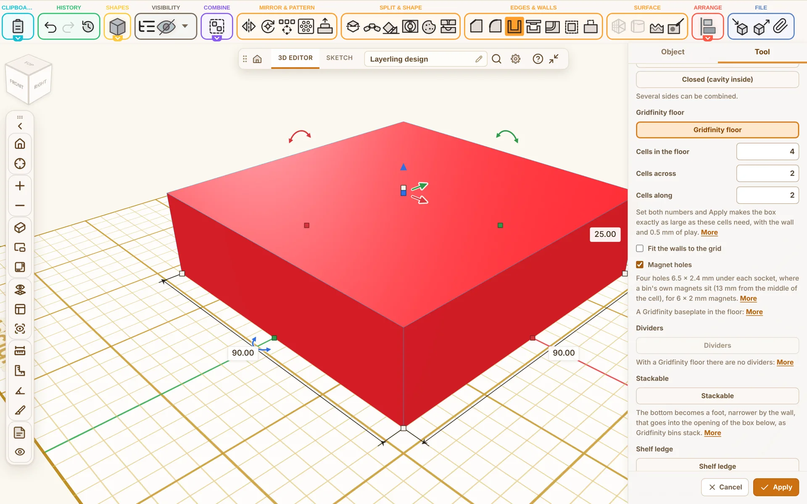
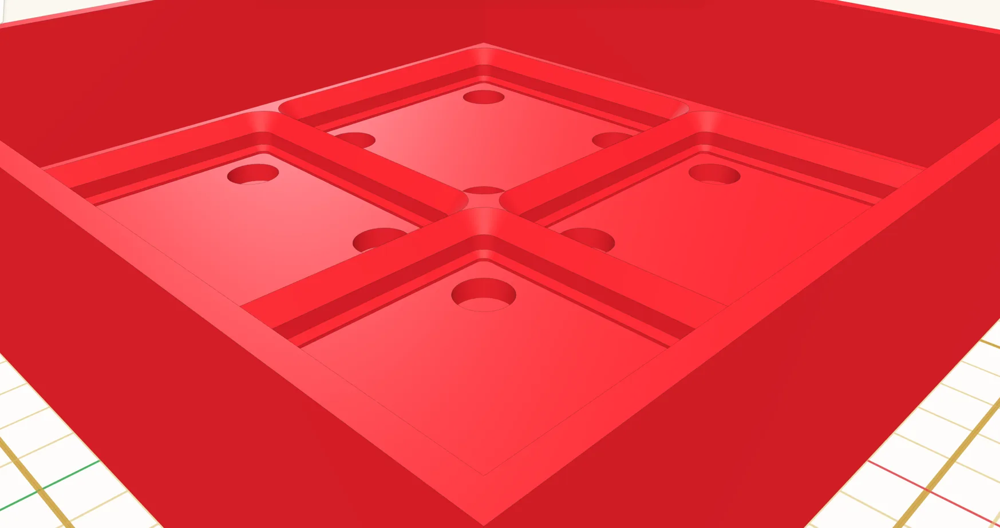

# Antwort an mlugo-apx in Discussion #1693 (Gridfinity-Boden)

Link: https://github.com/henmedia/layerling/discussions/1693 – als Antwort unter seinen Kommentar „Please go ahead …“.

---

## English (zum Posten)

Thanks for the go-ahead and for offering to review the geometry, @mlugo-apx! I went through your three points:

1. **Floor thickness:** the floor is the baseplate's 5 mm socket plus a closed floor of 1.2 mm under it, 6.2 mm. With magnet holes it is 8.6 mm, so the 1.2 mm stays under the holes too. A box too low for it is refused.
2. **Only whole 42 mm cells:** the sockets come from the existing baseplate code (`gridfinityOutlineCells`, the socket profile `GRIDFINITY_SOCKET`), only for whole cells that fit the inside, nearest the middle; what is left round them stays a solid, level border. *Fit the walls to the grid* thickens the walls instead, so the inside is exactly the cells plus 0.5 mm of play. If not even one cell fits, it is refused.
3. **Magnet holes:** new, as you suggested. Four holes 6.5 × 2.4 mm under each socket, where a bin's own magnets sit (13 mm from the cell's middle each way), with the same constants as the bins (`GRIDFINITY_MAGNET_DIAMETER`, `_DEPTH`, `_OFFSET`). I left screw holes out for now: in a box's floor they would go through the bottom. Would you want them anyway (for screwing the box down), or rather not?

It's on the branch `box-gridfinity` in my fork, on the current `main`, with tests against the real kernel (sockets, the border, the holes' places and depth, the volume). I'll open the PR when Stefan is back; your review of the geometry before or in the PR would be very welcome.

Cheers,
Marcus

---

## Deutsch (zum Nachlesen)

Danke für das „Go“ und dass du die Geometrie prüfen willst, @mlugo-apx! Ich bin deine drei Punkte durchgegangen:

1. **Bodendicke:** Der Boden ist die 5-mm-Mulde der Grundplatte plus 1,2 mm geschlossener Boden darunter, also 6,2 mm. Mit Magnetlöchern 8,6 mm, damit die 1,2 mm auch unter den Löchern bleiben. Eine zu niedrige Box wird abgelehnt.
2. **Nur ganze 42-mm-Felder:** Die Mulden kommen aus dem vorhandenen Grundplatten-Code, nur für ganze Felder, die in den Innenraum passen, von der Mitte aus; der Rest bleibt ein fester, ebener Rand. „Passend zum Raster“ verdickt stattdessen die Wände, sodass der Innenraum genau die Felder plus 0,5 mm Spiel ist. Passt kein einziges Feld, wird abgelehnt.
3. **Magnetlöcher:** neu, wie vorgeschlagen. Vier Löcher 6,5 × 2,4 mm unter jeder Mulde, dort wo die Magnete der Behälter sitzen (13 mm von der Feldmitte), mit denselben Maßen wie bei den Behältern. Schraublöcher habe ich vorerst weggelassen: Im Boden einer Box gingen sie durch den Boden. Möchtest du sie trotzdem (zum Festschrauben der Box)?

Liegt im Zweig `box-gridfinity` in meinem Fork, auf dem aktuellen `main`, mit Tests am echten Rechenkern. Den PR öffne ich, wenn Stefan zurück ist; deine Prüfung vorher oder im PR ist sehr willkommen.

Viele Grüße
Marcus
