# Drei Pull Requests für Stefan (henmedia/layerling)

Jeder PR ist ein eigener Zweig in deinem Fork, frisch auf Stefans neuestem `main` (dd02d0ef0) gebaut, ohne den angedockten Werkzeug-Bereich: die Fenster sehen aus wie bei Stefan (schwebend). So kann Stefan jeden PR für sich übernehmen.

| PR | Zweig | Öffnen (Link anklicken, Text unten einfügen, „Create pull request“) |
|---|---|---|
| 1 Gussform & Prägestempel | `mold-die` | https://github.com/henmedia/layerling/compare/main...marcus040473:layerling:mold-die?expand=1 |
| 2 Druckanalyse mit Schichtansicht | `layer-check` | https://github.com/henmedia/layerling/compare/main...marcus040473:layerling:layer-check?expand=1 |
| 3 Boxen & Gridfinity (Aushöhlen + Deckel) | `box-gridfinity` | https://github.com/henmedia/layerling/compare/main...marcus040473:layerling:box-gridfinity?expand=1 |
| 4 Schraube längs teilen, mit Zentrierstiften | `bolt-split` | https://github.com/henmedia/layerling/compare/main...marcus040473:layerling:bolt-split?expand=1 |

So geht's: Link öffnen → oben steht „Able to merge“ → Titel und Text aus dem Kasten unten hineinkopieren → **Create pull request**. Stefan ist bis 22.11. weg, er sieht sie danach.

Hinweis: PR 1 und PR 2 bringen beide die Datei `findings.ts` (die gemeinsame Befundliste) und die `finding.*`-Texte mit. Die Datei ist in beiden gleich; wenn Stefan den einen übernommen hat, kann es in den Sprachdateien beim zweiten einen kleinen Konflikt geben. Das steht im Text unter „Notes“, ich löse ihn dann mit einem Merge von `main`.

**Bewusst nicht dabei:** der Box-Generator (eigene Form „Box“ mit Fächern, Deckel und Gridfinity-Optionen). Den hattest du am 13.11. pausiert, und er hängt am angedockten Eigenschaften-Fenster, das es bei Stefan nicht gibt. Er bleibt in `marcus`.

---

## PR 1 – Gussform & Prägestempel

**Titel:**

```
Mold & die: suggested opening direction, casting material, vents, contour shell and relief stamps
```

**Text:**

```markdown
## Summary

Follow-up to the Mold & die tool, with the wishes from the Facebook group and Discussion #1806.

- **Opening direction:** all three directions (X, Y, Z) are rated with a visibility check per face, not only from the face normals, and the best one is suggested. Each button shows the share of the surface that would stick. Undercuts are painted red on the master.
- **Casting material** (silicone, casting resin, plaster, wax, soap, concrete …): silicone gives way, so small undercuts are only a hint there; the material also sets shrinkage and density.
- **Check before making:** outside size, pour volume with the sprue (ml and fl oz), cast weight, undercut, and an **air trap** finding with a red dot where air would stay. Vents can be switched on and off one by one.
- **Several masters, several sprues:** a mold of several parts (a tray of six soap bars, say) gives each separate cavity its own sprue and funnel, so every one fills; before, only the highest got one.
- **Outside:** a block or a **contour shell** (saves filament, prints without support), plus bolt holes, rubber band grooves, sprue shift (X/Y), draft check, and an assembled output.
- **Make the mold again:** the parts remember their settings; select a half, change something, and the parts are replaced in one undo step.
- **Stamp & die:** a new **Emboss relief** mode copies the relief of a coin or logo into the stamp; the fourth guide pin is thinner so the die fits only one way; a warning for details too fine for the sheet.
- MCP: `layerling_make_mold` takes `direction`, `castMaterial`, `shrinkage`, `density`, `draftLimit`, `outer`, `screws`, `bands`, `ventsOff`, `sprueShiftX/Y`, `output`, `dieMode: "relief"` and answers with an `analysis`. Guide chapter 6 and the AI chapter updated, texts in all languages.

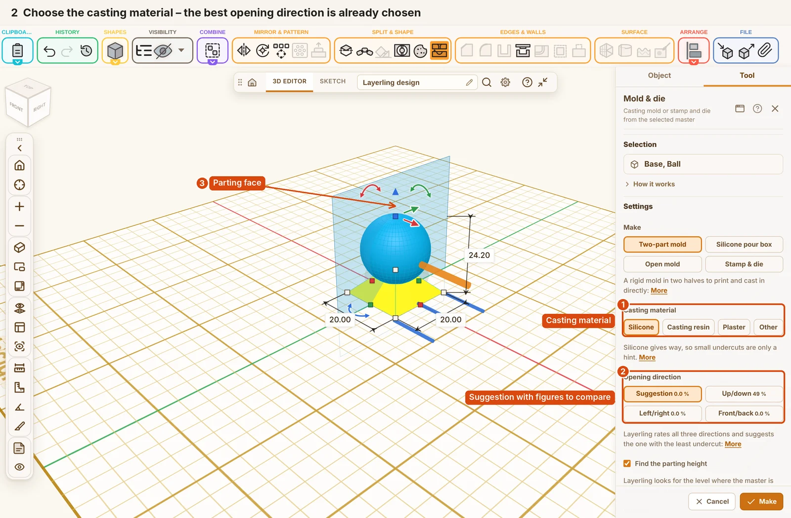
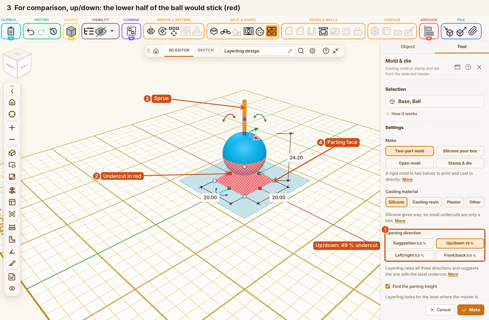
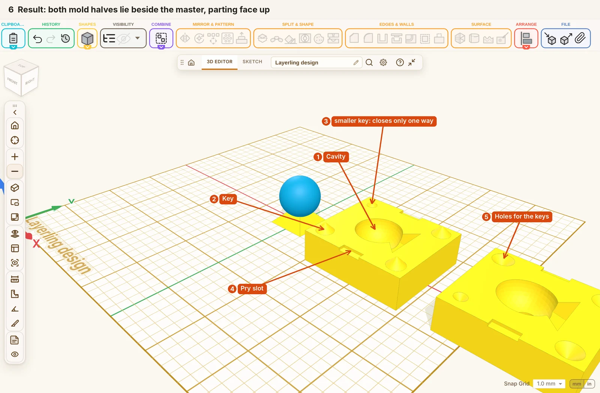
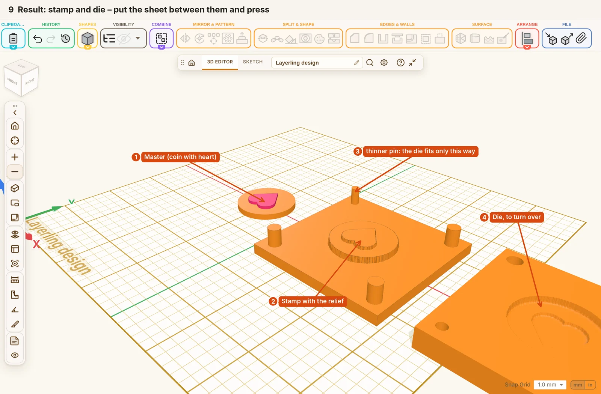

## Testing

- [x] `npm run typecheck`
- [x] `npm test` (634 files, 5943 tests)
- [x] e2e: `moldTool` and the new `moldDirections` (22 tests)
- [x] Manually tested the affected workflow (block and contour shell, air trap with a vent switched off, six masters in one mold, relief die)

## Notes

- Built on the current `main`, in the floating panel style.
- The shrinkage and density presets are values from data sheets; happy to change them.
- This PR and the print analysis PR both add `lib/findings.ts` (the shared list of findings) and the `finding.*` texts. The file is identical in both; if one is merged first, I'll merge `main` into the other.
- Not in yet, on purpose: a free opening direction with a rotate handle, and dragging the sprue and vents with the mouse.

🤖 Generated with [Claude Code](https://claude.com/claude-code)

https://claude.ai/code/session_01U6NM2J7dd79pkwCMPxv7JA
```

---

## PR 2 – Druckanalyse mit Schichtansicht

**Titel:**

```
Print analysis: every layer checked in one go, as a list of findings, with a layer view that shows why
```

**Text:**

```markdown
## Summary

A new **Print analysis** button next to Print check. It cuts the selected parts (or all visible ones) into layers at the slicer's layer height and compares each layer with the one below, in the geometry worker, with a progress bar and Stop.

- **Findings** in one list, problems (red) before hints (yellow): in the bed, floating, open mesh, larger than the build volume, area without support, overhang (hint from 45°, problem from 60°), bridge over 10 mm, thin wall (under 2 × nozzle), small island, too little bed adhesion. The same finding on layers in a row counts as one. Each says what helps, many with a button for it (Lay on workplane, Lay flat, Support rib). Filter by kind and part.
- **Layer view:** a click on a finding jumps there. The part is cut open at that layer, the spot painted, the layers below stay visible and the ones to come are faint. Upright layer slider with a mark per finding, a chart of the cross-section over the height, Up to here / Only this layer / From – to, playback, and keys (↑ ↓, Page, Home/End, N for the next finding).
- After a change the list is marked out of date; one click checks again. Closing it puts the camera back.
- A part with 100,000 triangles takes about a second at 0.2 mm.
- MCP: new tool `layerling_check_layers`. Guide chapter 11 and the AI chapter updated, texts in all languages.

It is no slicer preview: supports, infill and print time still come from the slicer.

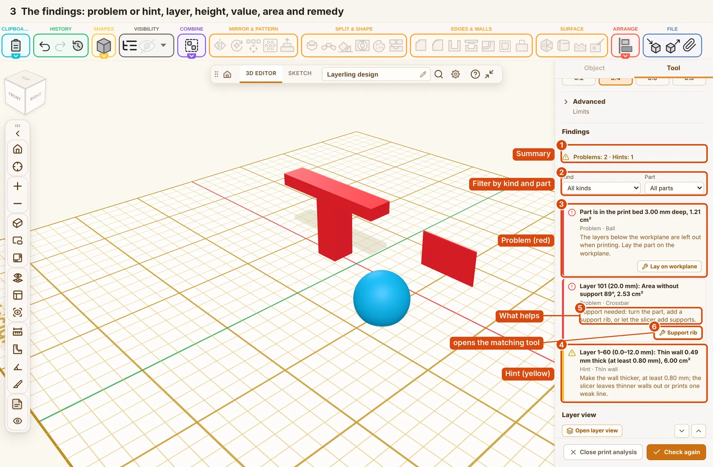
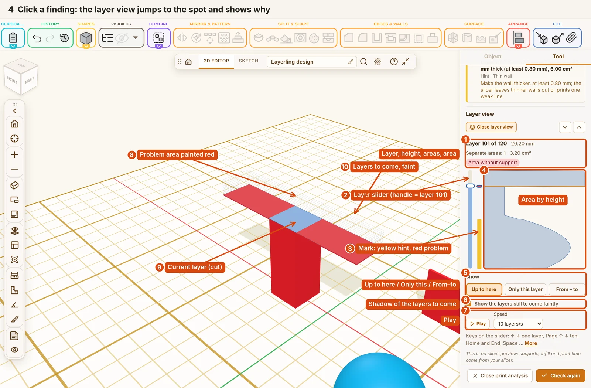

## Testing

- [x] `npm run typecheck`
- [x] `npm test` (633 files, 5947 tests)
- [x] e2e: new `layerCheck` (14 tests)
- [x] Manually tested the affected workflow (findings, layer view, remedy buttons, out of date and check again)

## Notes

- Built on the current `main`, in the floating panel style.
- The limits (45°/60°, 10 mm, 2 × nozzle, 2 mm²) are under Advanced; glad to hear if other defaults suit better.
- This PR and the mold PR both add `lib/findings.ts` and the `finding.*` texts. The file is identical in both; if one is merged first, I'll merge `main` into the other.

🤖 Generated with [Claude Code](https://claude.com/claude-code)

https://claude.ai/code/session_01U6NM2J7dd79pkwCMPxv7JA
```

---

## PR 3 – Boxen & Gridfinity (Aushöhlen + Deckel)

**Titel:**

```
Hollow and Lid: Gridfinity floor, dividers, stacking with a foot, stacking tops, slide latches and barrel bolts
```

**Text:**

```markdown
## Summary

Boxes made with Hollow and Lid, from Discussions #1693, #1560 and #1587 and the Facebook group.

**Hollow (top open)**
- **Gridfinity floor** (#1693): the floor becomes a Gridfinity baseplate, 6.2 mm thick, with a socket for each whole 42 mm cell the inside holds (as many as set). *Fit the walls to the grid* thickens the walls so the inside is exactly the cells with 0.5 mm play; *Cells across/along* sizes the box from cells.
- **Dividers** across and along, with height and thickness as in a Gridfinity bin (#1560); they end level with a shelf ledge.
- **Stacking with a foot**, the way Gridfinity bins stack: the bottom becomes a foot, narrower by the wall and 0.25 mm per side, that goes into the box below, widening at 45° – so every lid still fits. Works with rounded corners and edges. Optional **hollow foot** and **grip recesses** on any sides (width, depth, height, position), all printable without support.
- A body changed after hollowing says why it cannot be hollowed again; surface texture treats Gridfinity sockets as inside.

**Lid**
- **Stacking top** for plug, flat, cap, both, screw and bayonet lids: printed upright with a solid foot, a 45° flare and a tray the next box's foot goes into; works with a hinge and with latches.
- Two new **latch kinds** (#1587): **sliders** as on a tool case (a dovetail rail on the body, a slider printed flat beside the lid, a label such as OPEN cut in) and **barrel bolts** printed in place in a tube on the wall. Clips stay the default.
- Magnets that would reach into a Gridfinity floor's cells are refused with the box size needed.
- MCP: `layerling_hollow_object` takes `gridCells`, `gridFit`, `dividersX/Z`, `dividerHeight`, `dividerThickness`, `stackHollow`, `stackGrip…`; `layerling_make_lid` takes `stackTop`, `latchStyle`, `slider…`, `bolt…`, `latchLabel`. Guide chapter 6 updated, texts in all languages.

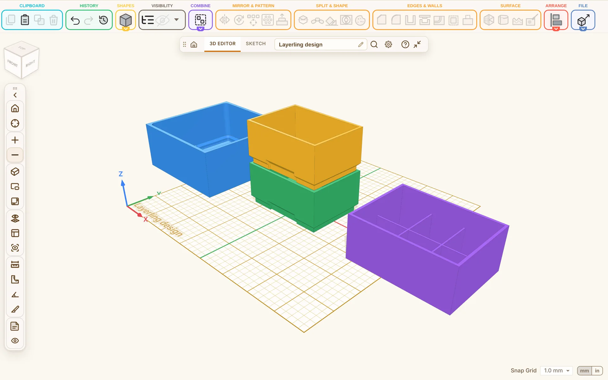
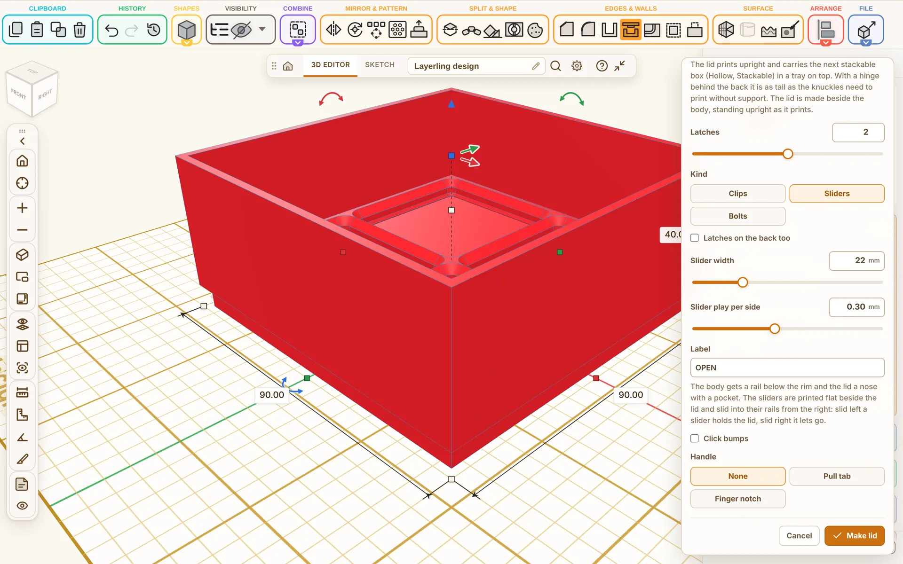
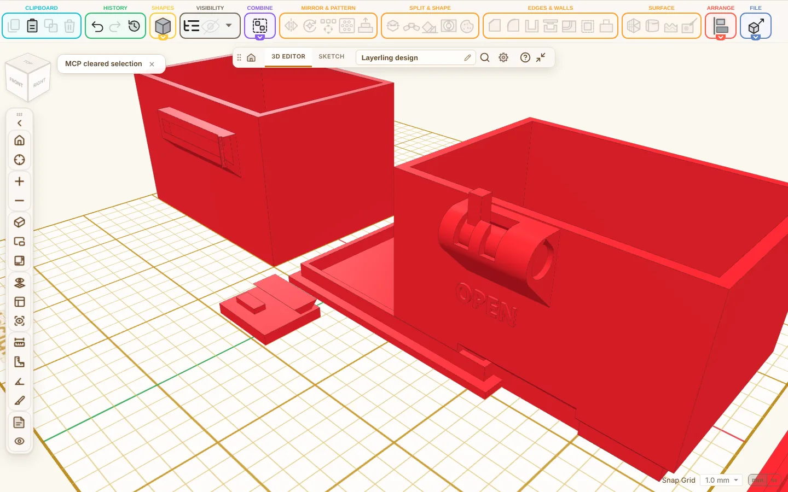

## Testing

- [x] `npm run typecheck`
- [x] `npm test` (635 files, 5948 tests)
- [x] e2e: all `cadShell*`, `lid*`, `cadGridfinity*`, `gridfinity*Panel` and `surfaceTexture*` (47 files, 483 tests), new ones among them: `cadShellGrid`, `cadShellStackRounded`, `lidStackTop`, `lidSlider`, `surfaceTextureGridFloor`
- [x] Manually tested the affected workflow (Hollow with Gridfinity floor and stacking, lids with sliders and bolts)

## Notes

- Built on the current `main`, in the floating panel style.
- **Stacking changes:** the earlier collar-and-groove stacking is replaced by the foot, so stackable boxes take any lid.
- The box generator (a Box shape with compartments) is not part of this; it is still being reworked.

🤖 Generated with [Claude Code](https://claude.com/claude-code)

https://claude.ai/code/session_01U6NM2J7dd79pkwCMPxv7JA
```

---

## PR 4 – Schraube längs teilen und flach legen

**Titel:**

```
Screws and threaded rods: split lengthwise and lay flat for printing, with centring pins
```

**Text:**

```markdown
## Summary

A screw printed standing breaks along its layers under the first real load; printed lying down its thread is many times stronger (an idea from the Facebook group and GitHub).

- A new button in the properties of a screw or threaded rod, **Split lengthwise and lay flat**, cuts it in two through its own axis (however it is turned on the workplane) and lays both halves on their cut faces where it stood, in one undo step. The thread's flanks rise from the bed without support; the halves are glued afterwards.
- **Centring pins** (on by default) line the halves up exactly, along the axis too, so the turns of both halves meet and the nut does not jam: always one in the head (on the axis past the drive's floor, else beside the drive) and one to three along the thread by its length (a rod gets one near each end). Where the thread's own pin does not fit, thinner pins (down to 1.5 mm) and a thinner wall are tried; under M6 the core is too thin and only the head gets one.
- The holes are square to the cut face and end in a 45 degree cone, so no hole needs a bridge; the pins print standing, chamfered, with the printer's play.
- MCP: new tool `layerling_split_bolt` (`pins`, `pinPlay`). Guide chapters 9 and 14, texts in all languages.

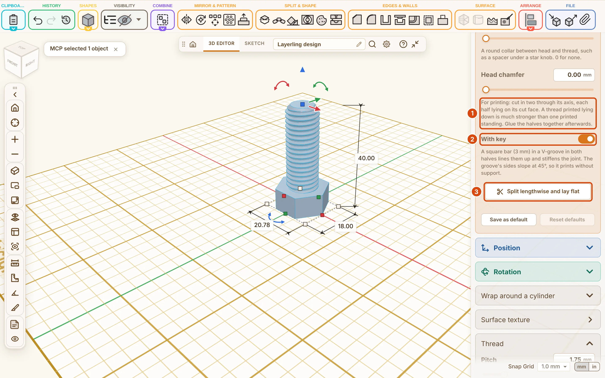
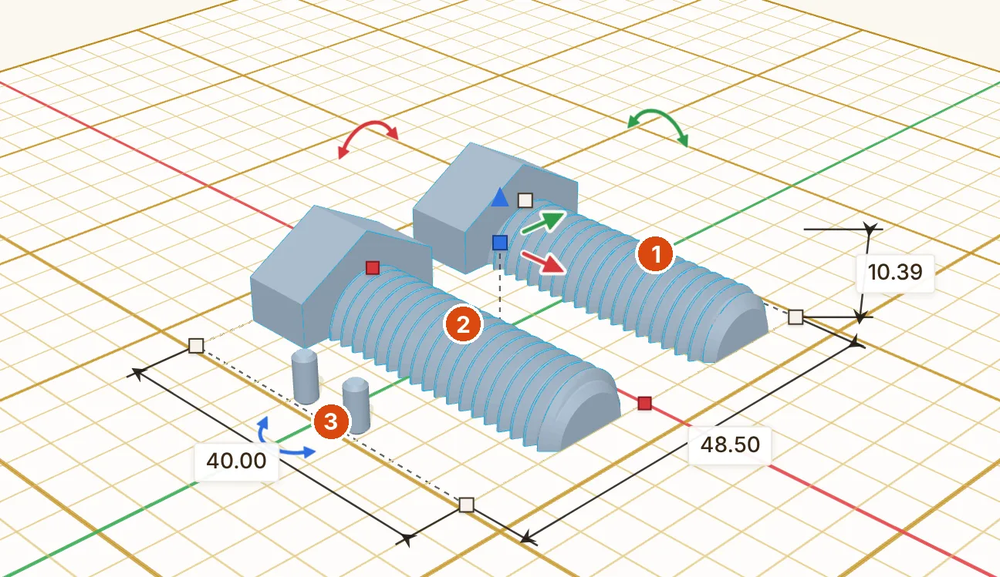
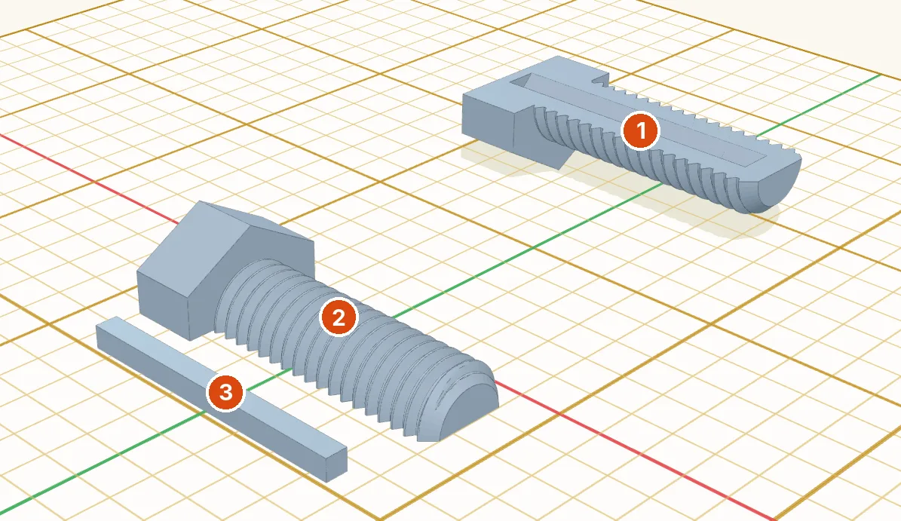

## Testing

- [x] `npm run typecheck`
- [x] `npm test` (633 files, 5939 tests)
- [x] e2e: new `boltSplit` (13 tests: halves equal and flat on their cut faces, holes in the same places in both, nothing facing down above the bed, a pin in the head and in the thread from M6 to M16 with cylinder, countersunk, hex, wing and knob heads, a 70 mm rod gets three, a turned screw is split along its own axis)
- [x] Manually tested the affected workflow (M12 hex screw: two halves and two pins, undo)

## Notes

- Built on the current `main`, in the floating panel style.
- The head stays split with its half rather than being a separate piece screwed on: simpler and stronger.
- Why pins and not a key in a groove: the glued face carries the load (each half takes its share from the head through its own turns into the nut, and the flanks press the halves together); what matters is that the halves meet exactly along the axis, which a lengthwise key cannot hold.

🤖 Generated with [Claude Code](https://claude.com/claude-code)

https://claude.ai/code/session_01U6NM2J7dd79pkwCMPxv7JA
```
