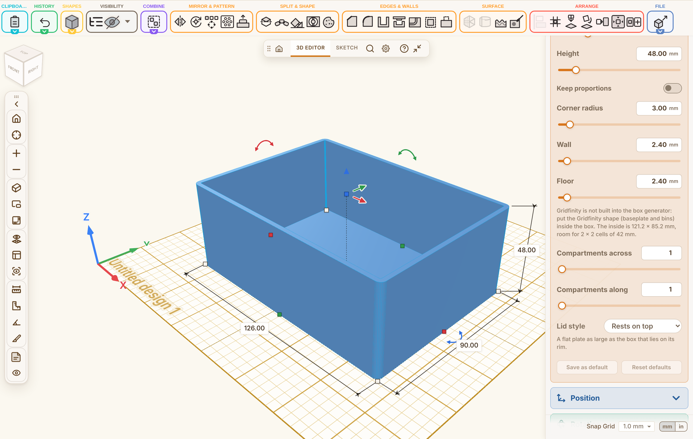

## Summary

Hi Stefan, a box generator, so that a box and its lid come from a few settings instead of a fixed template (Discussion #1619 asked for something like it; there is a generator of that kind on MakerWorld, but it is OpenSCAD code, so this one is built into Layerling).

- A new shape, **Box generator**, in the shape library. Only the settings are saved; the body is rebuilt from them, so a project always opens the same.
- Outline: rectangle (with a corner radius), round or oval, or a polygon with 3 to 12 corners. Wall and floor start at 2.4 mm.
- Compartments: columns and rows of fixed dividers, one piece with the wall and the floor. A compartment narrower than 2 mm stays solid and the panel says so.
- Lid: a copy of the shape set to Lid. It either rests on the box or has a skirt that goes down over the outside, with a fit per side; the panel gives the size that fits.
- A wall too thick for the box is reported instead of drawing a solid block in silence.
- **Gridfinity:** the generator does not build any Gridfinity of its own. Under Floor the panel says that the Gridfinity shape goes inside the box, and gives the inside of a rectangular box and how many cells of 42 mm fit across and along it (from the Gridfinity constants that are already there).
- MCP settings, the guide and the texts in every language are included.

## Testing

- [x] `npm run typecheck`
- [x] `npm test` (5627 passed, 5 skipped)
- [x] `npm run test:e2e` (1447 passed)
- [x] `npm run guide`, `npm run i18n:status`
- [x] Manually tested the affected workflow (box and lid, the round outline, the Gridfinity hint)

## Notes

- Hinges, latches and stacking are not part of this shape yet; the Hinge, Snap-fit and Gridfinity shapes can be used next to it.
- Thanks for looking at it!
