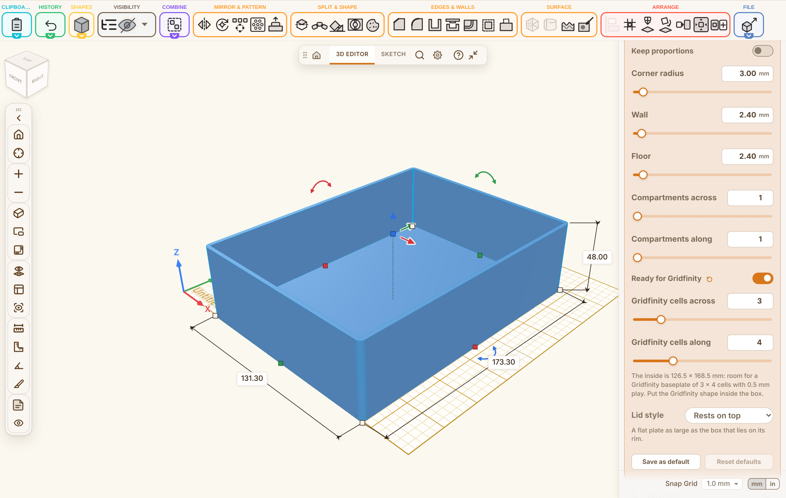
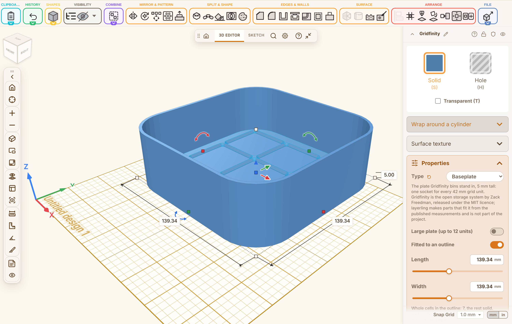

## Summary

Hi Stefan, a box generator, so that a box and its lid come from a few settings instead of a fixed template (Discussion #1619 asked for something like it; there is a generator of that kind on MakerWorld, but it is OpenSCAD code, so this one is built into Layerling).

- A new shape, **Box generator**, in the shape library. Only the settings are saved; the body is rebuilt from them, so a project always opens the same.
- Outline: rectangle (with a corner radius), round or oval, or a polygon with 3 to 12 corners. Wall and floor start at 2.4 mm.
- Compartments: columns and rows of fixed dividers, one piece with the wall and the floor. A compartment narrower than 2 mm stays solid and the panel says so.
- Lid: a copy of the shape set to Lid. It either rests on the box or has a skirt that goes down over the outside, with a fit per side; the panel gives the size that fits.
- A wall too thick for the box is reported instead of drawing a solid block in silence.
- **Gridfinity:** the generator builds no Gridfinity of its own; the existing Gridfinity shape goes inside the box. Two switches that exclude each other prepare the box for it:
  - *Gridfinity: box from cells*: type the cells in one field, for example "3 x 4". A rectangular box takes the size whose inside holds a baseplate of exactly those cells, 42 mm each with the 0.5 mm drawer play, and also allows for the rounded corners of the inside (a plate with the Gridfinity corner radius needs more room the larger the box's corner radius is). It keeps the fit when the wall or the corner radius changes. A round or many-sided box is not resized: the panel says whether the grid fits and names the largest grid that fits.
  - *Gridfinity: fit the floor*: the box keeps the size it is given, whatever its outline, and the panel says how many whole cells its inside holds (counted by the baseplate's own function). The plate is then fitted with the existing *Fit baseplate to outline*; for a box from this generator that action now reads the inside of the wall instead of the whole outline, so the plate sits on the floor with the whole cells that fit and the rest solid.
- MCP settings, the guide and the texts in every language are included.

## Testing

- [x] `npm run typecheck`
- [x] `npm test` (5632 passed, 5 skipped)
- [x] `npm run test:e2e` (1447 passed)
- [x] `npm run guide`, `npm run i18n:status`
- [x] Manually tested the affected workflow (box and lid, the round outline, both Gridfinity switches, and the baseplate fitted into the box)

## Notes

- Hinges, latches and stacking are not part of this shape yet; the Hinge, Snap-fit and Gridfinity shapes can be used next to it.
- Thanks for looking at it!
