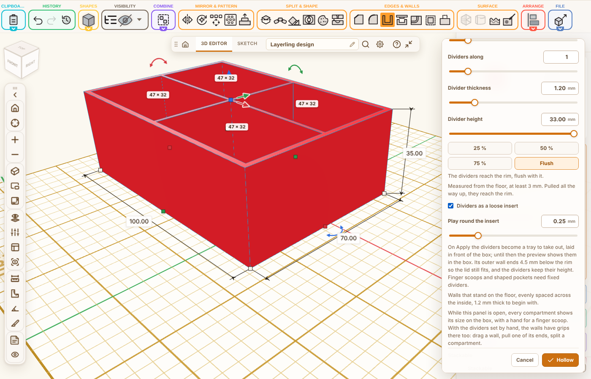
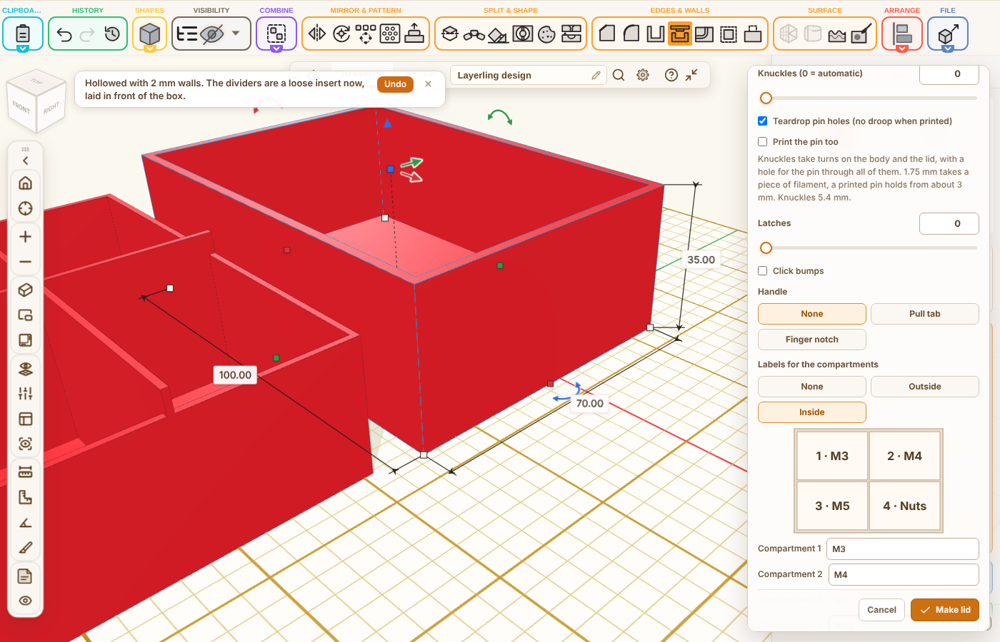
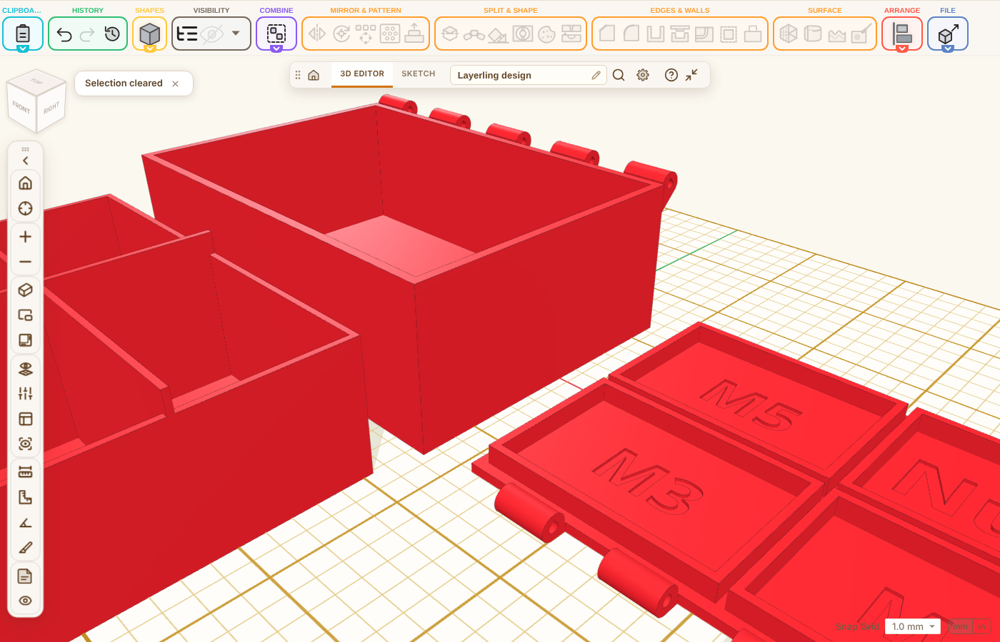
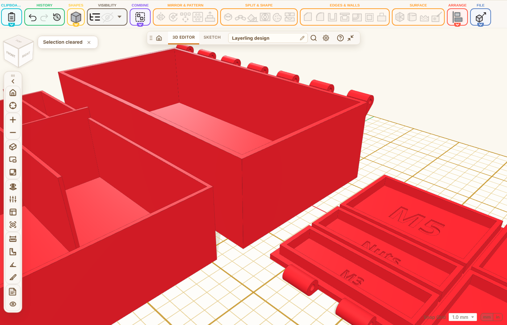

# Titel

Deckel: folgt seiner Box, Beschriftung der Fächer; Aushöhlen: Trennstege als loser Einsatz

# Text (Übersetzung für dich – in den PR kommt der englische Text)

## Zusammenfassung

Fortsetzung von #1974 (Trennstege von Hand, Griffmulden, Formfächer). Damit arbeiten eine Box mit Fächern und ihr Deckel vom ersten Klick bis zum Druck zusammen. Alles Neue ist freiwillig und aus, bis man es einschaltet; vorhandene Entwürfe bleiben unberührt.

**Vom Aushöhlen zum Deckel**

- Klickt man bei offenem Aushöhlen neben den Körper, geht das Aushöhlen nicht mehr verloren. Verlässt man das Werkzeug durch eine andere Auswahl, bleibt erhalten, was es zeigte, wie bei „Anwenden“ (ein Rückgängig-Schritt). „Abbrechen“ bricht weiter ab.
- „Anwenden und Deckel machen“ im Aushöhlen-Fenster behält das Aushöhlen und öffnet das Deckel-Werkzeug für die Box. Dasselbe passiert, wenn man das Deckel-Werkzeug bei offenem Aushöhlen aus der Leiste öffnet; vorher wurde der Deckel für den vollen Block gemacht.

**Deckel**

- Eine schräg gedrehte Box bekommt Scharnier, Verschlüsse, Griff und Magnete entlang ihrer eigenen Seiten; vorher wurde sie abgelehnt.
- Der Deckelrand folgt einem Absatz unter der Kante als Stufe (niedrigere Stege, Füllung mit Formfach), statt hineinzuragen.
- „Beschriftung der Fächer“ (Eingesteckt, Übergestülpt, Beidseitig, Flach): Das Fenster zeigt die Box von oben mit nummerierten Fächern und nimmt je Fach einen Text, außen oder innen. 0,6 mm vertieft, nie erhaben: Der Deckel druckt flach und bleibt stapelbar. Es sind Textobjekte, später änderbar. Beim Stapeldeckel stehen sie in der Mulde.
- Der Deckel folgt seiner Box: Er merkt sich Box und Einstellungen. Wird die Box neu ausgehöhlt (andere Fächer, andere Wand) oder in der Größe geändert, wird der Deckel an seinem Platz neu gemacht, samt Stift, Clips oder Stopfen, im selben Rückgängig-Schritt. Beschriftungen bleiben bei ihrem Fach.
- Das gilt auch für eine Box, an die der Deckel Teile gesetzt hat (Scharnier-Knöchel, Magnettaschen): Aushöhlen öffnet sich für die Box in der Gruppe; beim Ändern der Größe wird sie neu gebaut statt gestreckt.
- Öffnet man das Deckel-Werkzeug auf einer Box, die schon einen Deckel hat, startet es mit dessen Einstellungen, und „Anwenden“ ändert diesen Deckel, statt einen zweiten zu machen.

**Aushöhlen: Trennstege als loser Einsatz**

- Mit „Trennstege als loser Einsatz“ bleibt die Box innen glatt, und die Stege werden eine eigene Schale vor der Box: 0,8 mm Platte, die Stege und eine Wand um jedes Fach, sodass der Inhalt beim Herausheben mitkommt.
- Spiel rundum 0,25 mm (0,05 bis 1). Die Schale passt an jeder Höhe in die Öffnung und spart die Pfeiler für Deckel-Magnete aus.
- Ihre Außenwand endet 4,5 mm unter der Kante, wo der Deckelrand an der Box-Wand eingreift (mehr bei tieferem Rand). Die Stege behalten ihre Höhe, der Deckelrand sitzt neben ihnen, und jedes Fach ist für sich verschlossen. Der Deckel bekommt weiter Rand und Beschriftung je Fach.
- Solange das Werkzeug offen ist, zeigt die Vorschau die Stege in der Box. Der Einsatz folgt der Box wie der Deckel und verschwindet, wenn die Stege wieder fest sind. Griffmulden und Formfächer gibt es mit Einsatz nicht.

**Zurechtfinden**

- Im Eigenschaften-Bereich erscheint für eine ausgehöhlte Box, ihren Deckel oder ihren Einsatz ein Kärtchen: wozu das Teil gehört, und „Fächer ändern“ sowie „Deckel machen“ / „Deckel ändern“. Im Deckel-Fenster gibt es ebenfalls „Fächer ändern“.
- Auf dem Touch-Bildschirm sind die Häkchen der Werkzeuge fingergroß.

Texte in den 15 Sprachen, die ich vollständig halte, Anleitung Kapitel 6 in 16. Schnittstelle: `make_lid` nimmt `labelSide` und `labels`; `hollow_object` nimmt `dividerInsert` und `insertPlay`.

## Geprüft

- Typprüfung, alle Einzelprüfungen (6527), alle Ablaufprüfungen (1782), Anleitung, Übersetzungsstand.
- Von Hand: Box mit gleichmäßigem Raster und mit Wänden von Hand, gerade und gedreht; Deckel mit Scharnier, Verschlüssen, Magneten, Stapelmulde, Beschriftung außen und innen; Fächer geändert, Größe geändert, Rückgängig; Einsatz mit jedem dieser Deckel.
- Neue Prüfungen für alle Teile. Vorher rund 600 Kombinationen aus Deckel und Box durchgerechnet und jeden Deckel auf seine Box gesetzt.

## Hinweise

- Zwei neue Felder an einer Form (`lidFor`, `insertFor`), in der Projektdatei gespeichert und beim Lesen geprüft. Ältere Dateien sind nicht betroffen.
- Eine Verhaltensänderung ohne Schalter: Wegklicken behält das Aushöhlen, statt es zu verwerfen.
- Eine gedrehte Box mit Deckel-Teilen wird in der Größe nur ungefähr getroffen; gerade stehend genau.
- Änderungsliste und „Was ist neu“ habe ich nicht angefasst.
- Es ist eine große Änderung. Wenn sie sich in Teilen leichter ansehen lässt, teile ich sie auf.
