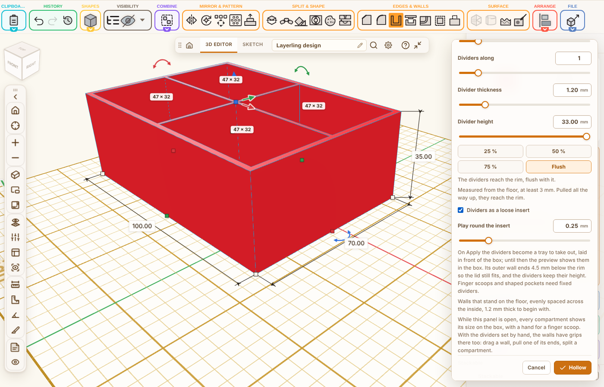
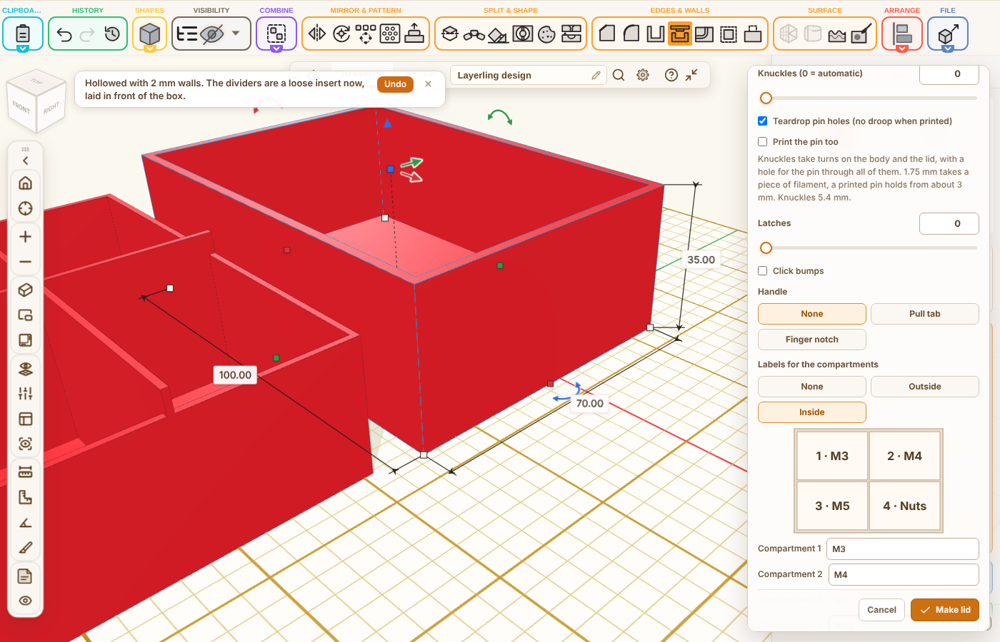
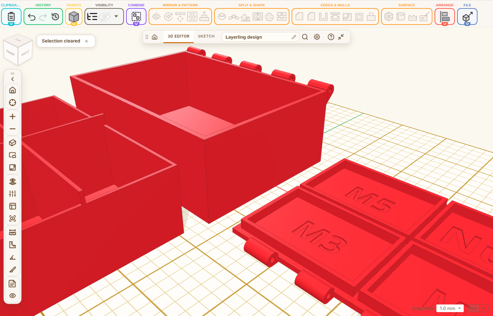
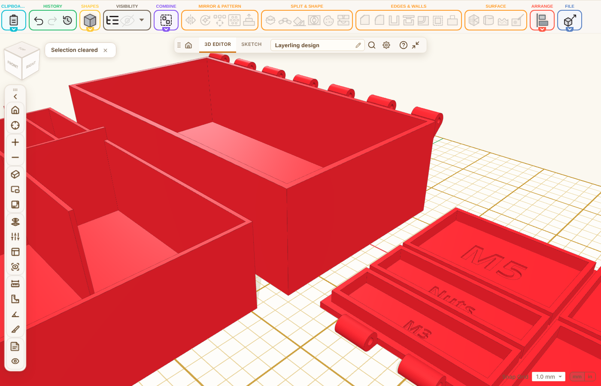

# Title

Lid: follows its box, labels for the compartments; Hollow: dividers as a loose insert

# Text

## Summary

Follow-up to #1974 (dividers by hand, finger scoops, shaped pockets). It makes a box with compartments and its lid work together from the first click to the print. Everything new is optional and off until asked for; existing designs are not touched.

**From Hollow to the lid**

- Clicking beside the body with Hollow open no longer throws the hollowing away. The preview stood in the body's place, so the box turned back into a block and every wall set by hand was gone. Leaving the tool by selecting something else now keeps what it showed, as Apply does (one undo step). Cancel still cancels.
- *Apply and make the lid* in the Hollow panel (top open) keeps the hollowing and opens the Lid tool on the box. Opening the Lid tool from the toolbar while Hollow is open does the same; before, the lid was made for the block under the preview.

**Lid**

- A box that stands turned on the workplane takes a hinge, latches, a handle and magnets. They go along the box's own sides; before, such a box was refused ("no room for three knuckles").
- The lip follows a ledge below the rim as a step: dividers that end lower, or a filling with a shaped pocket. Between two cuts it was a slope that stood into the ledge.
- *Labels for the compartments* (plug, cap, both, flat): the panel draws the box from above with its compartments numbered and takes a text for each, *Outside* or *Inside*. They are cut 0.6 mm into the plate, never raised, so the lid still prints flat and boxes stack on it. They are text objects grouped with the lid, so they can be changed later. A stacking lid takes them in its tray.
- The lid follows its box. A lid made for one body remembers that body and its settings. When the box is hollowed again (other compartments, another wall) or the hollowed box is resized, the lid is made again in its place under its id and name, with its pin, clips or plugs, in the same undo step. Labels stay with their compartments when a wall is added or removed.
- That also works for a box the lid's parts were grouped with (hinge knuckles, magnet pockets): Hollow opens on the box inside the group with its own settings, where it said the body had changed after its hollowing. Resized, such a box is built again at the new size, where the group's stretch stretched walls and knuckles.
- Opened on a box that has a lid, the Lid tool starts from that lid's settings, and Apply changes that lid in its place instead of making a second one.

**Hollow: dividers as a loose insert**

- With *Dividers as a loose insert* the box is hollowed smooth inside and the dividers become a tray of their own, laid in front of the box: a plate 0.8 mm thick on the floor, the dividers, and a wall round every compartment, so it takes along what lies in it when it is lifted out.
- The play round it is 0.25 mm (0.05 to 1). It is cut to the opening at every height, so rounded floor edges and leaning walls are cleared, and it stays clear of the posts a lid's magnets put into the corners.
- Its own wall ends 4.5 mm below the rim, where the lid's lip goes down along the box's wall (more for a deeper lip). The dividers keep their height, so the lid's lips go down beside them and every compartment is closed off from the next, as with fixed dividers. The lid still gets a lip and a label for every compartment.
- While the tool is open the preview shows the dividers in the box, so one sees where walls set by hand stand. The insert follows the box like the lid does, and goes when the dividers are fixed again. Finger scoops and shaped pockets are left out with it.

**Finding one's way**

- The inspector shows a small card for a hollowed box, its lid or its insert: what the selected part belongs to, and *Change compartments* and *Make lid* / *Change lid*, which open the tool on the box. The Lid panel has *Change compartments* too.
- On a touch screen the tools' check boxes are as large as a fingertip.

Texts in the 15 languages I keep complete (en, de, nl, fr, es, it, da, sv, pl, cs, sl, ru, ar, zh-cn, zh-tw), guide chapter 6 in 16. MCP: `make_lid` takes `labelSide` and `labels` and answers `changed: true` when it changed a lid; `hollow_object` takes `dividerInsert` and `insertPlay` and says `lidsRemade` / `insertId`.

## Testing

- [x] `npm run typecheck`
- [x] `npm test` (6528 tests)
- [x] `npm run test:e2e` (1782 tests)
- [x] `npm run guide`, `npm run i18n:status`
- [x] Manually tested the affected workflow: box with an even grid and with walls set by hand, standing square and turned; lid with hinge, latches, magnets, stacking top, labels outside and inside; compartments changed, box resized, undo; insert with each of these lids.

New tests: `lidTurnedBox`, `lidLabels`, `lidLabelHoles`, `lidRoomsForShapes`, `lidPanelLabels`, `lidGroup`, `shellInsert`, `shellPanelInsert`, `boxActionsCard`, and additions to `lylProject`, `shellGridLimits` and `lidTool`. Before writing them I ran every lid type with every extra against twelve boxes (dividers, slanted walls, low dividers, pockets, turned), some 600 combinations, and closed each lid on its box to look for overlaps; that is how the turned box and the ledge turned up.

## Notes

- Two new fields on a shape, both saved in the project file and checked on reading: `lidFor` on a lid (its body's id, its settings, its loose parts, the compartments' middles for the labels) and `insertFor` on an insert. The dividers' settings take `insert` and `insertPlay`. Older files are unaffected.
- One change of behaviour without a switch: leaving Hollow by clicking elsewhere keeps the hollowing instead of dropping it. I think that is what people expect, but you may see it differently.
- A box that stands turned and is grouped with its lid's parts is resized only approximately; standing square it gets exactly the size typed.
- I did not touch the changelog or What's new.
- It is a large change. If it is easier to look at in parts (lid on a turned box; labels; the lid that follows; the insert; the card), tell me and I will split it.
