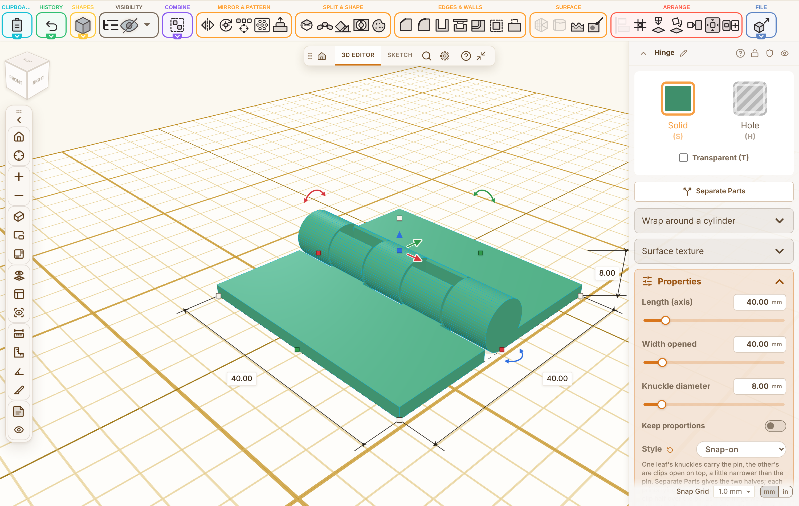

## Summary

Hi Stefan, this is the hinge from Discussion #1520 (you wrote that a hinge whose two halves snap together over a pin was not there yet). It is a new style of the Hinge shape, **Snap-on**:

- One leaf's knuckles carry the pin, like the pin style. The other leaf's knuckles are clips that are open on top and a little narrower than the pin (**Snap grip**, 0.3 mm to begin with, with a 45° lead-in), so the clip half simply clicks over the pin and then turns freely.
- Separate Parts gives the two halves. Both print lying flat as they are, without supports.
- It works in the exact CAD body and the STEP export too, and the MCP tools and the guide (every language) know the new style.
- The Lid tool has its own hinge styles; I left it as it is.

## Testing

- [x] `npm run typecheck`
- [x] `npm test` (5632 passed)
- [x] `npm run test:e2e` (1449 passed)
- [x] `npm run guide`, `npm run i18n:status`
- [x] Manually tested the affected workflow (Hinge, style Snap-on, Separate Parts)

## Notes

- Not yet printed on my side, so the default grip of 0.3 mm is a starting point; the hint next to the field says what it does when it is changed.
- Thanks for taking it in!
