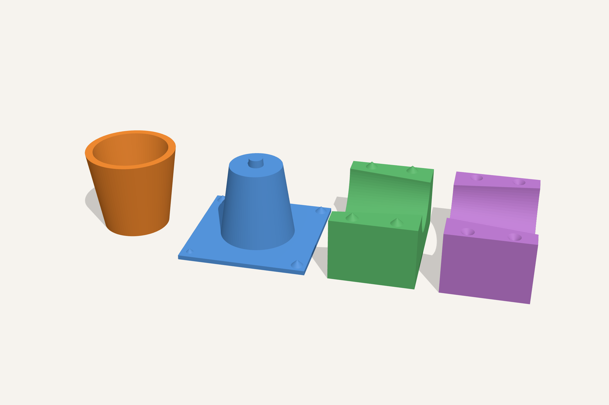
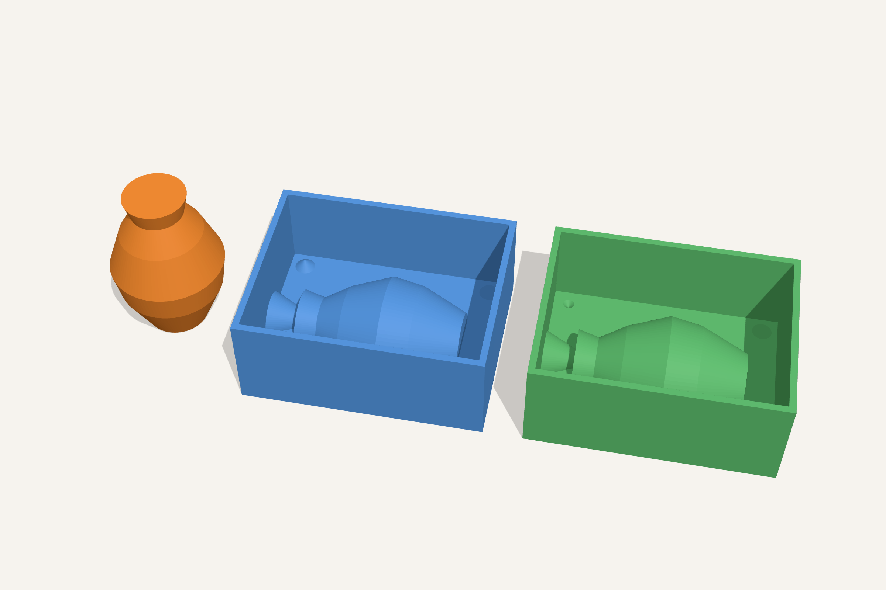
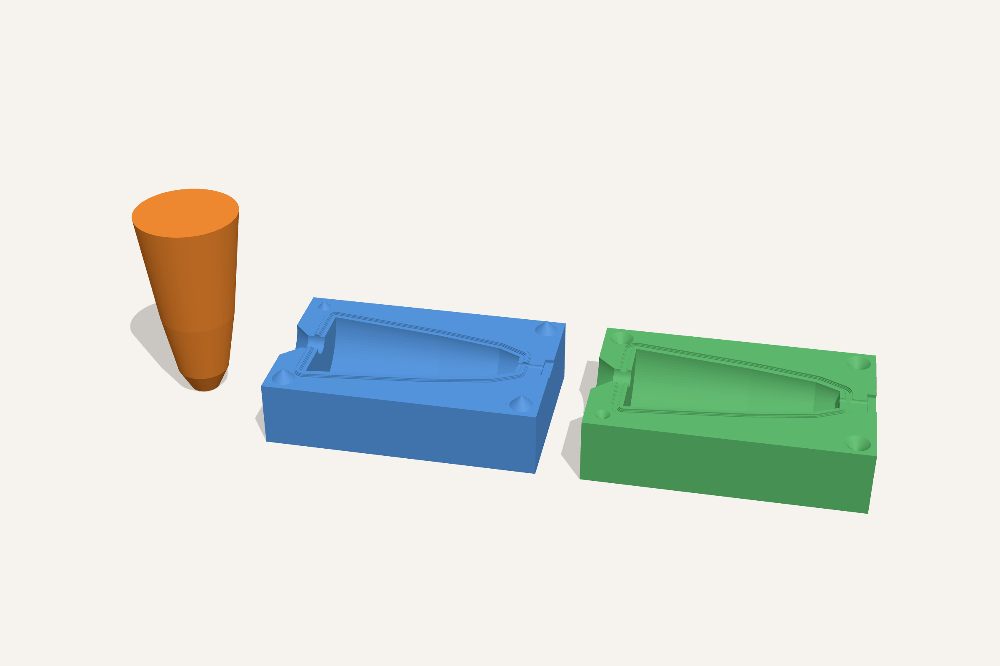

## Summary

Hi Stefan, this takes the Mold & die tool further. I compared it with what people use for candles, planters, figures and slip casting, and these were the gaps:

- **Silicone skin mold** (new kind): a thin silicone mold with a printed shell that holds it in shape. The master stands on a base plate, the shell leaves a gap all round, and the silicone is poured into that gap through the shell's roof. It takes a fraction of the silicone a pour box takes, and the window says how much less. The shell's inside never widens upward, so it lifts off; it prints roof down like a cup, without support, in one piece or in two halves bolted at a flange.

- **Core mold for a vessel** (new kind): for a planter, a cup or a vase. The hollow is found by itself; the parts are a base plate with the core and a sleeve in two halves or in one piece. Cast upside down and poured to the brim, with a pin for a drain hole if wanted. It says so when the master has no hollow, when a rigid core could not come out, and when the rim had to be cut level.

- **Two cases for mold halves** (new kind): each case has one half of the master on its plate. Silicone or plaster poured into each gives the two halves of a mold, with natches and a pour channel, without bedding the master in clay. With slip as the casting material the plaster mold is made larger by the shrinkage.

- **Two-part mold**: it can be poured standing through a sprue in the seam (the usual way for figures and candles), take a wick hole and a sealing lip, and be made in **four side parts** where any two halves would stick. The window suggests four parts when they would do better.

- **Pour box** that follows the master's outline instead of a rectangle.
- **What to mix**, under every kind but the die: the volume, the weight with an allowance, split by the mixing ratio (powder and water for plaster and concrete), and the cost at a price per kg. Wax, soap, concrete and slip are new casting materials.

The earlier settings make the same molds as before; the existing mold tests are unchanged and pass.

## Testing

- [x] `npm run typecheck`
- [x] `npm test` (6461 passed)
- [x] `npm run test:e2e` (1747 passed)
- [x] `npm run guide`, `npm run i18n:status`
- [x] Manually tested the affected workflow: skin mold on a cylinder, core mold on a tube, two-part mold poured through the seam with a wick, in the browser

New tests: `tests/e2e/moldKinds.e2e.ts` (the geometry of every new kind and way, measured), `tests/e2e/moldPanelKinds.e2e.ts` (the window), `tests/unit/moldNewOptions.test.ts` (settings, materials, the mix in words).

## Notes

- Nothing of this is cast in real material on my side yet. The mixing ratios and shrinkages the materials start with are the usual ones from data sheets, and the hints say to check them.
- The texts are in all 20 languages and the guide in the 16 that have this chapter; the translations of the new terms (skin mold, sleeve, natches, slip) would be glad of a native reader.
- The sentences for the changelog and What's new are yours, as always.
- `shrinkage` now goes up to 20 % (it was 5), because slip shrinks about a tenth, and the room round the master (`gap`) up to 50 mm, because plaster wants about 25.
