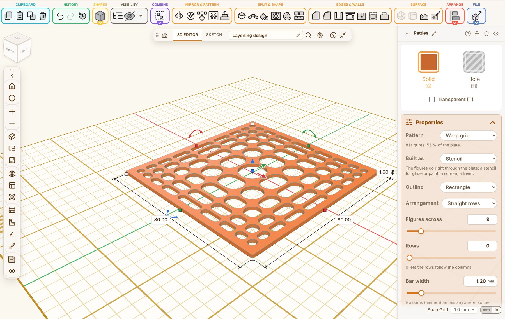
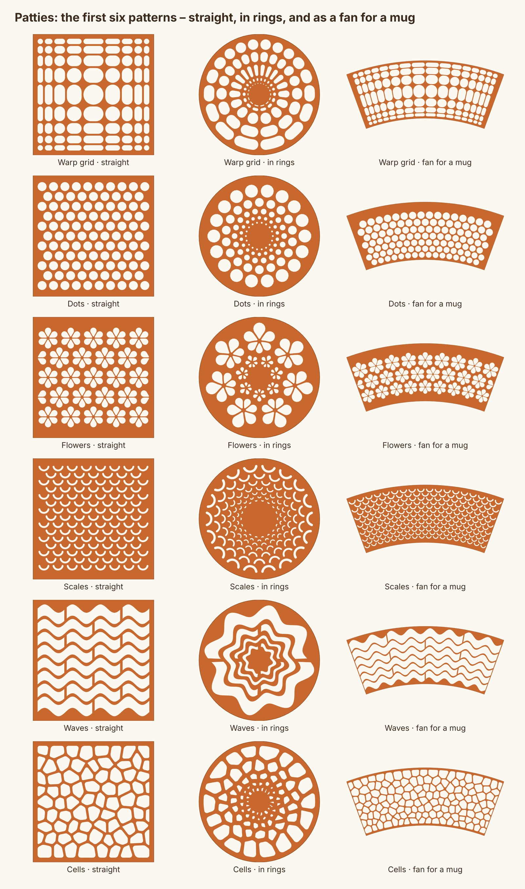
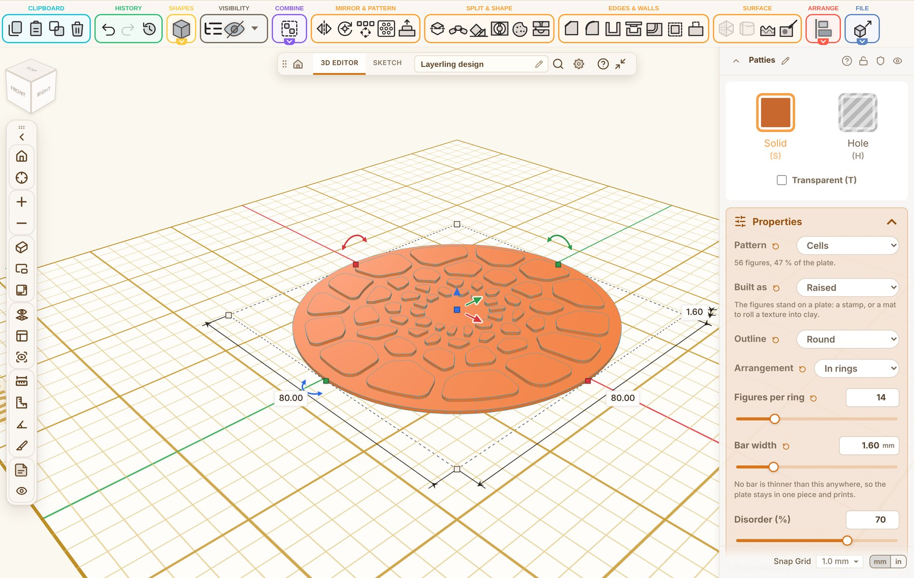
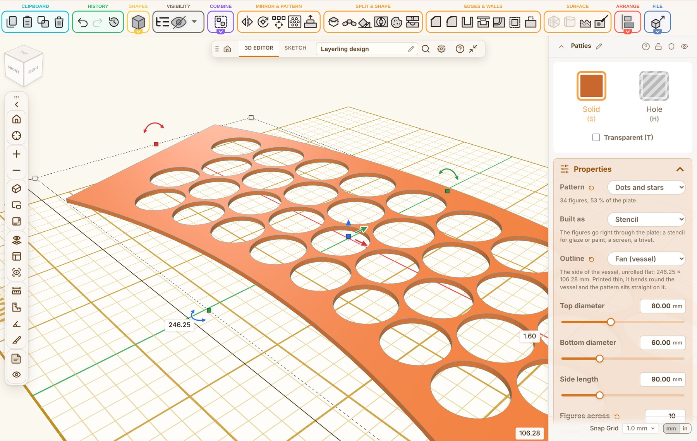
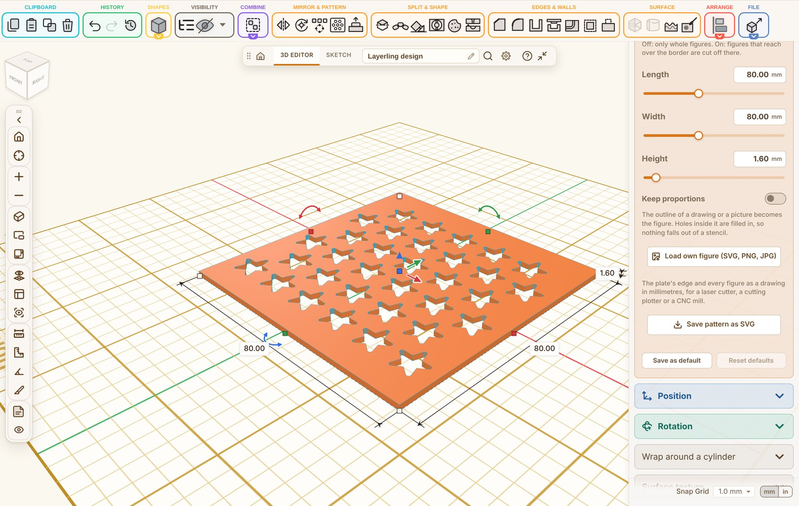
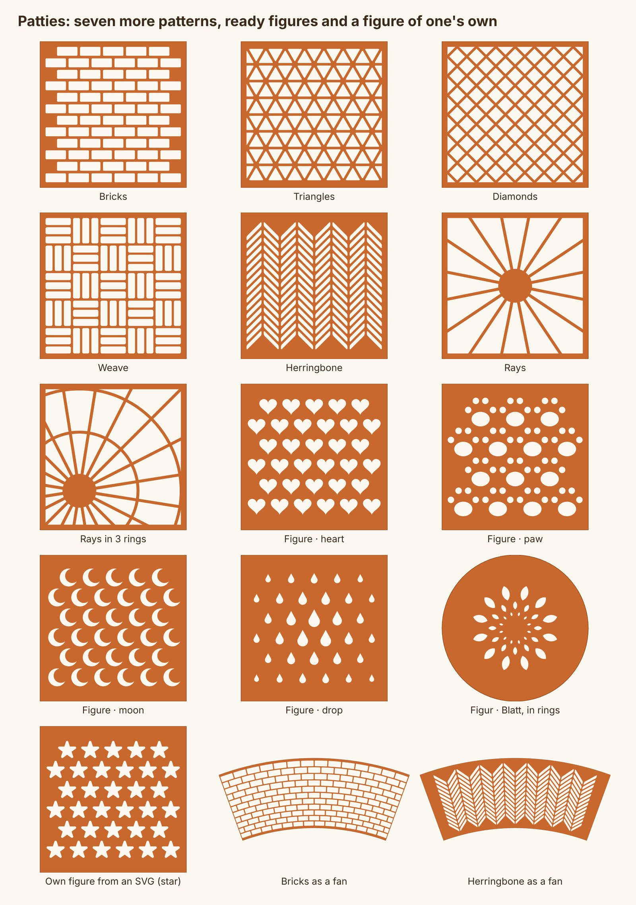
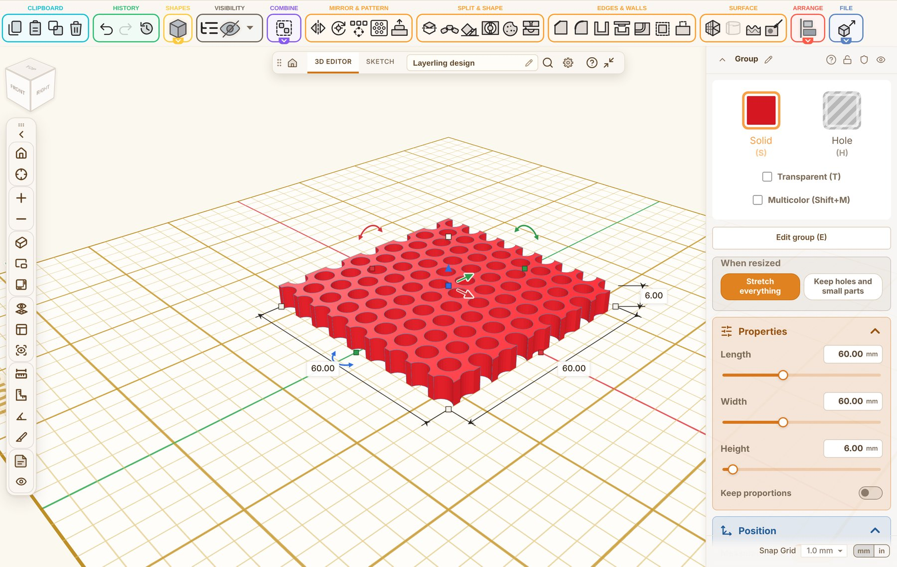

# Neu: Patties – Musterplatten für Schablonen, Stempel und Lochmuster

Ich habe eine neue Form für die Bibliothek gebaut: **Patties**, eine flache Platte mit einem Muster. Gedacht ist sie für alle, die Schablonen für Glasur oder Farbe brauchen, Stempel und Strukturmatten für Ton, Untersetzer, Lüftungsgitter oder einfach ein hübsches Lochmuster in einem Gehäuse.

Die Platte wird jedes Mal aus ihren Einstellungen gebaut. Man kann also auch nach dem Speichern noch alles ändern.

## Was Patties kann

**Dreizehn Muster.** Wölb-Raster, Punkte und Sterne, Blüten, Schuppen, Wellen und Zickzack, Zellen, Ziegel, Dreiecke, Rauten, Flechtwerk, Fischgrät, Strahlen und „Eigene Figur“. Wer ein Muster wählt, bekommt gleich einen guten Anfang und sieht nur die Regler, die dieses Muster braucht.

**Vier Bauarten.** Als Schablone sind die Figuren ausgeschnitten, als Stempel stehen sie erhaben auf einer Platte, als Form sind sie vertieft. Die vierte Bauart sind nur die Figuren, ohne Platte.

**Die Stege halten.** Man stellt eine Stegbreite ein, und kein Steg zwischen zwei Figuren wird dünner (mindestens 0,4 mm). So bleibt eine Schablone in einem Stück und lässt sich drucken. Das Fenster sagt dazu, wie viele Figuren die Platte hat und wie viel von ihr sie einnehmen.

**Im Kreis.** Die Figuren können in Ringen um die Mitte laufen. Jede behält dabei ihre Form und wächst mit ihrem Ring, und die Stege bleiben von der Mitte bis zum Rand gleich breit.

**Fächer für einen Becher.** Das ist mein Lieblingsteil: Man misst den Durchmesser des Gefäßes oben und unten und die Länge der Seite und trägt die drei Maße ein. Die Platte wird zur abgewickelten Seite des Gefäßes. 0,6 bis 1 mm dünn gedruckt lässt sie sich um den Becher oder Blumentopf legen, und das Muster sitzt gerade darauf. Mit „Enden treffen sich um ein Gefäß“ läuft das Muster über die Naht weiter.

**Eigene Figur.** Beim Muster „Eigene Figur“ gibt es sechs fertige Figuren (Herz, Tropfen, Mond, Kreuz, Blatt, Pfote) und einen Knopf, der eine eigene Figur lädt: aus einer **SVG**-Zeichnung, oder aus einem **PNG** oder **JPG**, dessen Umriss nachgezeichnet wird. Löcher in der Figur werden gefüllt, damit aus einer Schablone nichts herausfällt. Hier ein Stern aus einer SVG-Datei:

**Muster in jeden Körper schneiden.** Bauart „Nur Figuren“ wählen, auf „Aussparung“ stellen und mit einem Körper gruppieren: Das Muster ist im Körper.

**Für Laser und Schneidplotter.** „Muster als SVG speichern“ schreibt den Rand der Platte und alle Figuren als Zeichnung in Millimetern.

## Gut zu wissen

- Die Platte ist ein Netz wie ein importiertes Modell. Sie lässt sich gruppieren, schneiden und als STL oder 3MF exportieren. Ein STEP-Export lässt sie aus, und die Kantenwerkzeuge greifen bei ihr nicht.
- Bei einer eigenen Figur zählt nur der äußere Umriss, keine Farben. Sehr feine Umrisse werden auf rund 200 Punkte vereinfacht.
- Andere Bildformate als SVG, PNG und JPG gehen nicht.
- Die Texte gibt es in allen 20 Sprachen, die Anleitung dazu steht im Kapitel „Formen“.

Die Idee, Muster für Töpfer über Regler einzustellen, stammt von Patturn Studio. Code und Muster sind selbst geschrieben.
