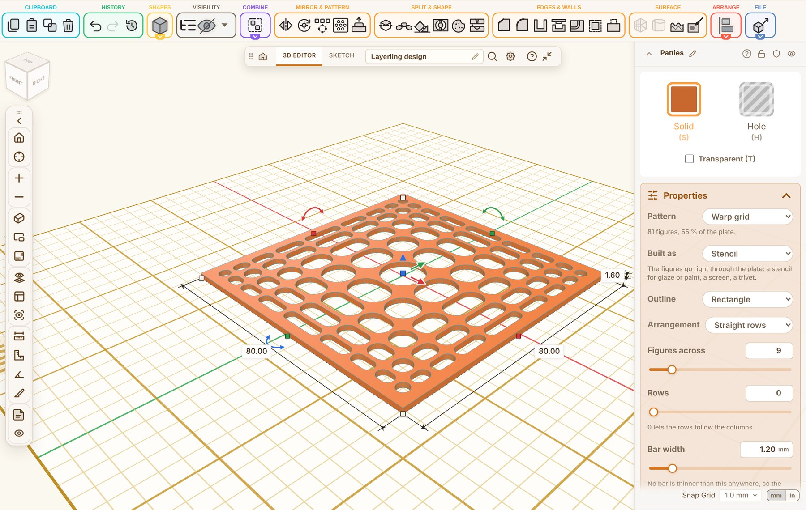
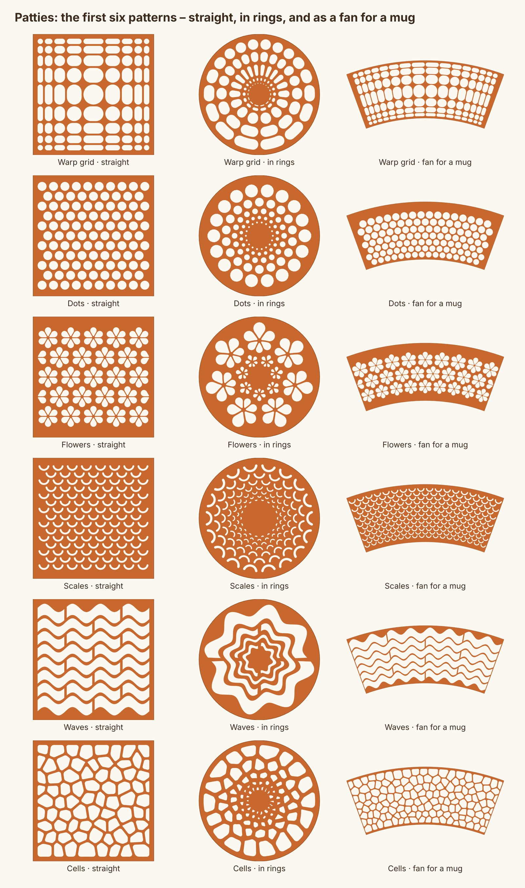
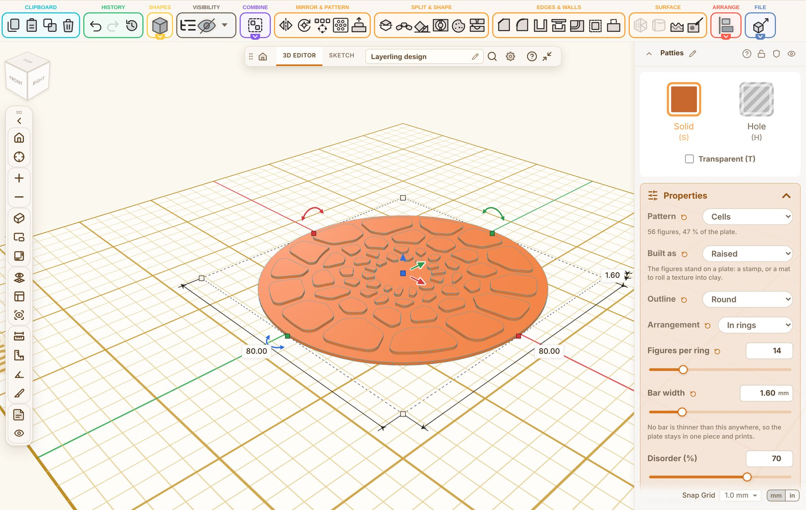
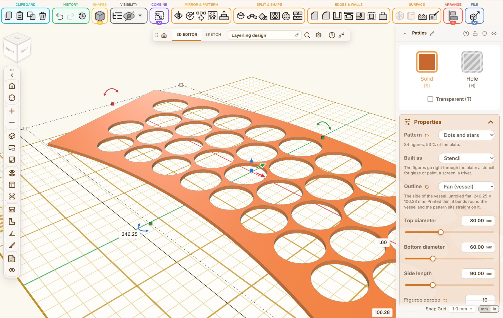
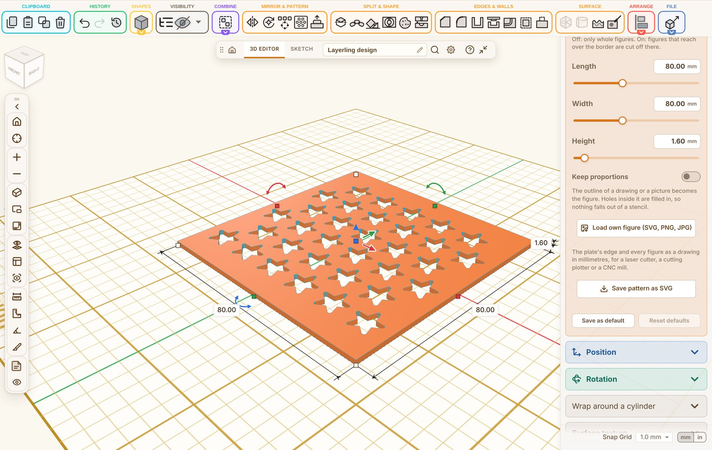
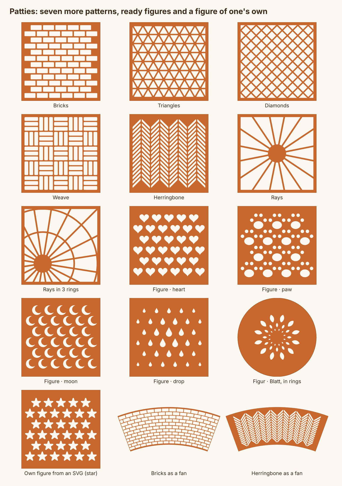
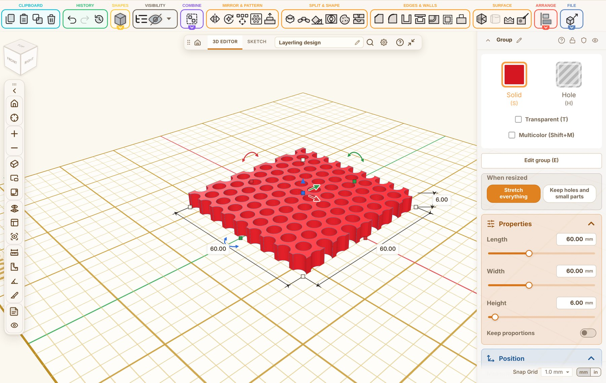

# New: Patties – pattern plates for stencils, stamps and perforations

I built a new shape for the library: **Patties**, a flat plate that carries a pattern. It is for everyone who needs stencils for glaze or paint, stamps and texture mats for clay, trivets, vents, or simply a nice pattern of holes in an enclosure.

The plate is built from its settings every time, so everything can still be changed after saving.

## What Patties does

**Thirteen patterns.** Warp grid, dots and stars, flowers, scales, waves and zigzag, cells, bricks, triangles, diamonds, weave, herringbone, rays and "Own figure". Choosing a pattern gives it a good start and shows only the sliders that pattern uses.

**Four ways to build it.** As a stencil the figures are cut out, as a stamp they stand raised on a plate, as a mould they are sunk in. The fourth way is the figures alone, without a plate.

**The bars hold.** You set a bar width, and no bar between two figures gets thinner (0.4 mm at least). So a stencil stays in one piece and prints. The panel also says how many figures the plate has and how much of it they take.

**In rings.** The figures can run in rings round the middle. Each keeps its shape and grows with its ring, and the bars stay as wide at the rim as at the middle.

**A fan for a mug.** This is my favourite part: measure the vessel's diameter at the top and at the bottom and the length of its side, and type the three numbers in. The plate becomes the side of the vessel, unrolled flat. Printed 0.6 to 1 mm thin it bends round the mug or flower pot, and the pattern sits straight on it. With "Ends meet round a vessel" the pattern runs on across the seam.

**A figure of your own.** The pattern "Own figure" has six ready figures (heart, drop, moon, cross, leaf, paw) and a button that loads your own: from an **SVG** drawing, or from a **PNG** or **JPG** whose outline is traced. Holes inside the figure are filled in, so nothing falls out of a stencil. Here is a star from an SVG file:

**Cut the pattern into any body.** Choose "Figures only", make it a hole and group it with a body: the pattern is in the body.

**For laser cutters and cutting plotters.** "Save pattern as SVG" writes the plate's edge and every figure as a drawing in millimetres.

## Good to know

- The plate is a mesh, like an imported model. It can be grouped, cut and exported as STL or 3MF. A STEP export leaves it out, and the edge tools do not apply to it.
- Of a figure of your own only the outer outline counts, no colours. Very fine outlines are simplified to about 200 points.
- Picture formats other than SVG, PNG and JPG are not read.
- The texts are there in all 20 languages, and the guide has a section on it in the chapter "Shapes".

The idea of setting patterns for potters with sliders comes from Patturn Studio. The code and the patterns are written from scratch.
