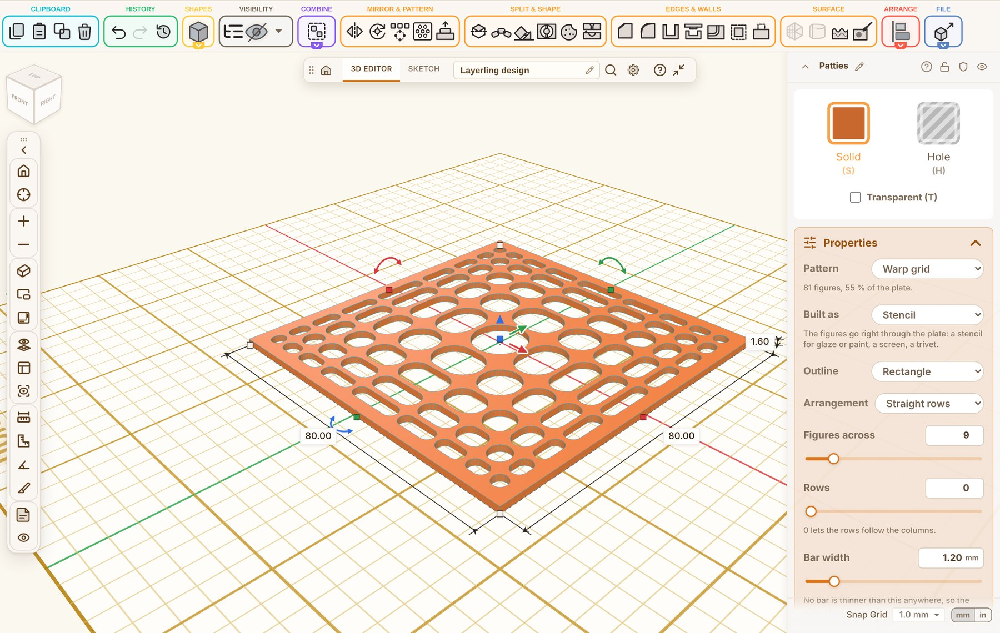
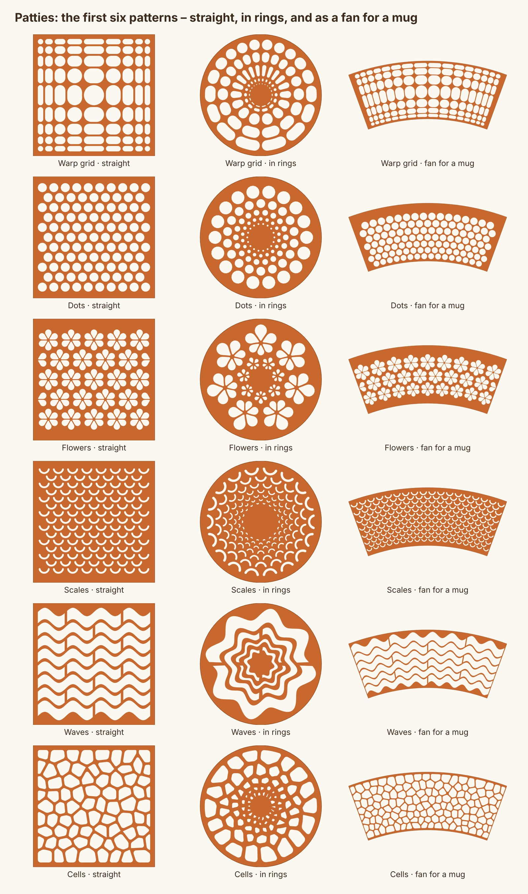
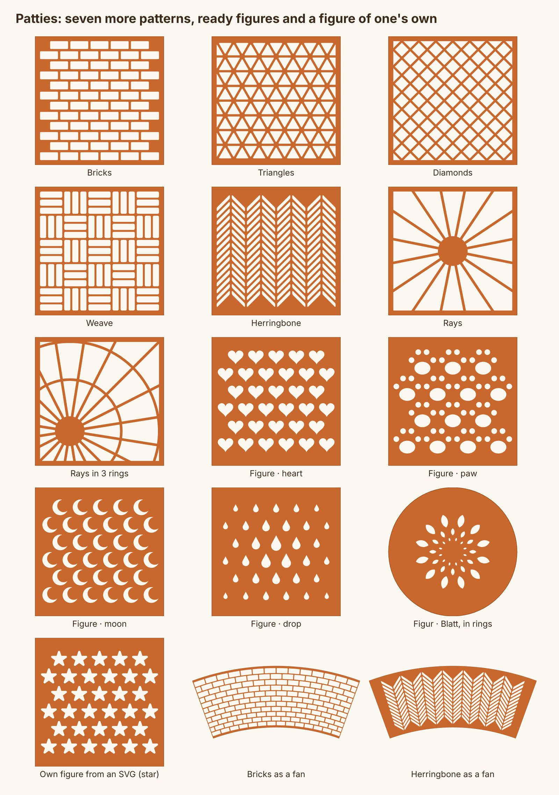
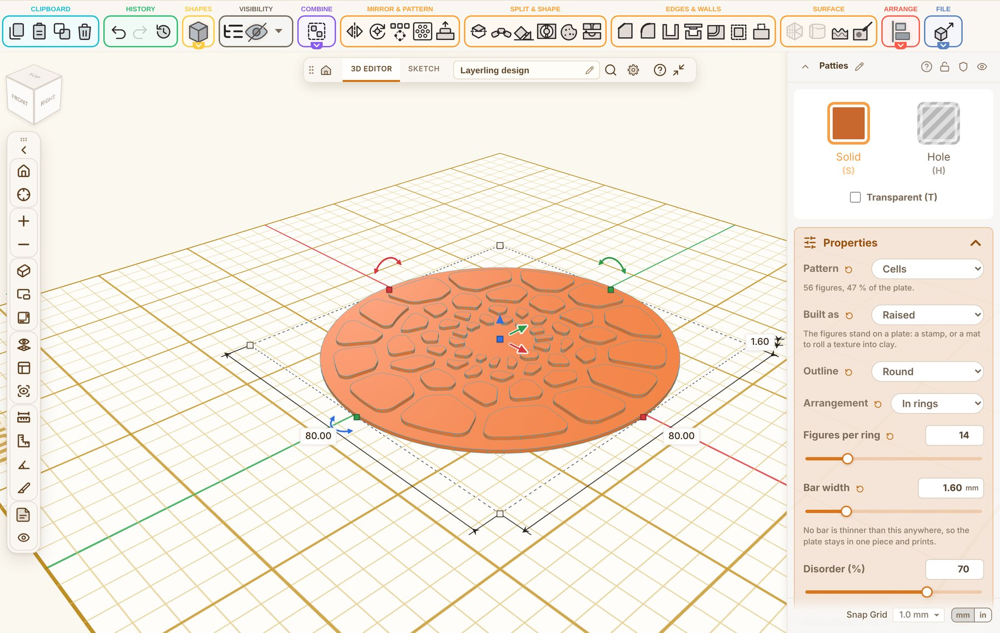
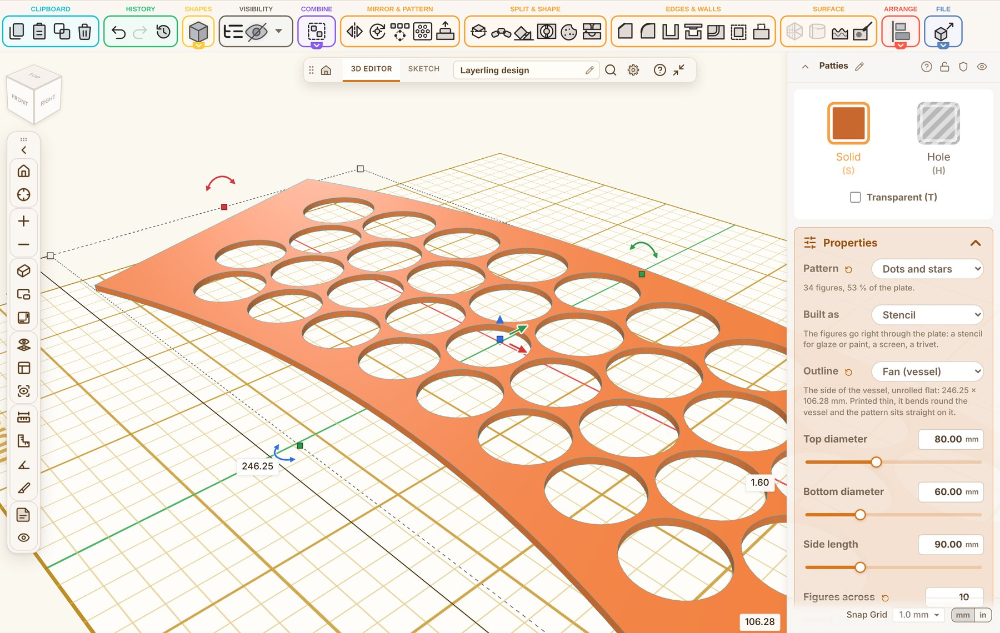
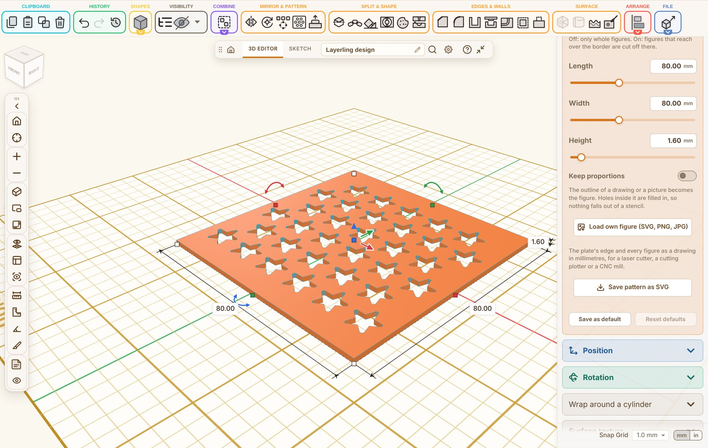
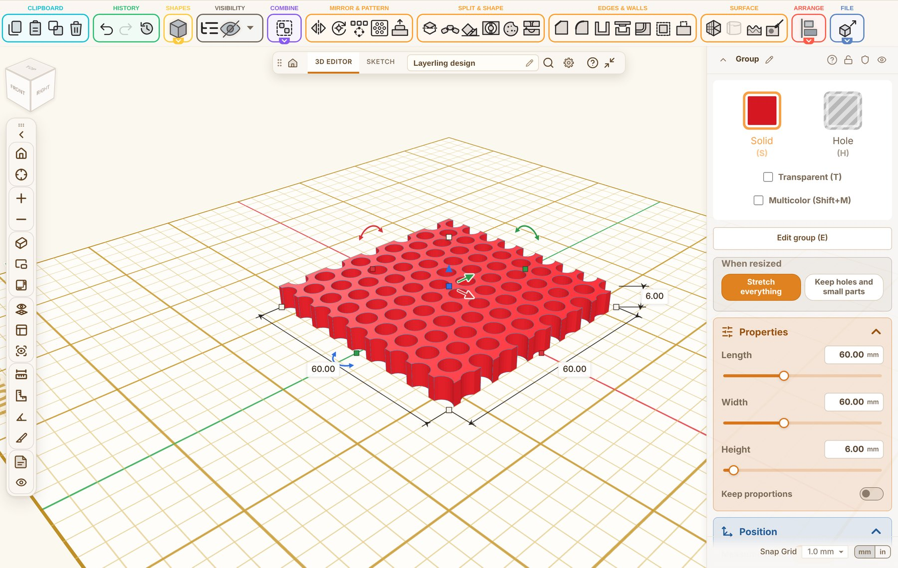

**Title:** Patties: a pattern plate – stencils, stamps and moulds from thirteen patterns, or from a figure of one's own

## Summary

A new shape in the library, **Patties**: a flat plate that carries a pattern of figures. Only its settings are stored; the body is built from them every time, so everything stays editable after saving.

- **Thirteen patterns:** warp grid, dots and stars, flowers, scales, waves and zigzag, cells (a honeycomb without disorder), bricks, triangles, diamonds, weave, herringbone, rays, and a motif pattern that repeats one figure.
- **Four ways to build it:** a stencil (figures cut through), a stamp (figures raised), a mould (figures sunk in), or the figures alone. Figures alone, turned into a hole and grouped with a body, cut their pattern into that body.
- **Three outlines:** rectangle, round, or a **fan for a round vessel**: type the diameter at the top, at the bottom and the length of the side, and the plate becomes the unrolled side of a mug or flower pot. Printed thin it bends round the vessel as a stencil. "Ends meet round a vessel" leaves half a bar at each end so the pattern runs on across the seam.
- **Straight rows or rings round the middle.** In rings every figure keeps its shape and grows with its ring, and the bars keep their width from the middle to the rim.
- **The bar width is kept everywhere:** no bar between two figures is thinner than the width set (0.4 mm at least), so a stencil stays in one piece and prints. The inspector says how many figures the plate has and how much of it they take.
- **A figure of one's own:** the motif pattern has six ready figures (heart, drop, moon, cross, leaf, paw) and a button that reads one's own from an **SVG**, or traces it from a **PNG or JPG**. Holes inside the figure are filled in, so nothing falls out of a stencil.
- **Save pattern as SVG:** the plate's edge and every figure as a drawing in millimetres, for a laser cutter or cutting plotter.
- AI bridge: `layerling_create_shape` with `kind: "patties"` and the settings as one object `patties` (a figure of one's own as `motifSvg`); `layerling_update_object` changes the settings given and keeps the rest. Skill files updated.
- Texts in all 20 languages, a guide section in the 16 languages that have the shapes chapter, library icon.

The first six patterns, straight, in rings and as a fan:

Seven more patterns, the ready figures and a figure of one's own:

Cells in rings, built as a stamp:

A fan for a mug (top 80 mm, bottom 60 mm, side 90 mm):

A star read from an SVG file as the figure, with the two buttons below the settings:

Dots as "figures only", made a hole and grouped with a box:

## Testing

- [x] `npm run typecheck`
- [x] `npm test` (687 files, 6531 tests)
- [x] `npm run test:e2e`: 1725 of 1727 passed in the full run. The two that failed were the hard-coded shape counts in `shapeLibraryList.e2e.ts` (49 shapes, now 50); corrected and rerun on its own, the whole suite was not run again after that.
- [x] `npm run guide`, `npm run i18n:status`
- [x] Manually tested the affected workflow: every pattern, all four ways of building, round, rings and fan, a figure from an SVG, a PNG and a JPG, and figures as a hole grouped with a box, in the browser.

New tests: `pattiesPattern`, `pattiesGeometry`, `pattiesMotifShapes`, `pattiesMotif`, `pattiesShape` (unit) and `pattiesPanel` (e2e). They check, for every pattern on every outline, that the body is closed, that no bar is thinner than set, and that figures keep off the edge.

## Notes

- A pattern plate is a mesh, not an exact body: it groups, cuts and exports as STL or 3MF; a STEP export leaves it out, and the edge tools do not apply to it.
- The settings travel as one object on the shape (`patties`), like the QR code's, so the many lists that name a shape's fields each take one entry.
- A figure of one's own keeps at most 200 points and 16 outlines; only its outer outline counts, no colours. Between the parts of such a figure the bar is whatever the drawing leaves.
- Three's ear cutting leaves out a point that sits on a straight run with points of other figures, which opened a crack beside the wall standing on it. `pattiesFaceTriangles` cuts the triangle edges that run over such a point; the closedness tests fail without it.
- The idea of a parametric pattern generator for potters comes from Patturn Studio's public landing page; the code and the patterns are written from scratch.
- No `CHANGELOG.md` or "what's new" entry.
- The pictures of this text live in `uebergabe/pr-media/patties/`.
