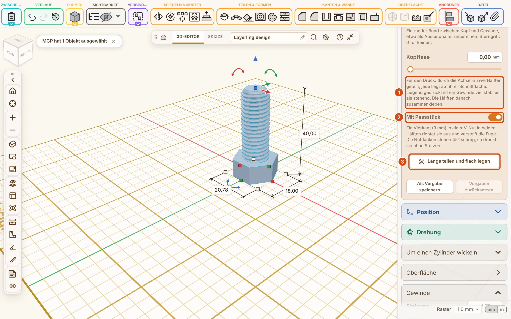
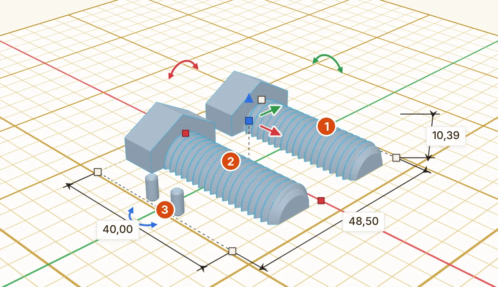
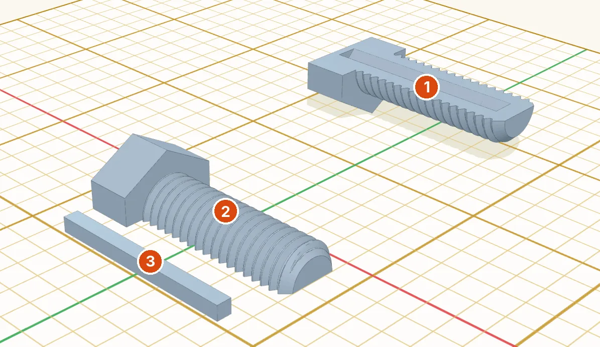

# Schraube längs teilen und flach legen (17.11.2026)

Eine stehend gedruckte Schraube bricht bei der ersten richtigen Last entlang ihrer Schichten. Liegend gedruckt ist das Gewinde um ein Vielfaches stabiler. Layerling teilt die Schraube dafür mit einem Klick, legt beide Hälften richtig hin und gibt Zentrierstifte dazu.

## 1 – Der Knopf

Schraube oder Gewindestange wählen, in den Eigenschaften nach unten:

1. **Hinweis**: was passiert.
2. **Mit Zentrierstiften**: an (Standard). Darunter steht der Stiftdurchmesser.
3. **Längs teilen und flach legen**.

## 2 – Das Ergebnis

1. **Hälfte 1** und 2. **Hälfte 2**: durch die Achse geteilt, jede liegt auf ihrer Schnittfläche – genau da, wo die Schraube stand. Die Gewindeflanken steigen ohne Stützen vom Druckbett auf.
3. **Zentrierstifte**: stehend, an beiden Enden angefast, mit dem Spiel deines Druckers (sonst 0,15 mm je Seite) und 0,3 mm kürzer als die beiden Bohrungen zusammen.

Die Meldung oben nennt Anzahl und Maße der Stifte. **Rückgängig** holt die Schraube mit allen Einstellungen zurück.

## 3 – Die Bohrungen

Hier ist Hälfte 1 nur fürs Bild umgedreht:

1. **Bohrung im Kopf**: auf der Achse über dem Innensechskant; passt sie dort nicht, neben dem Antrieb.
2. **Bohrung im Gewinde**: je nach Länge eine bis drei, etwa eine pro 20 mm. Eine Gewindestange bekommt eine nahe jedem Ende.
3. **Die andere Hälfte** hat die Bohrungen an denselben Stellen.
4. **Die Stifte** stecken in beiden Hälften und richten sie genau aus, auch längs: so passen die Gewindegänge beider Hälften aufeinander, und die Mutter klemmt nicht.

Die Bohrungen stehen im gedruckten Teil senkrecht vom Druckbett auf und enden oben in einem 45°-Kegel. Keine Bohrung braucht eine Brücke, alles druckt ohne Stützen. Wo eine Bohrung nicht mit 0,6 mm Wand ins Teil passt, wird sie ausgelassen; ein sehr dünnes Gewinde (etwa M4) bekommt keine Stifte.

## Warum Stifte und kein Passstück?

Die Last trägt die Klebefläche: Jede Hälfte trägt ihren Anteil vom Kopf über die eigenen Gänge in die Mutter, und die Gewindeflanken drücken die Hälften dabei zusammen. Wichtig ist, dass die Hälften genau aufeinandersitzen, **auch in Längsrichtung**. Ein Passstück in einer Längsnut kann das nicht, Stifte schon.

## Zusammenbauen

Stifte in eine Hälfte stecken, Kleber (z. B. Sekundenkleber) auf die Schnittfläche, zweite Hälfte aufsetzen, eine Minute andrücken.

## Für KI-Helfer (MCP)

Werkzeug `layerling_split_bolt` mit `id`, `pins` (Standard an) und `pinPlay`. Antwort: die Teile, `pins`, `pinDiameter`, `pinLength`, `placed` (Kopf, Gewinde).
