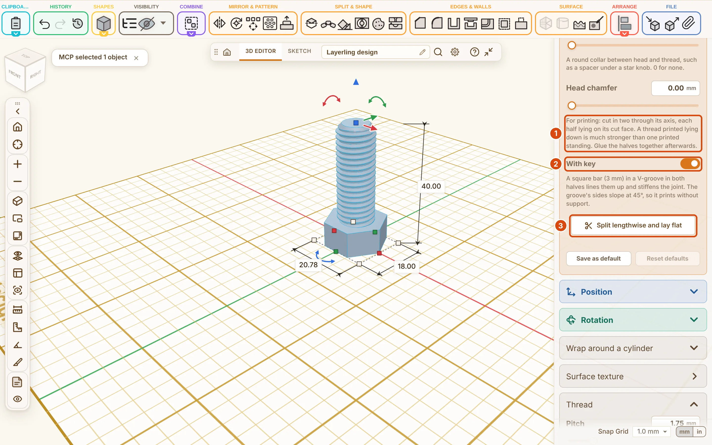
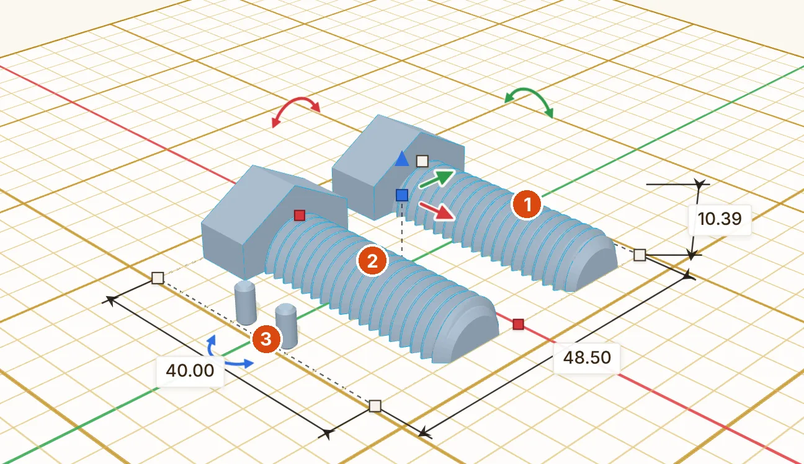
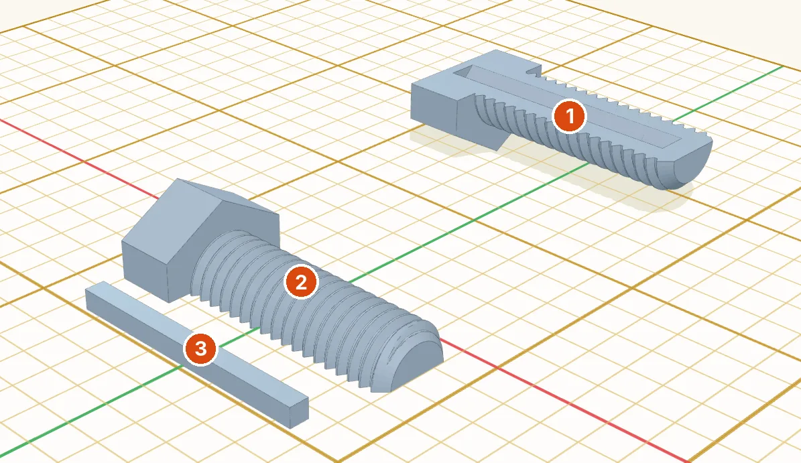
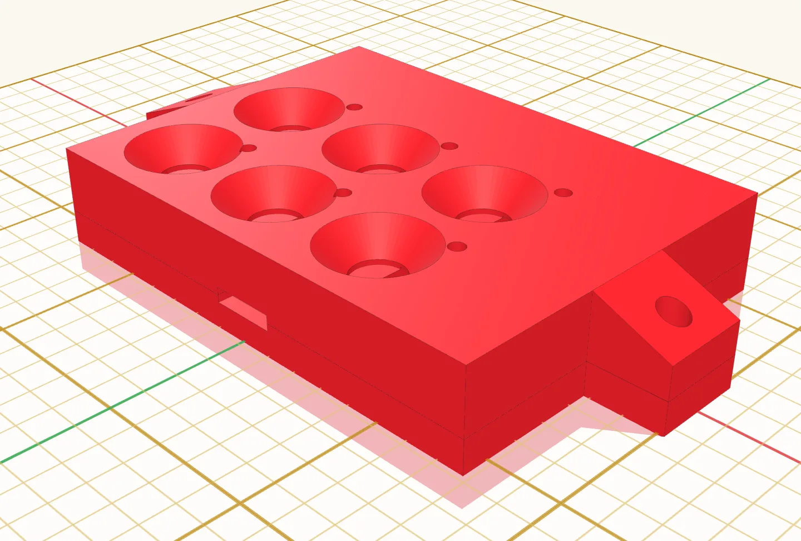

# Beiträge: Schraube längs teilen + mehrere Eingüsse (Deutsch und Englisch)

Bilder für Facebook: im Zip `Facebook-Bilder-Schraube-Eingusse.zip` (deutsch und englisch).
Bilder für GitHub sind unten schon fest verlinkt.

---

## 1. Facebook – Deutsch

**Neu: Schrauben liegend drucken – längs geteilt, mit Zentrierstiften**

Hallo zusammen,

eine stehend gedruckte Schraube bricht bei der ersten richtigen Last entlang ihrer Schichten. Liegend gedruckt ist das Gewinde um ein Vielfaches stabiler. Dafür gibt es jetzt einen Knopf: Schraube oder Gewindestange anklicken, in den Eigenschaften „Längs teilen und flach legen“.

Layerling teilt die Schraube durch ihre Achse, und beide Hälften liegen mit der Schnittfläche auf dem Druckbett. Dazu kommen Zentrierstifte: einer immer im Kopf und je nach Länge ein bis drei im Gewinde. Sie richten die Hälften beim Kleben genau aus, auch in Längsrichtung, damit die Gewindegänge beider Hälften aufeinanderpassen und die Mutter nicht klemmt. Die Bohrungen enden oben in einem 45°-Kegel und die Stifte druckt man stehend: Alles druckt ohne Stützen.

Danach einfach mit den Stiften dazwischen zusammenkleben (z. B. Sekundenkleber) und eine Minute andrücken. Ab M6 gibt es immer Stifte im Kopf und im Gewinde, darunter ist der Kern zu dünn und nur der Kopf bekommt einen.

Außerdem: Eine Gussform aus mehreren Teilen (zum Beispiel sechs Seifen auf einmal) bekommt jetzt für jeden Hohlraum einen eigenen Einguss mit Trichter. Danke für den Hinweis!

Ich freue mich über Rückmeldungen und Bilder von euren ersten Schrauben!

Viele Grüße
Marcus

---

## 1. Facebook – English

**New: print screws lying down – split lengthwise, with centring pins**

Hi everyone,

a screw printed standing breaks along its layers under the first real load. Printed lying down, its thread is many times stronger. There's a button for that now: click a screw or threaded rod and choose "Split lengthwise and lay flat" in its properties.

Layerling cuts the screw through its axis and both halves lie on the bed with their cut face down. Centring pins come with them: always one in the head and one to three along the thread, depending on its length. They line the halves up exactly when you glue them, along the axis too, so the turns of both halves meet and the nut doesn't jam. The holes end in a 45° cone and the pins print standing, so everything prints without support.

Then just glue the halves with the pins in between (superglue works) and press them together for a minute. From M6 up there are always pins in the head and in the thread; below that the core is too thin and only the head gets one.

Also new: a mold made of several parts (six soap bars at once, say) now gives each cavity its own sprue and funnel. Thanks for pointing that out!

I'd love to hear how it works for you, and pictures of your first screws are very welcome!

Cheers,
Marcus

---

## 2. GitHub – English (as an answer in the "Bolt printed" idea, or as a new Show and tell)

**Split a screw lengthwise and print it lying flat, with centring pins**

Hi everyone,

thanks for the idea. It's on the branch `bolt-split` in my fork, built on the current `main`, and I'll open a PR for it.

A new button in the properties of a screw or threaded rod, **Split lengthwise and lay flat**, cuts it in two through its own axis and lays both halves on their cut faces where it stood (one undo step). With **centring pins** (on by default) there's always one pin in the head and one to three along the thread by its length. They line the halves up exactly, along the axis too, so the turns of both halves meet. The holes are square to the cut face and end in a 45° cone, and the pins print standing, so nothing needs support. Glue the halves with the pins in place.

I left out the separate screwed-on head from the pictures in the idea on purpose: the split head is one piece with its half, which is simpler and stronger.

From M6 up every screw I tried gets a pin in the head and in the thread (cylinder, countersunk, hex, wing and knob heads); below M6 the core is too thin for a printable pin and only the head gets one. AI helpers can use `layerling_split_bolt`.

Cheers,
Marcus

---

## 2. GitHub – Deutsch (Übersetzung zum Nachlesen)

**Schraube längs teilen und liegend drucken, mit Zentrierstiften**

Hallo zusammen,

danke für die Idee. Sie liegt im Zweig `bolt-split` in meinem Fork, auf dem aktuellen `main`, und ich öffne dafür einen PR.

Ein neuer Knopf in den Eigenschaften einer Schraube oder Gewindestange, **Längs teilen und flach legen**, teilt sie durch die eigene Achse und legt beide Hälften auf ihre Schnittfläche, dort wo sie stand (ein Rückgängig-Schritt). Mit **Zentrierstiften** (Standard) gibt es immer einen Stift im Kopf und je nach Länge ein bis drei im Gewinde. Sie richten die Hälften genau aus, auch längs, damit die Gewindegänge beider Hälften aufeinanderpassen. Die Bohrungen stehen senkrecht zur Schnittfläche und enden in einem 45°-Kegel, die Stifte druckt man stehend: Nichts braucht Stützen. Die Hälften mit den Stiften zusammenkleben.

Den extra aufgeschraubten Kopf aus den Bildern der Idee habe ich bewusst weggelassen: Der geteilte Kopf ist ein Stück mit seiner Hälfte, das ist einfacher und stabiler.

Ab M6 bekommt jede getestete Schraube einen Stift im Kopf und im Gewinde (Zylinder-, Senk-, Sechskant-, Flügel- und Sterngriffkopf); unter M6 ist der Kern zu dünn, dann bekommt nur der Kopf einen. KI-Helfer nutzen `layerling_split_bolt`.

Viele Grüße
Marcus

---

## 3. Antwort zu „mehrere Teile, nur ein Einguss“ – English

You were using it right, thanks for catching this! With several masters the two-part mold treated them as one and gave only the highest point a sprue, so only that cavity could be filled; the small holes over the others were just vents. Now every separate cavity gets its own sprue and funnel (up to 24), the vents keep clear of them, and the window says how many separate cavities there are. It's in the mold PR.

## 3. Antwort – Deutsch

Du hast es richtig benutzt, danke für den Hinweis! Bei mehreren Urmodellen hat die zweiteilige Form sie als eines behandelt und nur den höchsten Punkt mit einem Einguss versehen, so ließ sich nur dieser Hohlraum füllen; die kleinen Löcher über den anderen waren nur Entlüftungen. Jetzt bekommt jeder getrennte Hohlraum seinen eigenen Einguss mit Trichter (bis zu 24), die Entlüftungen halten Abstand, und das Fenster sagt, wie viele getrennte Hohlräume es sind. Das ist im Gussform-PR.
