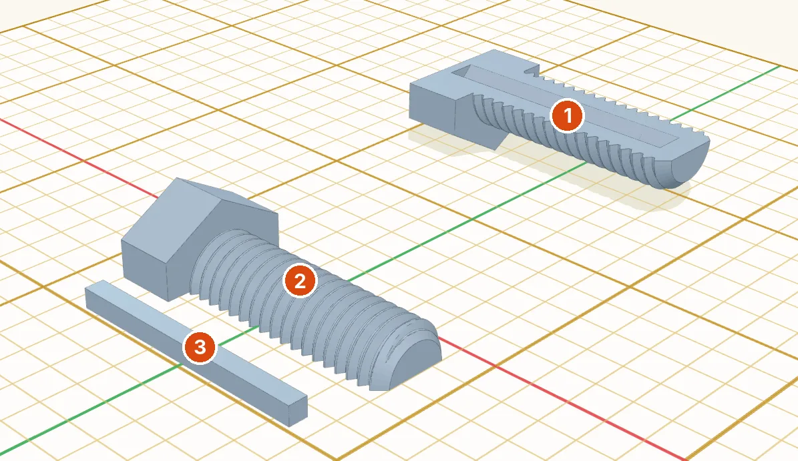

# Split a screw lengthwise and lay it flat (17 Nov 2026)

A screw printed standing breaks along its layers under the first real load. Printed lying down, the thread is many times stronger. Layerling splits the screw with one click, lays both halves down the right way and adds centring pins.

## 1 – The button

Select a screw or threaded rod and scroll down its properties:

1. **Hint**: what happens.
2. **With centring pins**: on (default). The pin diameter is shown below it.
3. **Split lengthwise and lay flat**.

## 2 – The result

1. **Half 1** and 2. **Half 2**: cut through the axis, each lying on its cut face, right where the screw stood. The thread's flanks rise from the bed without support.
3. **Centring pins**: standing, chamfered at both ends, with your printer's play (else 0.15 mm per side), 0.3 mm shorter than the two holes together.

The message at the top gives the number and size of the pins. **Undo** brings the screw back with all its settings.

## 3 – The holes

Half 1 is turned over here only for the picture:

1. **Hole in the head**: on the axis past the drive's floor; where it does not fit there, beside the drive.
2. **Holes along the thread**: one to three by its length, about one per 20 mm. A threaded rod gets one near each end.
3. **The other half** has its holes in the same places.
4. **The pins** go into both halves and line them up exactly, along the axis too, so the turns of both halves meet and the nut does not jam.

In the printed part the holes stand up from the bed and end in a 45° cone at the top. No hole needs a bridge; everything prints without support. A hole that would not fit with 0.6 mm of wall is left out; a very thin thread (about M4) gets no pins.

## Why pins and not a key?

The glued face carries the load: each half takes its own share from the head through its own turns into the nut, and the thread's flanks press the halves together. What matters is that the halves meet exactly, **along the axis too**. A key in a lengthwise groove cannot do that; pins can.

## Putting it together

Put the pins into one half, glue (superglue, say) on the cut face, put the other half on, press for a minute.

## For AI helpers (MCP)

Tool `layerling_split_bolt` with `id`, `pins` (default on) and `pinPlay`. Answer: the parts, `pins`, `pinDiameter`, `pinLength`, `placed` (head, thread).
