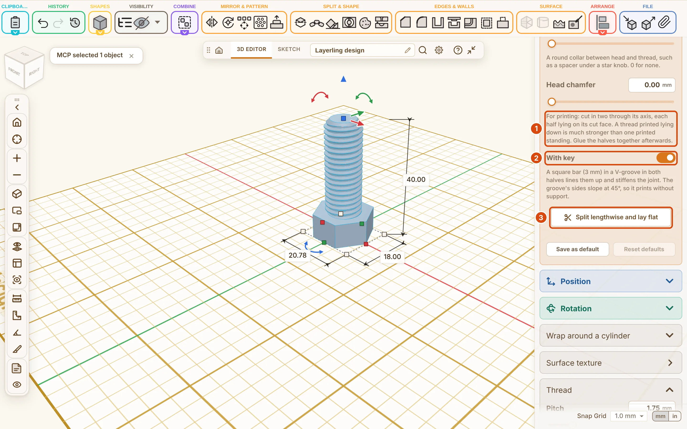
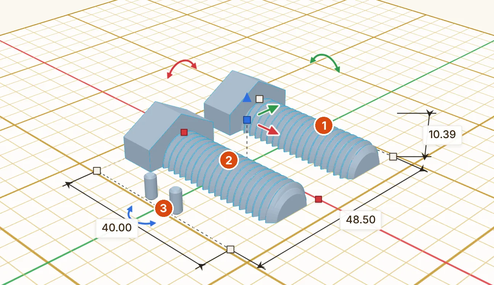

# Split a screw lengthwise and lay it flat (17 Nov 2026)

A screw printed standing breaks along its layers under the first real load. Printed lying down, the thread is many times stronger. Layerling splits the screw with one click and lays both halves down the right way.

## 1 – The button

Select a screw or threaded rod and scroll down its properties:

1. **Hint**: what happens.
2. **With key**: on (default) = a V-groove in both halves and a square key. From about M6; on thinner threads it says the thread is too thin, and the screw is split without a key.
3. **Split lengthwise and lay flat**.

## 2 – The result

1. **Half 1** and 2. **Half 2**: cut through the axis, each lying on its cut face, right where the screw stood. The thread's flanks rise from the bed without support.
3. **Key**: a square bar, as long as the groove less 0.3 mm at each end, with your printer's play (else 0.15 mm per side).

The message at the top gives the key's size. **Undo** brings the screw back with all its settings.

## 3 – The groove

Half 1 is turned over here only for the picture:

1. **V-groove** along the axis in the cut face. Its sides slope at 45°, so it prints as part of the bottom face, without a bridge. It stops short of the chamfers and (on a screw) of the drive's floor.
2. **The other half** has the same groove.
3. **The key** goes in: it lines the halves up when gluing and stiffens the joint.

## Putting it together

- Lay the key in one half, put glue (superglue, say) on the cut face, put the other half on, press for a minute.

## For AI helpers (MCP)

New tool `layerling_split_bolt` with `id`, `key` (default on) and `keyPlay`. Answer: the parts, `keySide`, `keyLength`, and `keyLeftOut` for thin threads.
